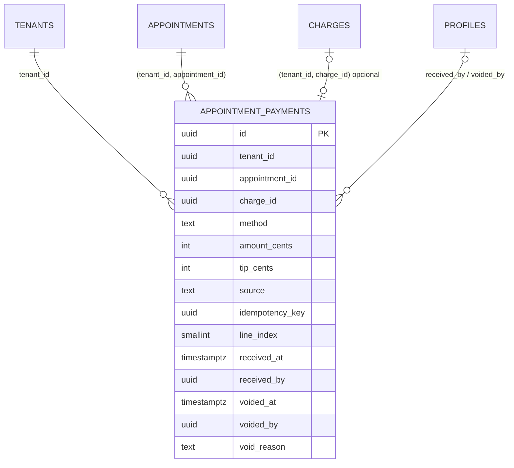

# SPEC — ADR-001 Schema: ledger `appointment_payments` + `charges` gateway-only (scoped)

**Feature slug:** `cobranca-formas-pagamento-adr-001`
**ADR de origem:** `.spec/prd/cobranca-formas-pagamento/ADRs/ADR-001-schema-ledger-recebimentos/ADR.md`
**PRD:** `.spec/prd/cobranca-formas-pagamento/PRD.md` (RF-25, RF-28, RF-29; RNF-05/06/07/09/10)
**RESEARCH:** `.spec/prd/cobranca-formas-pagamento/RESEARCH.md` (Alternativa B)
**Depende de:** —
**Escopo:** migration única (tabela, checks, FKs, uniques/índices, RLS/grants, alterações em `charges`, backfill) + atualização das regras de domínio. Sem RPC/Edge, sem gateway, sem UI.

## 1. Decisão

Criar `public.appointment_payments` como **ledger imutável de recebimento** (1:N por atendimento) e reduzir `charges` a **cobrança PIX do gateway**.

- **Receita** = `sum(amount_cents)` das linhas com `voided_at is null`.
- **“A receber”** = `charges.status = 'pendente'` (reserva; nunca receita).
- **`tip_cents`** = gorjeta explícita, fora da receita de serviço e da base de comissão.
- **Escrita** só por caminho privilegiado (`service_role` nas RPCs da ADR-002; owner da migration no backfill); **leitura direta** só admin do tenant.
- **Correção** = estorno lógico (`voided_*`); nunca `UPDATE` de valor nem `DELETE`.
- **PIX do sistema**: no máximo 1 cobrança por atendimento, **para sempre** (inclusive após paga).

A comissão **não muda** nesta entrega: continua no trigger de `concluido` sobre `appointments.price_cents`.

## 2. Migration

**Arquivo:** `supabase/migrations/20261106120000_appointment_payments_ledger.sql`
(timestamp `20261106120000` > `20261105090000`; nenhuma migration aplicada é editada.)

Ordem obrigatória — cada passo depende do anterior:

| # | Passo | Motivo da ordem |
|---|---|---|
| 2.1 | unique `charges (tenant_id, id)` e `(tenant_id, id, appointment_id)` | alvos de FK composta (precisam existir antes da tabela e da FK do vínculo) |
| 2.2 | `create table public.appointment_payments` + checks + FKs | corpo do ledger |
| 2.3 | uniques parciais do ledger | idempotência e 1 recebimento por cobrança |
| 2.4 | `drop` do unique global antigo + cap `(tenant_id, appointment_id)` | 1 PIX por atendimento, por tenant |
| 2.5 | `charges.idempotency_key` + unique parcial | retry da criação de cobrança (ADR-003 consome) |
| 2.6 | índices de consulta | leitura por atendimento/período/método/estorno |
| 2.7 | RLS + grants | fecha escrita do cliente |
| 2.8 | backfill + validação de contagem | receita histórica na fonte nova |

> `profiles (tenant_id, id)` já é único desde `20250307090000_profiles_active_audit_adr001.sql` (constraint `profiles_tenant_id_id_unique`). Não recriar.
> `appointments (tenant_id, id)` já é único desde `20250220089000_appointments_tenant_unique.sql`. Não recriar.

### 2.1 – 2.6 DDL congelado (idempotente)

```sql
-- 2.1) Alvos de FK composta por tenant para charges.
create unique index if not exists charges_tenant_id_id_uidx
  on public.charges (tenant_id, id);
create unique index if not exists charges_tenant_id_id_appointment_uidx
  on public.charges (tenant_id, id, appointment_id);

-- 2.2) Ledger imutável de recebimento.
create table if not exists public.appointment_payments (
  id               uuid primary key default gen_random_uuid(),
  tenant_id        uuid not null default current_tenant_id()
                     references public.tenants (id) on delete cascade,
  appointment_id   uuid not null,
  charge_id        uuid,
  method           text not null check (method in (
                     'dinheiro','cartao_credito','cartao_debito',
                     'pix_sistema','pix_maquininha'
                   )),
  amount_cents     int  not null check (amount_cents > 0),
  tip_cents        int  not null default 0 check (tip_cents >= 0),
  source           text not null default 'manual'
                     check (source in ('manual','asaas')),
  idempotency_key  uuid,
  line_index       smallint not null default 0 check (line_index >= 0 and line_index < 50),
  received_at      timestamptz not null default now(),
  received_by      uuid,
  voided_at        timestamptz,
  voided_by        uuid,
  void_reason      text,
  created_at       timestamptz not null default now(),

  constraint appointment_payments_appointment_fk
    foreign key (tenant_id, appointment_id)
    references public.appointments (tenant_id, id) on delete restrict,
  constraint appointment_payments_charge_fk
    foreign key (tenant_id, charge_id, appointment_id)
    references public.charges (tenant_id, id, appointment_id) on delete restrict,
  constraint appointment_payments_received_by_fk
    foreign key (tenant_id, received_by)
    references public.profiles (tenant_id, id) on delete restrict,
  constraint appointment_payments_voided_by_fk
    foreign key (tenant_id, voided_by)
    references public.profiles (tenant_id, id) on delete restrict,
  constraint appointment_payments_void_consistent check (
    (voided_at is null and voided_by is null and void_reason is null)
    or
    (voided_at is not null and voided_by is not null
     and void_reason is not null and length(btrim(void_reason)) > 0)
  )
);

-- 2.3) Unicidade do ledger.
create unique index if not exists appointment_payments_idem_uidx
  on public.appointment_payments (tenant_id, idempotency_key, line_index)
  where idempotency_key is not null;

create unique index if not exists appointment_payments_charge_uidx
  on public.appointment_payments (tenant_id, charge_id)
  where charge_id is not null;

-- 2.4) Cap de 1 PIX do sistema por atendimento (substitui o unique global).
drop index if exists public.charges_appointment_id_uidx;
create unique index if not exists charges_tenant_appointment_uidx
  on public.charges (tenant_id, appointment_id)
  where appointment_id is not null;

-- 2.5) Retry de criação de cobrança.
alter table public.charges add column if not exists idempotency_key uuid;
create unique index if not exists charges_tenant_idem_uidx
  on public.charges (tenant_id, idempotency_key)
  where idempotency_key is not null;

-- 2.6) Índices de consulta.
create index if not exists appointment_payments_tenant_appointment_idx
  on public.appointment_payments (tenant_id, appointment_id, received_at);
create index if not exists appointment_payments_tenant_received_idx
  on public.appointment_payments (tenant_id, received_at)
  where voided_at is null;
create index if not exists appointment_payments_tenant_method_received_idx
  on public.appointment_payments (tenant_id, method, received_at)
  where voided_at is null;
create index if not exists appointment_payments_tenant_voided_idx
  on public.appointment_payments (tenant_id, voided_at)
  where voided_at is not null;
```

### Nota de DDL — FK da cobrança (vínculo ao atendimento)

A FK `appointment_payments_charge_fk` é de **3 colunas**:
`(tenant_id, charge_id, appointment_id) → charges (tenant_id, id, appointment_id)`, apoiada no
unique `charges_tenant_id_id_appointment_uidx`. Consequências:

- `charge_id` continua nullable; com nulo a FK **não** é verificada (MATCH SIMPLE default).
- A linha só pode referenciar cobrança **do próprio atendimento** — cobrança de outro
  atendimento do mesmo tenant falha com `23503`.
- Cobrança com `appointment_id` nulo (assinatura) nunca casa, pois `NULL` não é igual ao
  `appointment_id` da linha.
- A constraint é re-declarada fora do `create table`
  (`alter table ... drop constraint if exists` + `add constraint`) para reparar bancos onde a
  versão anterior da migration aplicou a FK de 2 colunas.

### Nota de DDL — `voided_by` (lacuna documental do ADR, D-01)

O “DDL resumido” do ADR-001 (§Interface congelada) declara FK composta apenas para `received_by`, mas a prosa do mesmo ADR (§5 e tabela de riscos) congela `on delete restrict` para **`received_by`/`voided_by`**. A FK de `voided_by` é incluída acima porque:

1. sem ela, a trilha de auditoria pode apontar para perfil de outro tenant (viola I7/RNF-10);
2. o comportamento declarado no ADR é `restrict` para ambos os atores.

**Ação de merge:** corrigir o DDL resumido do ADR para refletir a constraint. Se o dono preferir o DDL literal, remover a constraint exige reabrir a decisão — não silenciar.

## 3. Modelo e semântica



| Campo | Semântica |
|---|---|
| `amount_cents` | parte **serviço** recebida; inteiro em centavos; `> 0` |
| `tip_cents` | gorjeta explícita; inteiro em centavos; `>= 0`; fora de receita/comissão |
| `source` | `manual` (dinheiro/cartão/maquininha/baixa manual/manual do PIX) ou `asaas` (webhook/backfill) |
| `charge_id` | só em `pix_sistema`; liga a linha à cobrança que a originou; `null` nas demais |
| `idempotency_key` + `line_index` | identificam a linha dentro de um lote de fechamento; webhook/backfill usam `null` |
| `received_at` | instante do caixa/lançamento (`now()` no manual; evento/`paid_at` no webhook; `coalesce(paid_at, created_at)` no backfill) |
| `voided_at/by/reason` | estorno lógico: linha permanece, sai das somas, edição/exclusão proibidas |
| `tenant_id` | `not null`, default `current_tenant_id()` (defesa); nunca aceito do cliente |

> `charge_id` preenchido apenas em `pix_sistema` é **contrato de escrita da ADR-002**, não `check` de DDL nesta migration (a ADR-001 não congela essa constraint). O unique por `charge_id` já impede dupla contagem; a coerência método↔origem fica na RPC.

Regras de leitura (não impostas por DDL, verificadas em teste):

- receita do atendimento = `sum(amount_cents)` onde `voided_at is null`;
- gorjeta = `sum(tip_cents)` onde `voided_at is null`, em linha própria;
- “a receber” = `charges.status='pendente'`; nunca somar `charges` pagas à receita;
- `charges` é gateway-only: nenhuma linha desta SPEC cria QR, chama gateway ou altera status.

## 4. RLS e grants

```sql
alter table public.appointment_payments enable row level security;

drop policy if exists appointment_payments_select_tenant_admin on public.appointment_payments;
create policy appointment_payments_select_tenant_admin on public.appointment_payments
  for select
  using (tenant_id = current_tenant_id() and current_role_name() = 'admin');

revoke all on table public.appointment_payments from anon, authenticated;
grant select on table public.appointment_payments to authenticated;
grant all on table public.appointment_payments to service_role;
```

- **Nenhuma** policy de `insert`, `update` ou `delete`.
- `charges` mantém a policy existente (`charges_select_tenant_admin`) e **não** ganha policy nova.
- `receptionist`/`professional` têm `select` concedido, mas **nenhuma policy** ⇒ 0 linhas. Leitura operacional de um atendimento só pela Edge da ADR-002 (service role).
- `super_admin` não tem caminho novo nesta tabela.
- `service_role` escreve (bypassa RLS) e é o único caminho de escrita.

## 5. Backfill dos `charges` pagos

Uma linha por cobrança `status='pago'` com `appointment_id` não nulo:

```sql
do $$
declare
  faltantes_antes      bigint;
  inseridas            bigint;
  pagas_sem_atendimento bigint;
  pagas_sem_valor      bigint;
begin
  -- Guarda derivada (D-02): cobrança paga com valor <= 0 não pode gerar linha
  -- (violaria amount_cents > 0) nem ser ignorada (violaria 1:1 de RF-09).
  select count(*) into pagas_sem_valor
    from public.charges c
   where c.status = 'pago' and c.appointment_id is not null and c.amount_cents <= 0;
  if pagas_sem_valor > 0 then
    raise exception 'backfill appointment_payments: % cobranca(s) paga(s) com amount_cents <= 0; corrigir a origem antes da migration', pagas_sem_valor;
  end if;

  select count(*) into faltantes_antes
    from public.charges c
   where c.status = 'pago'
     and c.appointment_id is not null
     and not exists (
       select 1 from public.appointment_payments p
        where p.tenant_id = c.tenant_id and p.charge_id = c.id
     );

  insert into public.appointment_payments
    (tenant_id, appointment_id, charge_id, method, amount_cents, tip_cents,
     source, received_at, received_by)
  select c.tenant_id, c.appointment_id, c.id, 'pix_sistema', c.amount_cents, 0,
         'asaas', coalesce(c.paid_at, c.created_at), null
    from public.charges c
   where c.status = 'pago'
     and c.appointment_id is not null
     and not exists (
       select 1 from public.appointment_payments p
        where p.tenant_id = c.tenant_id and p.charge_id = c.id
     );

  get diagnostics inseridas = row_count;

  select count(*) into pagas_sem_atendimento
    from public.charges c
   where c.status = 'pago' and c.appointment_id is null;

  raise notice 'backfill appointment_payments: % paga(s) sem atendimento fora do ledger', pagas_sem_atendimento;

  if inseridas <> faltantes_antes then
    raise exception 'backfill appointment_payments divergente: faltantes_antes=%, inseridas=%',
      faltantes_antes, inseridas;
  end if;
end;
$$;
```

Regras:

- **Não** backfill de `pendente`, `expirado` ou `cancelado`.
- Cobrança paga **sem** `appointment_id` não entra; apenas contabilizada em `notice`.
- **Não** recalcular comissão; trigger de comissão intocado.
- Idempotente por `not exists (tenant_id, charge_id)`; reexecução insere 0.
- `tenant_id` é passado explicitamente no `select` (não depende do default `current_tenant_id()`, que é nulo sob service role).
- Divergência de contagem **aborta** a migration (fail-closed).

> D-02: cobrança paga com `amount_cents <= 0` não é representável no ledger. A guarda aborta com mensagem em vez de gravar linha inválida ou sumir com receita. Precisa ser registrada como nota no ADR no merge.

## 6. Invariantes

| # | Invariante | Onde é imposta |
|---|---|---|
| I1 | `amount_cents > 0` e `tip_cents >= 0`; valores **inteiros** em centavos | `check` nas colunas (`int`) |
| I2 | `method` e `source` restritos aos enums | `check` |
| I3 | `voided_at/by/reason` ou todos nulos, ou todos preenchidos com motivo não vazio | `appointment_payments_void_consistent` |
| I4 | Um `charge_id` aparece no máximo 1× por tenant | `appointment_payments_charge_uidx` |
| I5 | `(tenant_id, idempotency_key, line_index)` único quando a chave existe | `appointment_payments_idem_uidx` |
| I6 | `charges` tem no máximo 1 linha por `(tenant_id, appointment_id)` | `charges_tenant_appointment_uidx` |
| I7 | Atendimento/cobrança/perfil referenciados pertencem ao mesmo tenant, e a cobrança vinculada é a do próprio atendimento da linha (FK de 3 colunas) | FKs compostas (`appointment`, `charge`, `received_by`, `voided_by`) |
| I8 | Nenhuma linha sem `tenant_id` | `tenant_id not null` |
| I9 | Receita só considera `voided_at is null` | contrato de leitura (§3), verificado por teste |
| I10 | Cap de PIX não é recriável após pago | índice de I6 sem predicado de status |

## 7. Requisitos funcionais (escopo do ADR-001)

| RF | Entrada → saída observável | Invariante |
|---|---|---|
| **RF-01** | `npx supabase db reset` duas vezes seguidas → exit 0 nas duas (migration idempotente) | I1–I10 |
| **RF-02** | Consulta ao catálogo (`pg_class`, `pg_attribute`, `pg_indexes`) → tabela, colunas, defaults, checks, FKs e 4 índices de consulta presentes | I1–I3, I8 |
| **RF-03** | Catálogo de `charges` → `charges_appointment_id_uidx` ausente; `charges_tenant_appointment_uidx` e `charges_tenant_idem_uidx` presentes; coluna `idempotency_key` presente | I6, I10 |
| **RF-04** | Duas linhas com mesmo `(tenant_id, charge_id)` → segunda falha com `23505` | I4 |
| **RF-05** | Mesma `(tenant_id, idempotency_key, line_index)` → `23505`; mesma chave com `line_index` diferente → aceita | I5 |
| **RF-06** | Linha apontando atendimento/cobrança/perfil de outro tenant → falha por FK (`23503`); cobrança de outro atendimento do mesmo tenant ou de assinatura (`appointment_id` nulo) → `23503` | I7 |
| **RF-07** | Admin autenticado: `select` vê só o próprio tenant; `insert`/`update`/`delete` falham por falta de grant; `has_table_privilege` confirma | §4, I8 |
| **RF-08** | `receptionist`/`professional` autenticados: `select` retorna 0 linhas (grant existe, policy não) | §4 |
| **RF-09** | Cada `charges.status='pago'` com `appointment_id` tem exatamente 1 linha com `charge_id` igual; reexecução não duplica; paga sem atendimento não entra e é contada | §5, I4 |
| **RF-10** | `voided_at` sem `void_reason` (ou `voided_by` nulo) → `23514` | I3 |
| **RF-11** | `.agents/rules/dominio.md` + `.kiro/steering/dominio.md` não afirmam que concluir gera PIX; descrevem ledger, cap de 1 PIX, gorjeta fora de receita/comissão e comissão inalterada | — |

### Rastreabilidade PRD → esta SPEC

| PRD | Cobertura |
|---|---|
| RF-25 (receita × a receber) | §1, §3 (contrato de leitura), I9, RF-09 |
| RF-28 (backfill único) | §5, RF-01, RF-09 |
| RF-29 (isolamento multi-tenant) | §4, I7, I8, RF-06, RF-07, RF-08 |
| RNF-05 (centavos inteiros) | I1 |
| RNF-06 (UTC) | `timestamptz` em `received_at`/`created_at`/`voided_at` |
| RNF-07 (idempotência) | I5, I6, I10, RF-01, RF-04, RF-05 |
| RNF-09 (RLS) | §4, I8, RF-07, RF-08 |
| RNF-10 (auditabilidade) | `received_by`/`voided_*`; imutabilidade garantida por ausência de grants de escrita; RF-11 |

## 8. Fora de escopo

- RPCs e Edge Functions (`register_appointment_payments`, `settle_charge_payment`, `void_appointment_payment`, `get-appointment-settlement`) — ADR-002.
- `create-charge` e `asaas-webhook` — ADR-003.
- UI/diálogo/comprovante/i18n — ADR-004.
- Painel financeiro, aba Recebimentos, RBAC final e KPIs — ADR-005.
- Hard delete de perfil (soft delete é a regra).
- Caixa/turno/sangria, taxa de maquininha, estorno financeiro no gateway.
- Qualquer alteração em `supabase/functions/**` ou `src/**`.

## 9. Estratégia de teste

### Arquivos (todos em `tests/integration/`)

| Arquivo | Cobre |
|---|---|
| `tests/integration/helpers/payments-fixtures.ts` | fixtures mínimas (tenant, customer, professional, service, appointment, charge) + `cleanupPaymentFixtures(tenantId)` que apaga `appointment_payments` e `charges` **antes** de `deleteTestUsers` |
| `tests/integration/security/appointment-payments-schema.test.ts` | RF-02, RF-03, RF-04, RF-05, RF-06 (vínculo ao atendimento), RF-10; invariantes I1–I8, I10 |
| `tests/integration/security/appointment-payments-rls.test.ts` | RF-06, RF-07, RF-08; I7, I8 |
| `tests/integration/security/appointment-payments-backfill.test.ts` | RF-01, RF-09; I4, I9 |

Padrões obrigatórios (herdados do repo):

- SQL via `sql()` de `tests/integration/helpers/sql.ts` (psql por **stdin**, sem URL/senha em `argv`).
- RLS via cliente Supabase com JWT real (`createCommonUser`, `createTenantMember`, `signInWithPassword`); não simular claims em `sql()` (o `sql()` roda como owner e bypassa RLS).
- Dados cross-tenant criados com `serviceClient()` (service role).
- Erros de constraint verificados por `sqlstate`: `23505` (unique), `23503` (FK), `23514` (check).
- `afterAll`: `cleanupPaymentFixtures(...)` **antes** de `deleteTestUsers()` — as FKs `restrict` do ledger bloqueiam a exclusão de profiles/tenants.
- Nenhum `deleteAll`, nenhum H2, nada de `pkill -f`.
- Toda task é **teste primeiro** (RED → migration → GREEN).

### Comandos canônicos

```sh
npx supabase db reset                 # aplica migrations do zero (RF-01)
npm run test:integration -- tests/integration/security/appointment-payments-schema.test.ts
npm run test:integration -- tests/integration/security/appointment-payments-rls.test.ts
npm run test:integration -- tests/integration/security/appointment-payments-backfill.test.ts
npm test                              # não regressão da suíte unitária
```

Inspeção manual (opcional, para o review) — **nunca** passar a URL do banco em `argv` (a senha fica visível em `ps`). Use o helper `sql()` de `tests/integration/helpers/sql.ts` ou o container local:

```sh
docker exec -i "$(docker ps --filter name=supabase_db_ --format '{{.Names}}' | head -1)" \
  psql -U postgres -d postgres -c '\d+ public.appointment_payments'
```

## 10. Critérios de aceite

1. `npx supabase db reset` termina com exit 0 **duas vezes seguidas** (RF-01).
2. `appointment_payments` existe com colunas/defaults/checks/FKs/uniques/índices de §2 (RF-02).
3. `charges` não tem mais o unique global por `appointment_id`; tem `charges_tenant_appointment_uidx`, `charges_tenant_idem_uidx` e a coluna `idempotency_key` (RF-03).
4. `23505` para `(tenant_id, charge_id)` duplicado e para `(tenant_id, idempotency_key, line_index)` repetido; `line_index` distinto passa (RF-04, RF-05).
5. `23503` para referência cross-tenant em atendimento, cobrança e perfis, e para cobrança de
   outro atendimento do mesmo tenant / de assinatura (vínculo de 3 colunas) (RF-06).
6. Admin lê só o próprio tenant; `insert`/`update`/`delete` negados; `has_table_privilege` confirma os grants (RF-07).
7. Recepção e profissional leem 0 linhas (RF-08).
8. Backfill 1:1, idempotente, com `notice` de pagas sem atendimento (RF-09).
9. `voided_*` inconsistente falha com `23514` (RF-10).
10. `dominio.md` e espelho atualizados, sem afirmar PIX automático na conclusão (RF-11).
11. `npm test` sem regressão; `npm run test:integration` verde para os três arquivos novos.
12. Nenhuma alteração de implementação fora de `supabase/migrations/**`, `tests/integration/**`, `.agents/rules/dominio.md` e `.kiro/steering/dominio.md` (os artefatos SDD deste diretório são documentação e não contam como implementação).

## 11. Delta Specs (impacto em documentos existentes)

| Documento | Tipo | Mudança |
|---|---|---|
| `.agents/rules/dominio.md` | MODIFIED | remove “ao entrar em concluído: gera cobrança PIX + mensagem cobrança”; passa a declarar que conclusão **não** gera PIX, PIX só por escolha na parcela (máx. 1 por atendimento), `appointment_payments` como fonte única de receita, `charges` gateway-only, gorjeta fora de receita/comissão e comissão inalterada sobre `price_cents` no `concluido` |
| `.kiro/steering/dominio.md` | MODIFIED | espelho com a mesma semântica (mantém frontmatter `inclusion: always`) |
| `.agents/rules/seguranca-multitenant.md` | — | sem mudança: a regra genérica de RLS já cobre a tabela nova |
| `.agents/rules/db-migration-supabase.md` | — | sem mudança: a migration segue a regra vigente |

## 12. Riscos e lacunas declaradas

| Risco/lacuna | Mitigação |
|---|---|
| Backfill parcial/duplicado | `not exists` + `faltantes_antes == inseridas` + reset 2× + teste de reexecução |
| Unique global removido e recriado errado | cap `(tenant_id, appointment_id)` sem predicado de status + teste `23505` após paga |
| FK composta sem alvo único | 2.1 cria os uniques `(tenant_id, id)` e `(tenant_id, id, appointment_id)` antes da tabela/FK; `profiles`/`appointments` já verificados no disco |
| `tenant_id` nulo sob service role | default fail-closed; backfill passa `tenant_id` explícito; teste de insert sem tenant espera erro |
| Grant de escrita esquecido | `revoke all` + `grant select`; `has_table_privilege` e tentativa de insert sob `authenticated` |
| Cobrança paga com valor 0 (D-02) | guarda aborta com contagem, antes de qualquer insert |
| `voided_by` sem FK no DDL resumido do ADR (D-01) | constraint incluída conforme prosa; corrigir o ADR no merge |
| FKs `restrict` quebram a limpeza dos testes | `cleanupPaymentFixtures` antes de `deleteTestUsers` |
| Soma de receita incluir estornada | I9 + teste com linha estornada |
