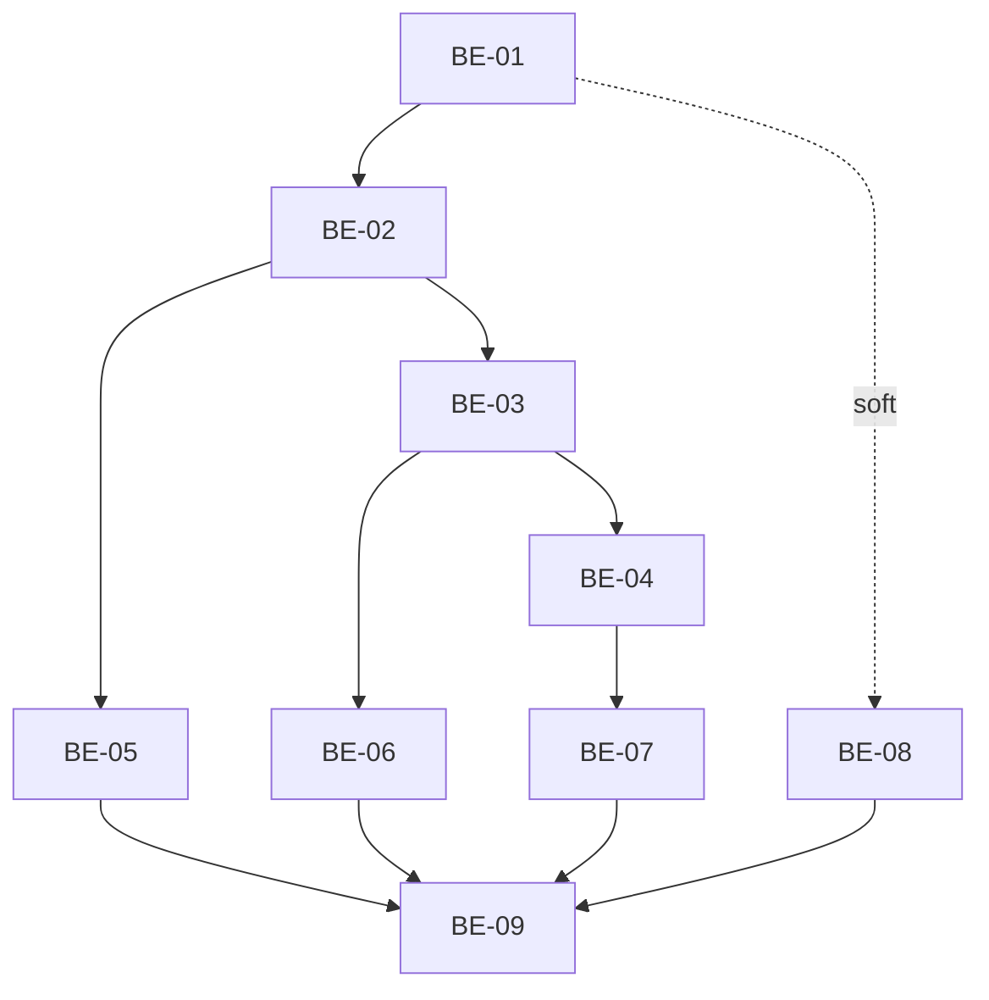

# TASKS — ADR-001 Schema: ledger `appointment_payments` + `charges` gateway-only (scoped)

## 1. Origem

- **SPEC:** `.spec/backend/cobranca-formas-pagamento-adr-001/SPEC.md`
- **PLAN:** `.spec/backend/cobranca-formas-pagamento-adr-001/PLAN.md`
- **ADR:** `.spec/prd/cobranca-formas-pagamento/ADRs/ADR-001-schema-ledger-recebimentos/ADR.md`
- **Meta:** 9 microtasks atômicas, todas teste-primeiro (RED → GREEN), com caminho físico e RF rastreável.

## 2. Backlog

| Task | Tipo | Prioridade | Risco | Complexidade | Status |
|---|---|---|---|---|---|
| BE-01 | Infra / Migration | P0 | High | 2h | Done |
| BE-02 | Infra / Migration | P0 | High | 1h30 | Done |
| BE-03 | Infra / RLS | P0 | High | 1h | Done |
| BE-04 | Infra / Backfill | P0 | High | 1h30 | Done |
| BE-05 | Test / Invariantes | P0 | Medium | 1h30 | Done |
| BE-06 | Test / RLS-RBAC | P0 | High | 1h | Done |
| BE-07 | Test / Backfill | P0 | High | 1h | Done |
| BE-08 | Docs / Domínio | P1 | Low | 30min | Done |
| BE-09 | Validação | P0 | Medium | 45min | Done |

## 3. Grafo de dependências

## 4. Rastreabilidade RF → task

| RF | Task(s) |
|---|---|
| RF-01 (reset 2×) | BE-01, BE-09 |
| RF-02 (tabela/índices) | BE-01, BE-02 |
| RF-03 (`charges` uniques/coluna) | BE-02 |
| RF-04 (`23505` por `charge_id`) | BE-02, BE-05 |
| RF-05 (`23505` por idempotência) | BE-02, BE-05 |
| RF-06 (FK cross-tenant) | BE-05 |
| RF-07 (admin select recortado; escrita negada) | BE-03, BE-06 |
| RF-08 (recepção/profissional 0 linhas) | BE-03, BE-06 |
| RF-09 (backfill 1:1 e reexecução) | BE-04, BE-07 |
| RF-10 (`voided_*` inconsistente) | BE-01, BE-05 |
| RF-11 (`dominio.md` atualizado) | BE-08 |

---

## 5. Task Backlog

### Task `BE-01`: Migration base — tabela, checks e FKs

- **Constraint Ref:** SPEC §2.2, I1–I3, I7, I8; RF-02, RF-10
- **Depends on (PLAN):** —
- **Dependency Type:** Hard (raiz)
- **Layer:** Data / Migration
- **Task Type:** Infra
- **Priority:** P0
- **Risk Level:** High
- **Parallelizable:** No
- **Artifact:** `supabase/migrations/20261106120000_appointment_payments_ledger.sql`
- **Framework Detail:** PostgreSQL 15 (Supabase), `create table if not exists`, checks inline, FKs compostas por tenant

#### 📝 Contexto e impacto

- **Descrição:** criar `public.appointment_payments` com colunas, defaults, checks (`method`, `source`, `amount_cents`, `tip_cents`, `line_index`, `voided_*`) e FKs compostas para `appointments`, `charges`, `profiles (received_by)` e `profiles (voided_by)`.
- **Impacto no domínio:** materializa a fonte única de receita; nenhuma cobrança pendente entra aqui.

#### 🛡️ Enforcement técnico

- **Regra:** nenhuma linha sem `tenant_id`; nenhuma linha com valor não inteiro/zero; estorno só completo.
- **Modo de falha:** receita inventada, linha órfã de tenant, auditoria de estorno inconsistente.

#### ✅ Critérios de aceite (BDD)

- **Cenário 1 (sucesso):** linha válida persiste com defaults.
  - **Given** tenant, atendimento e perfis do mesmo tenant
  - **When** insiro `appointment_payments` com `tenant_id`, `appointment_id`, `method='dinheiro'`, `amount_cents=10000`
  - **Then** a linha existe, `tip_cents=0`, `source='manual'`, `line_index=0`, `received_at` não nulo, `voided_*` nulos
- **Cenário 2 (falha):** valores e enums inválidos.
  - **Given** o mesmo fixture
  - **When** insiro `amount_cents=0`, ou `method='boleto'`, ou `voided_at` sem `void_reason`
  - **Then** cada tentativa falha com SQLSTATE `23514`
- **Cenário 3 (borda):** limites aceitos.
  - **Given** valores de fronteira
  - **When** insiro `tip_cents=0`, `line_index=49`, `received_at` explícito
  - **Then** persiste; `line_index=50` falha com `23514`

#### 🛠️ Passos (TDD — teste primeiro)

- [x] `tests/integration/helpers/payments-fixtures.ts`: criar fixtures (tenant, customer, professional, service, appointment, charge) via `serviceClient()` + `cleanupPaymentFixtures(tenantId)` que apaga **nesta ordem** `appointment_payments` → `charges` → `appointments` (FKs `restrict`).
- [x] `tests/integration/security/appointment-payments-schema.test.ts`: escrever os 3 cenários (RED — tabela ainda não existe).
- [x] `supabase/migrations/20261106120000_appointment_payments_ledger.sql`: passos 2.1–2.2 da SPEC.
- [x] `npx supabase db reset` e rodar o teste (GREEN).

> **Nota de revisão (Y1):** a FK da cobrança não é `(tenant_id, charge_id)`. É de **3 colunas** —
> `(tenant_id, charge_id, appointment_id) → charges (tenant_id, id, appointment_id)` — apoiada no
> unique `charges_tenant_id_id_appointment_uidx` (passo 2.1). Isso impede vincular a linha a
> cobrança de **outro atendimento** do mesmo tenant e a cobrança de assinatura (`appointment_id`
> nulo); `charge_id` nulo continua aceito (FK não verificada). A constraint é re-declarada com
> `drop constraint if exists` + `add constraint` para ser idempotente/reparadora. Cenário de
> teste: atendimento A + `charge_id` do atendimento B → `23503`.

#### 🏁 Definition of Done

- [x] Teste criado antes da migration.
- [x] `npx supabase db reset` exit 0.
- [x] `npm run test:integration -- tests/integration/security/appointment-payments-schema.test.ts` verde.
- [x] Nenhum `TODO`; `afterAll` limpa fixtures antes de `deleteTestUsers`.

---

### Task `BE-02`: Unicidade, índices e `charges` gateway-only

- **Constraint Ref:** SPEC §2.3–2.6, I4–I6, I10; RF-03, RF-04, RF-05
- **Depends on (PLAN):** BE-01
- **Dependency Type:** Hard
- **Layer:** Data / Migration
- **Task Type:** Infra
- **Priority:** P0
- **Risk Level:** High
- **Parallelizable:** No
- **Artifact:** mesmo arquivo de migration (passos 2.3–2.6)
- **Framework Detail:** unique parciais (`where ... is not null`), `drop index if exists`, `alter table add column if not exists`

#### 📝 Contexto e impacto

- **Descrição:** impor 1 recebimento por cobrança, idempotência por lote, cap de 1 PIX por atendimento (inclusive após pago) e índices de consulta.
- **Impacto no domínio:** fecha no banco as corridas que a aplicação sozinha não fecha.

#### 🛡️ Enforcement técnico

- **Regra:** unique parcial + cap sem filtro de status.
- **Modo de falha:** webhook + baixa manual duplicam receita; 2º PIX por atendimento.

#### ✅ Critérios de aceite (BDD)

- **Cenário 1 (sucesso):** estruturas no catálogo e split aceito.
  - **Given** migration aplicada
  - **When** consulto `pg_indexes` e insiro 2 linhas no mesmo atendimento com métodos distintos
  - **Then** `charges_appointment_id_uidx` não existe, `charges_tenant_appointment_uidx`/`charges_tenant_idem_uidx` existem, `charges.idempotency_key` existe e as 2 linhas persistem
- **Cenário 2 (falha):** duplicidades rejeitadas.
  - **Given** linha existente com `charge_id`
  - **When** insiro outra linha com o mesmo `(tenant_id, charge_id)`, ou repito `(tenant_id, idempotency_key, line_index)`, ou crio 2ª `charges` para o mesmo atendimento já pago
  - **Then** todas falham com `23505`
- **Cenário 3 (borda):** `null` e `line_index` distinto.
  - **Given** chaves nulas ou índice de linha diferente
  - **When** insiro várias linhas com `charge_id null` e `idempotency_key null`, e a mesma chave com `line_index=1`
  - **Then** todas são aceitas; `charges` com `appointment_id null` também não colidem

#### 🛠️ Passos (TDD — teste primeiro)

- [x] Estender `appointment-payments-schema.test.ts` com os 3 cenários de unicidade/índices (RED).
- [x] Implementar passos 2.3–2.6 na migration.
- [x] `npx supabase db reset`; rodar o teste (GREEN).
- [x] Conferir `\d+ public.charges` (índice global ausente, novos presentes).

#### 🏁 Definition of Done

- [x] Testes de `23505` cobrindo `charge_id`, idempotência e cap pós-pago.
- [x] 4 índices de consulta presentes no catálogo.
- [x] Nenhuma alteração em migration já aplicada.

---

### Task `BE-03`: RLS e grants

- **Constraint Ref:** SPEC §4; I8; RF-07, RF-08; RNF-09
- **Depends on (PLAN):** BE-02
- **Dependency Type:** Hard
- **Layer:** Data / Security
- **Task Type:** Infra
- **Priority:** P0
- **Risk Level:** High
- **Parallelizable:** No
- **Artifact:** mesmo arquivo de migration (passo 2.7)
- **Framework Detail:** `enable row level security`, policy `for select`, `revoke all`, `grant select/all`, helpers `current_tenant_id()`/`current_role_name()`

#### 📝 Contexto e impacto

- **Descrição:** habilitar RLS com **uma** policy de leitura admin e nenhuma de escrita; devolver só `select` a `authenticated`.
- **Impacto no domínio:** receita deixa de ser gravável pelo cliente; recepção/profissional não varrem a tabela.

#### 🛡️ Enforcement técnico

- **Regra:** grant decide a operação; policy recorta a linha. Sem policy de escrita ⇒ escrita negada.
- **Modo de falha:** cliente autenticado grava/lê receita de outro tenant.

#### ✅ Critérios de aceite (BDD)

- **Cenário 1 (sucesso):** admin lê o próprio tenant.
  - **Given** admin autenticado com linha no tenant A
  - **When** seleciona `appointment_payments`
  - **Then** vê a linha; `has_table_privilege('authenticated', ..., 'SELECT') = 't'`
- **Cenário 2 (falha):** escrita negada.
  - **Given** admin autenticado
  - **When** tenta `insert`, `update` ou `delete`
  - **Then** falha por permissão; `has_table_privilege` = `'f'` para INSERT/UPDATE/DELETE; `anon` = `'f'` em tudo
- **Cenário 3 (borda):** papéis sem policy.
  - **Given** `receptionist`/`professional`/`super_admin` autenticados com linhas no tenant
  - **When** selecionam a tabela
  - **Then** recebem 0 linhas (grant existe, policy não); `service_role` tem todos os privilégios

#### 🛠️ Passos (TDD — teste primeiro)

- [x] `tests/integration/security/appointment-payments-rls.test.ts`: criar sessões com `createCommonUser`, `createTenantMember` e `serviceClient()` para semear linhas (RED).
- [x] Implementar passo 2.7 (RLS + grants) na migration.
- [x] `npx supabase db reset`; rodar o arquivo (GREEN).

#### 🏁 Definition of Done

- [x] Policy única de `select` admin; zero policies de escrita.
- [x] Teste de grants por `has_table_privilege` + tentativas reais de escrita.
- [x] `charges` mantém a policy existente (sem policy nova).

---

### Task `BE-04`: Backfill validado dos `charges` pagos

- **Constraint Ref:** SPEC §5; I4; RF-01, RF-09; RF-28 (PRD)
- **Depends on (PLAN):** BE-03
- **Dependency Type:** Hard
- **Layer:** Data / Migration
- **Task Type:** Infra
- **Priority:** P0
- **Risk Level:** High
- **Parallelizable:** No
- **Artifact:** mesmo arquivo de migration (passo 2.8)
- **Framework Detail:** bloco `DO $$` com `not exists`, `get diagnostics row_count`, `raise notice/exception`

#### 📝 Contexto e impacto

- **Descrição:** converter cada cobrança paga com atendimento em exatamente uma linha `pix_sistema/asaas`, com `received_at = coalesce(paid_at, created_at)`, validando contagem antes/depois.
- **Impacto no domínio:** receita histórica passa a existir na fonte nova antes de o painel migrar (RF-25).

#### 🛡️ Enforcement técnico

- **Regra:** `faltantes_antes == inseridas`; paga sem atendimento só conta em `notice`; paga com valor `<= 0` aborta.
- **Modo de falha:** receita histórica parcial, duplicada ou silenciosamente perdida.

#### ✅ Critérios de aceite (BDD)

- **Cenário 1 (sucesso):** 1:1 com campos corretos.
  - **Given** cobrança `pago` com `appointment_id`, `amount_cents > 0`, `paid_at` preenchido
  - **When** a migration roda
  - **Then** existe 1 linha com `method='pix_sistema'`, `source='asaas'`, `charge_id` igual, `tip_cents=0`, `received_at=paid_at`
- **Cenário 2 (falha):** divergência aborta.
  - **Given** cobrança paga com `amount_cents = 0` e atendimento
  - **When** a guarda da migration avalia
  - **Then** detecta contagem `> 0` e `raise exception` (teste verifica a query de guarda)
- **Cenário 3 (borda):** paga sem atendimento e reexecução.
  - **Given** cobrança `pago` com `appointment_id null`, e backfill já aplicado
  - **When** a migration roda de novo
  - **Then** a paga sem atendimento não vira linha (contada em `notice`); reexecução insere 0 e a contagem fecha

#### 🛠️ Passos (TDD — teste primeiro)

- [x] `tests/integration/security/appointment-payments-backfill.test.ts`: cenários 1 e 3; query de guarda do cenário 2 (RED).
- [x] Implementar passo 2.8 na migration.
- [x] `npx supabase db reset` duas vezes; rodar o arquivo (GREEN).

#### 🏁 Definition of Done

- [x] Backfill idempotente comprovado por reexecução.
- [x] Contagem `faltantes_antes == inseridas` no `DO`.
- [x] Comissão não recalculada; nenhum trigger tocado.

---

### Task `BE-05`: Testes SQL de invariantes

- **Constraint Ref:** SPEC §6 (I1–I7, I9); RF-04, RF-05, RF-06, RF-10
- **Depends on (PLAN):** BE-02
- **Dependency Type:** Hard
- **Layer:** Test / Integration
- **Task Type:** Test
- **Priority:** P0
- **Risk Level:** Medium
- **Parallelizable:** Yes (após BE-02)
- **Artifact:** `tests/integration/security/appointment-payments-schema.test.ts`
- **Framework Detail:** Vitest + `sql()` (psql por stdin) + `serviceClient()`; SQLSTATE por bloco `DO`/erro do client

#### 📝 Contexto e impacto

- **Descrição:** fechar a cobertura das invariantes que não são “só DDL”: coerência de tenant nas 4 FKs, fronteiras numéricas, estorno consistente e receita que ignora linha estornada.
- **Impacto no domínio:** impede linha cross-tenant e soma inflada por estorno.

#### 🛡️ Enforcement técnico

- **Regra:** toda FK composta é testada com tenant divergente; toda soma filtra `voided_at is null`.
- **Modo de falha:** auditoria aponta ator/atendimento de outro tenant; receita inflada.

#### ✅ Critérios de aceite (BDD)

- **Cenário 1 (sucesso):** fronteiras válidas.
  - **Given** fixtures do mesmo tenant
  - **When** insiro `amount_cents=1`, `tip_cents=0`, `line_index=49`, `voided_*` nulos
  - **Then** persiste
- **Cenário 2 (falha):** referências cross-tenant e limite de linha.
  - **Given** tenant A e tenant B
  - **When** insiro linha do tenant A referenciando `appointment_id`, `charge_id` ou `received_by` do tenant B, ou `line_index=50`
  - **Then** as referências falham com `23503` e `line_index=50` com `23514`
- **Cenário 3 (borda):** estorno e idempotência.
  - **Given** uma linha válida e uma linha estornada (`voided_at/by/reason` preenchidos)
  - **When** somo `amount_cents` filtrando `voided_at is null`
  - **Then** a estornada permanece no histórico e não entra na soma; mesma `idempotency_key` com `line_index` distinto é aceita

#### 🛠️ Passos (TDD — teste primeiro)

- [x] Escrever os 3 cenários no arquivo de schema (RED quando a constraint faltar).
- [x] Ajustar a migration se algum cenário revelar lacuna (sem mudar decisão da SPEC).
- [x] Rodar o arquivo isolado (GREEN).

#### 🏁 Definition of Done

- [x] 4 FKs cross-tenant cobertas (`appointment`, `charge`, `received_by`, `voided_by`).
- [x] Soma de receita com estorno testada.
- [x] Nenhum teste depende de ordem de execução da suíte.

---

### Task `BE-06`: Testes de RLS/RBAC por papel

- **Constraint Ref:** SPEC §4; I8; RF-07, RF-08
- **Depends on (PLAN):** BE-03
- **Dependency Type:** Hard
- **Layer:** Test / Security
- **Task Type:** Test
- **Priority:** P0
- **Risk Level:** High
- **Parallelizable:** Yes (após BE-03)
- **Artifact:** `tests/integration/security/appointment-payments-rls.test.ts`
- **Framework Detail:** Vitest + cliente Supabase com JWT real (`createCommonUser`, `createTenantMember`) + `has_table_privilege`

#### 📝 Contexto e impacto

- **Descrição:** provar recorte por tenant para admin e ausência total de leitura/escrita para os demais papéis.
- **Impacto no domínio:** recepção/profissional não podem varrer faturamento (RF-20/RF-21 do PRD).

#### 🛡️ Enforcement técnico

- **Regra:** admin A não lê B; papéis sem policy leem 0; escrita direta negada para todos os `authenticated`.
- **Modo de falha:** vazamento de receita entre tenants ou por papel.

#### ✅ Critérios de aceite (BDD)

- **Cenário 1 (sucesso):** recorte de tenant.
  - **Given** linhas nos tenants A e B
  - **When** admin A seleciona
  - **Then** vê só A; admin B vê só B
- **Cenário 2 (falha):** papéis operacionais.
  - **Given** `receptionist` e `professional` do tenant A
  - **When** selecionam a tabela
  - **Then** 0 linhas; tentativa de `insert`/`update`/`delete` falha para todos os papéis `authenticated`
- **Cenário 3 (borda):** super admin e regressão de `charges`.
  - **Given** `super_admin` autenticado e a policy antiga de `charges`
  - **When** seleciona `appointment_payments` e `charges`
  - **Then** 0 linhas no ledger; `charges` continua admin-only (recepção 0, admin vê o próprio tenant)

#### 🛠️ Passos (TDD — teste primeiro)

- [x] Escrever os 3 cenários (RED).
- [x] Ajustar policy/grants se necessário (sem criar policy de escrita).
- [x] Rodar o arquivo isolado (GREEN).

#### 🏁 Definition of Done

- [x] Cobertura por papel: admin, receptionist, professional, super_admin.
- [x] `charges` sem regressão de policy.
- [x] `cleanupPaymentFixtures` executado antes de `deleteTestUsers`.

---

### Task `BE-07`: Testes de backfill e idempotência

- **Constraint Ref:** SPEC §5; I4, I9; RF-01, RF-09
- **Depends on (PLAN):** BE-04
- **Dependency Type:** Hard
- **Layer:** Test / Integration
- **Task Type:** Test
- **Priority:** P0
- **Risk Level:** High
- **Parallelizable:** Yes (após BE-04)
- **Artifact:** `tests/integration/security/appointment-payments-backfill.test.ts`
- **Framework Detail:** Vitest + `sql()` com blocos `begin; ... rollback;` para reexecutar o backfill sem sujar a base

#### 📝 Contexto e impacto

- **Descrição:** provar 1:1 entre cobranças pagas e ledger, reexecução sem duplicar e exclusão correta de pagas sem atendimento.
- **Impacto no domínio:** garante que a receita histórica não desaparece nem duplica (RF-28).

#### 🛡️ Enforcement técnico

- **Regra:** `count(ledger) == count(charges pago com appointment_id e valor > 0)`; reexecução adiciona 0.
- **Modo de falha:** receita histórica errada após o deploy.

#### ✅ Critérios de aceite (BDD)

- **Cenário 1 (sucesso):** 1:1 e valores.
  - **Given** N cobranças pagas com atendimento
  - **When** o backfill roda
  - **Then** existem N linhas com `charge_id` correspondente e `sum(amount_cents)` igual à soma das cobranças
- **Cenário 2 (falha):** duplicação impossível.
  - **Given** backfill já aplicado
  - **When** reexecuto o mesmo `insert ... not exists` em transação
  - **Then** 0 linhas novas e nenhuma violação de unique
- **Cenário 3 (borda):** paga sem atendimento e estorno.
  - **Given** cobrança paga com `appointment_id null` e uma linha estornada
  - **When** conto ledger e receita
  - **Then** a paga sem atendimento fica fora do ledger e é contada no `notice`; a estornada não entra na receita

#### 🛠️ Passos (TDD — teste primeiro)

- [x] Escrever os 3 cenários (RED contra base sem backfill).
- [x] Rodar após BE-04 (GREEN).
- [x] Validar `npx supabase db reset` duas vezes sem erro.

#### 🏁 Definition of Done

- [x] 1:1 provado por contagem, não por amostra.
- [x] Reexecução em transação com `rollback` (sem `deleteAll`).
- [x] Teste não depende de dados pré-existentes de produção.

---

### Task `BE-08`: Atualização das regras de domínio

- **Constraint Ref:** SPEC §7 (RF-11); ADR-001 §5
- **Depends on (PLAN):** BE-01 (soft)
- **Dependency Type:** Soft
- **Layer:** Docs / Rules
- **Task Type:** Docs
- **Priority:** P1
- **Risk Level:** Low
- **Parallelizable:** Yes
- **Artifact:** `.agents/rules/dominio.md` e `.kiro/steering/dominio.md`
- **Framework Detail:** Markdown; mesma semântica nos dois arquivos (o espelho mantém frontmatter `inclusion: always`)

#### 📝 Contexto e impacto

- **Descrição:** remover a afirmação de que concluir gera PIX e registrar o ledger como fonte única de receita, o cap de 1 PIX, a gorjeta fora de receita/comissão e a comissão inalterada.
- **Impacto no domínio:** elimina a regra que induziria o próximo agente a recriar o PIX automático.

#### 🛡️ Enforcement técnico

- **Regra:** nenhum dos dois arquivos pode afirmar geração automática de PIX na conclusão.
- **Modo de falha:** implementação futura reintroduz o comportamento removido.

#### ✅ Critérios de aceite (BDD)

- **Cenário 1 (sucesso):** ledger documentado.
  - **Given** as regras atualizadas
  - **When** busco `appointment_payments` nos dois arquivos
  - **Then** ambos descrevem o ledger e a receita vinda dele
- **Cenário 2 (falha):** afirmação proibida ausente.
  - **Given** as regras atualizadas
  - **When** busco `gera cobrança PIX` (ou equivalente “ao entrar em concluído: gera PIX”)
  - **Then** zero ocorrências nos dois arquivos
- **Cenário 3 (borda):** paridade semântica.
  - **Given** `dominio.md` e o espelho `.kiro/steering/dominio.md`
  - **When** comparo as frases obrigatórias (cap de 1 PIX, gorjeta fora de receita/comissão, comissão inalterada)
  - **Then** as duas contêm as mesmas afirmações; o frontmatter do espelho não é copiado para o `.agents`

#### 🛠️ Passos (TDD — teste primeiro)

- [x] Escrever o teste/grep de aceitação (pode ser script de verificação no BE-09) — RED.
- [x] Editar `.agents/rules/dominio.md`.
- [x] Editar `.kiro/steering/dominio.md` com a mesma semântica.
- [x] Rodar os greps (GREEN).

#### 🏁 Definition of Done

- [x] Nenhuma menção a PIX automático na conclusão.
- [x] Ledger, cap, gorjeta e comissão descritos nos dois arquivos.
- [x] Nenhum outro trecho do domínio alterado sem necessidade.

---

### Task `BE-09`: Verificação final e revisão de escopo

- **Constraint Ref:** SPEC §10; PLAN §8; RF-01 (idempotência do reset)
- **Depends on (PLAN):** BE-05, BE-06, BE-07, BE-08
- **Dependency Type:** Hard
- **Layer:** Validation
- **Task Type:** Test
- **Priority:** P0
- **Risk Level:** Medium
- **Parallelizable:** No
- **Artifact:** nenhum arquivo novo; execução de comandos canônicos
- **Framework Detail:** `npx supabase db reset`, `npm test`, `npm run test:integration`, `grep`, `git status --porcelain`

#### 📝 Contexto e impacto

- **Descrição:** provar idempotência da migration, não regressão e diff restrito.
- **Impacto no domínio:** evita deploy com migration não idempotente ou alteração fora do escopo.

#### 🛡️ Enforcement técnico

- **Regra:** reset 2× exit 0; suítes verdes; diff só nos caminhos permitidos.
- **Modo de falha:** migration quebra no segundo apply; arquivo estranho entra no PR.

#### ✅ Critérios de aceite (BDD)

- **Cenário 1 (sucesso):** verificação completa.
  - **Given** branch com as tasks concluídas
  - **When** rodo reset 2×, `npm test` e `npm run test:integration`
  - **Then** todos exit 0
- **Cenário 2 (falha):** qualquer comando vermelho bloqueia.
  - **Given** uma falha em qualquer etapa
  - **When** a task é avaliada
  - **Then** BE-09 **não** é concluída; abrir task de correção no domínio da falha
- **Cenário 3 (borda):** escopo do diff.
  - **Given** `git status --porcelain`
  - **When** comparo com a lista permitida
  - **Then** só aparecem `supabase/migrations/**`, `tests/integration/**`, `.agents/rules/dominio.md`, `.kiro/steering/dominio.md`, `.spec/backend/cobranca-formas-pagamento-adr-001/**` e `.spec/prd/cobranca-formas-pagamento/ADRs/ADR-001-schema-ledger-recebimentos/**`

#### 🛠️ Passos (TDD — teste primeiro)

- [x] Rodar `npx supabase db reset && npx supabase db reset`.
- [x] Rodar `npm test`.
- [x] Rodar `npm run test:integration`.
- [x] Rodar `grep -n "gera cobrança PIX" .agents/rules/dominio.md .kiro/steering/dominio.md` → esperado vazio.
- [x] Rodar `git status --porcelain` e conferir a allowlist.
- [x] Registrar evidência (saída dos comandos) no relatório de review.

#### 🏁 Definition of Done

- [x] Reset 2× exit 0 (RF-01).
- [x] `npm test` sem regressão.
- [x] `npm run test:integration` verde.
- [x] Grep negativo das regras vazio.
- [x] Diff restrito ao escopo.

---

## 6. Validação de cobertura

- [x] Todas as tasks do PLAN (BE-01..BE-09) presentes e mapeadas.
- [x] Cada task tem cenário de sucesso, falha e borda/idempotência.
- [x] Cada task lista o teste **antes** da implementação.
- [x] Nenhum ciclo no grafo; nenhuma task órfã.
- [x] I1–I10 e §4/§5 da SPEC têm task responsável.
- [x] Nenhuma task toca `supabase/functions/**` ou `src/**`.
