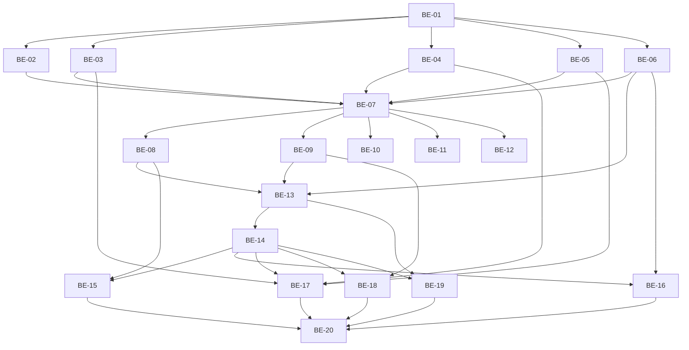

# PLAN — ADR-002 API privilegiada: RPCs + Edge Functions (scoped)

## 1. Contexto e rastreabilidade

- **SPEC:** `.spec/backend/cobranca-formas-pagamento-adr-002/SPEC.md`
- **ADR:** `.spec/prd/cobranca-formas-pagamento/ADRs/ADR-002-api-privilegiada-rpc-edges/ADR.md`
- **ADR-001 (schema, implementado):** `.spec/backend/cobranca-formas-pagamento-adr-001/SPEC.md`
- **PRD:** `.spec/prd/cobranca-formas-pagamento/PRD.md`
- **Depende de:** `supabase/migrations/20261106120000_appointment_payments_ledger.sql`
  (`appointment_payments`, `charges.idempotency_key`, uniques, RLS/grants)
- **Goal:** entregar a API privilegiada completa — 4 RPCs, 2 primitivas internas de cobrança,
  5 Edge Functions e a extensão mínima de `create-charge` — com testes que provam autorização,
  concorrência, replay e falha de gateway. **Sem** webhook e **sem** UI.

### 1.1 Validação da SPEC

- **Status:** validada com 13 lacunas declaradas (D-01..D-13). Nenhuma reabre decisão congelada;
  três exigem alinhamento no merge (D-01 coluna aditiva, D-04 interpretação do `strict`,
  D-09 códigos da ADR-003).
- **D-01** (`lote_signature`) é a única mudança de schema: aditiva, nullable, com `check` de hash.
  Sem ela, o replay não distingue alteração do valor PIX (que não vira linha) e o “mesma chave +
  payload diferente” do ADR passa em silêncio.
- **D-06** é correção de desenho: a reserva da cobrança precisa da mesma trava do atendimento.
  `create-charge` reserva via SQL, nunca via “ler saldo em TS e inserir depois”.
- **D-09** é bloqueante de UI, não de backend: a ADR-003 deve adotar os códigos congelados ou
  estender a tabela formalmente.

### 1.2 Assumptions

- Banco local com `supabase start` ativo; `supabase/functions/.env` presente.
- Nenhuma cobrança paga com `amount_cents = 0` (ADR-001 já aborta o backfill nesse caso).
- `professionals.profile_id` é o único vínculo login↔profissional (constraint existente).
- O trigger de comissão roda dentro do `UPDATE` de status e não precisa de mudança.

---

## 2. Estratégia técnica

- **Camada de escrita:** funções SQL (`security invoker`, `execute` só `service_role`). Nenhuma
  escrita financeira em TypeScript.
- **Camada de leitura:** Edge com `service_role`, sempre filtrada por `tenant_id` do JWT e
  montada por um único módulo (`_shared/payments.ts`).
- **Identidade:** um único `_shared/identity.ts` (JWT → `auth.getUser` → `profiles` com `active`),
  reutilizado por 6 endpoints; `create-charge` passa a usá-lo.
- **Erros:** SQLSTATE `PT4xx` + `message = CODE` na RPC; tradução única em `_shared/http.ts`.
- **Log:** função de whitelist em `_shared/http.ts`; nada de `JSON.stringify(body)`.
- **Concorrência:** `SELECT ... FOR UPDATE` em `appointments` nos dois caminhos que consomem saldo.
- **Testes:** integração contra o stack local (Vitest) + unitários Deno de schema/handler;
  gateway apontado para porta fechada (`ASAAS_API_BASE_URL`) para falha determinística.

---

## 3. Mapeamento de restrições → ponto de aplicação

| Ref. SPEC | Restrição | Onde é imposta | Modo de falha | Verificação |
|---|---|---|---|---|
| I1, RF-17 | cliente não executa função financeira | `revoke execute … public, anon, authenticated` | escrita financeira pelo cliente | `has_function_privilege` + chamada com JWT |
| I2, RF-13 | identidade nunca vem do corpo | `zod.strict()` + `resolveIdentity` | tenant B operando A | body com `tenant_id` ⇒ 400 |
| I3 | toda query filtra tenant | helper de leitura + `eq("tenant_id", …)` | vazamento cross-tenant | dois tenants reais |
| I4, RF-04 | saldo após lock | `FOR UPDATE` em `appointments` (`register` e `reserve`) | estouro de valor | `Promise.all` concorrente |
| I5, RF-02 | atomicidade local | uma função = uma transação | concluiu sem registrar | falha forçada na última linha |
| I6, RF-03 | replay honesto | `lote_signature` + unique `(tenant, key, line_index)` | receita duplicada / payload mascarado | replay igual/diferente |
| I7, RF-11 | ledger imutável | nenhum `DELETE`/`UPDATE` de valor nas RPCs; `voided_*` | “apagar” receita | tentativa de delete sob `authenticated` |
| I8, RF-09/10 | `pago` nunca rebaixa | `update … where status <> 'pago'` | receita perdida | settle/cancel sobre `pago` |
| I9, RF-14 | PIX é intenção | `register` ignora item PIX; só `settle` cria linha | linha PIX fantasma | register com PIX ⇒ 0 linhas PIX |
| I10 | Edge não escreve ledger | revisão + teste de superfície | escrita fora da RPC | grep/inspeção no review |
| I11, I12, RF-08 | leitura escopada + QR | `_shared/payments.ts` | recepção montando relatório | settlement de 1 atendimento |
| I13 | erros estáveis | `_shared/http.ts` | vazamento de SQL | assert de `code`/`message` |
| I-PII, RF-12 | sem PII em log/audit | whitelist + `reason_length` + hash | vazamento LGPD | inspeção de `audit_log` e do log |
| I15 | centavos inteiros | `int`/`numeric`; float só na borda do gateway | erro de arredondamento | `price/paid/reserved` inteiros |
| I16 | invoker + search_path | DDL §3.1 | escalada de privilégio | catálogo `prosecdef=false`, `proconfig` |

---

## 4. Estrutura de arquivos

| Arquivo | Ação | Responsabilidade |
|---|---|---|
| `supabase/migrations/20261106130000_appointment_payments_api_helpers.sql` | criar | `lote_signature`; `appointment_payment_summary`; `reserve_appointment_charge`; `attach_charge_gateway_data`; revokes/grants |
| `supabase/migrations/20261106131000_appointment_payments_api_rpcs.sql` | criar | 4 RPCs + revokes/grants + `comment on function` |
| `supabase/functions/_shared/identity.ts` | criar | `resolveIdentity(req, service, roles)` |
| `supabase/functions/_shared/http.ts` | criar | CORS, `jsonResponse`, `ApiError`, `mapRpcError`, `logEvent` (whitelist) |
| `supabase/functions/_shared/payments.ts` | criar | `loadSettlement`, `readSummary`, `composePermissions`, `PAYMENT_METHODS` |
| `supabase/functions/register-appointment-payments/{index,handler,schemas}.ts` | criar | endpoint §5.4 |
| `supabase/functions/get-appointment-settlement/{index,handler,schemas}.ts` | criar | endpoint §5.5 |
| `supabase/functions/cancel-charge/{index,handler,schemas}.ts` | criar | endpoint §5.6 |
| `supabase/functions/confirm-charge-manual/{index,handler,schemas}.ts` | criar | endpoint §5.7 |
| `supabase/functions/void-appointment-payment/{index,handler,schemas}.ts` | criar | endpoint §5.8 |
| `supabase/functions/create-charge/{handler,schemas}.ts` | alterar | reserva antes do gateway, `amount_cents`, `idempotency_key`, 422, `reused` |
| `supabase/functions/_shared/asaas.ts` | alterar | `ASAAS_API_BASE_URL`; `asaasFetch` com `try/catch`; `cancelPayment` |
| `tests/integration/helpers/payments-fixtures.ts` | alterar | `seedAppointment` com `status`/vínculo, `seedPayment`, `seedCharge` com QR/asaas id |
| `tests/integration/global-setup.ts` | alterar | `ASAAS_API_BASE_URL=http://127.0.0.1:1` antes de subir as funções |
| `tests/integration/security/payments-rpcs.test.ts` | criar | RF-01/02/03/05/06/15/17 |
| `tests/integration/security/payments-concurrency.test.ts` | criar | RF-04/14 |
| `tests/integration/security/payments-settlement-rpcs.test.ts` | criar | RF-09/10/11 |
| `tests/integration/security/payments-edges-auth.test.ts` | criar | RF-07/08/12/13/16 |
| `tests/integration/security/payments-gateway.test.ts` | criar | RF-03/14 |
| `supabase/functions/*/schemas.test.ts` (5) + `register-appointment-payments/handler.test.ts` | criar | validação/mapeamento de erro |
| `package.json` | alterar | novos diretórios em `test:functions` |

Fora da lista: nada. `supabase/functions/asaas-webhook/**` e `src/**` intocados.

---

## 5. Fases e dependências

### Fase 0 — Base SQL de leitura e idempotência
- **Tasks:** BE-01.
- **Entrega:** `lote_signature`, `appointment_payment_summary`, grants/revokes, grant tests RED→GREEN.

### Fase 1 — RPCs de escrita
- **Tasks:** BE-02 (register), BE-03 (settle), BE-04 (cancel), BE-05 (void).
- **Depende de:** Fase 0 (summary e assinatura).
- **Entrega:** 4 RPCs com `PT4xx`, auditoria e grants; testes de contrato em paralelo.

### Fase 2 — Primitivas de cobrança
- **Tasks:** BE-06.
- **Depende de:** Fase 0.
- **Entrega:** `reserve_appointment_charge` + `attach_charge_gateway_data`; lock do atendimento.

### Fase 3 — Helpers compartilhados de Edge
- **Tasks:** BE-07.
- **Depende de:** Fase 1 + Fase 2 (contratos de erro prontos).
- **Entrega:** `identity`, `http`, `payments`; `create-charge` migrada para o helper de identidade.

### Fase 4 — Edge Functions novas
- **Tasks:** BE-08..BE-12.
- **Depende de:** Fase 3.
- **Entrega:** 5 endpoints; settlement montado por um único módulo.

### Fase 5 — Extensão de `create-charge`
- **Tasks:** BE-13.
- **Depende de:** Fase 2 + Fase 3.
- **Entrega:** contrato novo, reserva idempotente, retomada por `externalReference`, 422.

### Fase 6 — Infra de teste
- **Tasks:** BE-14.
- **Depende de:** Fase 5 (rotas de gateway definidas).
- **Entrega:** fixtures estendidas, gateway determinístico, `test:functions` atualizado.

### Fase 7 — Consolidação de testes de integração
- **Tasks:** BE-15..BE-19.
- **Depende de:** Fases 4–6.
- **Entrega:** autorização por papel, concorrência, replay, falha de gateway e PII.

### Fase 8 — Portão de verificação
- **Tasks:** BE-20.
- **Depende de:** todas.
- **Entrega:** reset 2×, `check:functions`, `test:functions`, integração verde, `npm test`,
  `npm run typecheck`; evidência no report.

---

## 6. Ordem de deploy (rollout)

1. **Migration `…_api_helpers.sql`** (aditiva; `lote_signature` nullable, funções novas).
2. **Migration `…_api_rpcs.sql`**.
3. **Edge Functions novas** (não usadas por ninguém ainda).
4. **`create-charge` estendida** — compatível com o cliente antigo porque `amount_cents` e
   `idempotency_key` são opcionais (RNF-11).
5. **Frontend (ADR-004)** consome os endpoints; remoção do fallback de valor é fase final da ADR-003.
6. **Webhook (ADR-003)** passa a chamar `settle_charge_payment`.

Rollback: as migrations são aditivas; reverter o deploy das funções de Edge basta (as RPCs ficam
inertes, sem chamador). Nenhum `drop` de coluna/tabela.

---

## 7. Riscos e mitigação de implementação

| Risco | Impacto | Mitigação |
|---|---|---|
| `raise exception using errcode='PT4xx'` não propagar como esperado | Edge mapeia errado | teste asserta `error.code` **e** `error.message` por RPC |
| `jsonb` com número não inteiro aceito por cast | valor fracionado gravado | validar `numeric % 1 = 0` antes de `::int` |
| `FOR UPDATE` esquecido em um caminho | saldo estourado | teste de concorrência obrigatório (BE-16) |
| Deadlock `register` × `settle` | timeout intermitente | ordem única de lock documentada (§8.1 da SPEC); settle não trava `appointments` |
| `service_role` não ter privilégio após `revoke` | 500 em produção | `grant all` da ADR-001 + `grant execute` explícito; teste positivo com service client |
| Gateway real em teste | flaky/CI sem rede | `ASAAS_API_BASE_URL` para porta fechada; sucesso é smoke manual |
| Vazamento de payload em log | LGPD | `logEvent` com whitelist; review procura `JSON.stringify` |
| `lote_signature` divergir entre caminhos | falso conflito | função única de assinatura usada só no `register` |
| Migration com função pesada | `db reset` lento | nenhuma função chamada em DDL; sem backfill nesta ADR |

---

## 8. Dependências externas

| Dependência | Estado | Observação |
|---|---|---|
| ADR-001 (schema) | implementada, não commitada (decisão do usuário) | branch atual |
| `zod@3.23.8` | já usado | `strict()` |
| `jsr:@supabase/supabase-js@2` | já usado | `service_role` nas edges |
| Asaas sandbox | fora do CI | smoke manual na ADR-003 |
| Admin API do GoTrue | já usado nos testes | `createTenantMember` |

---

## 9. Definição de pronto do plano

- [ ] SPEC aprovada (este documento + `SPEC.md`).
- [ ] Todas as microtasks `BE-01..BE-20` com DoD marcado.
- [ ] Migrations idempotentes (`db reset` 2×).
- [ ] `check:functions`, `test:functions`, integração e `npm test` verdes.
- [ ] Nenhum arquivo de `asaas-webhook` ou `src/**` alterado.
- [ ] Lacunas D-01..D-13 registradas no report de verificação (e D-09 levada ao merge da ADR-003).
