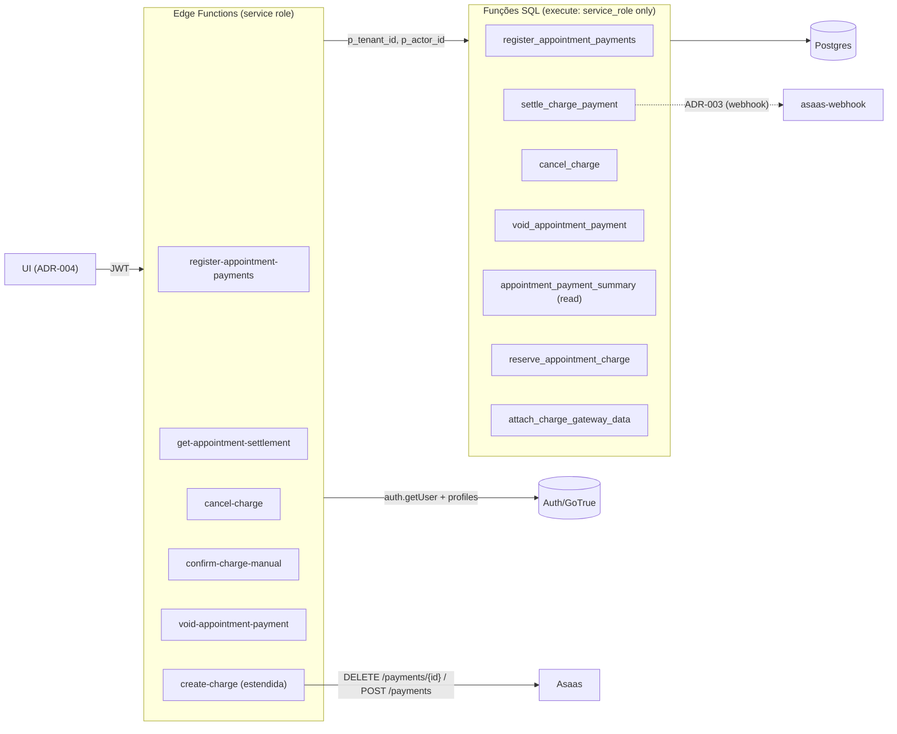

# SPEC — ADR-002 API privilegiada: RPCs + Edge Functions (scoped)

**Feature slug:** `cobranca-formas-pagamento-adr-002`
**ADR de origem:** `.spec/prd/cobranca-formas-pagamento/ADRs/ADR-002-api-privilegiada-rpc-edges/ADR.md`
**ADR dependente:** `.spec/backend/cobranca-formas-pagamento-adr-001/SPEC.md` (schema já implementado)
**PRD:** `.spec/prd/cobranca-formas-pagamento/PRD.md` (RF-07, RF-08, RF-11..RF-21, RF-26, RF-27, RF-29; RNF-01, RNF-04, RNF-07, RNF-08, RNF-10, RNF-11)
**Depende de:** ADR-001 (`appointment_payments`, `charges.idempotency_key`, uniques, RLS/grants)
**Escopo:** 4 RPCs + 2 primitivas internas + 5 Edge Functions novas + extensão mínima de `create-charge` + testes. **Sem** webhook, **sem** UI, **sem** relatórios.

---

## 1. Decisão

Toda mutação financeira passa por **função SQL invocada só pelo `service_role`**. A Edge resolve a
identidade do JWT (`auth.getUser` → `profiles`), aplica o RBAC de endpoint, valida o corpo com `zod`
`strict` e chama a RPC passando `p_tenant_id`/`p_actor_id` **já resolvidos**. O cliente continua sem
qualquer caminho de escrita: as tabelas seguem com `revoke all` (ADR-001) e as funções nascem com
`revoke execute from public, anon, authenticated`.

Quatro invariantes de projeto sustentam a decisão:

1. **Autorização também no SQL.** A Edge é conveniência; a RPC revalida ator, papel, `active` e
   vínculo do profissional. Uma futura Edge nova não herda autorização por acidente.
2. **Um único lugar para a conta de saldo.** O cálculo `paid + reserved + novo ≤ price` e o
   `payment_status` vivem em `appointment_payment_summary`, usada pela RPC de escrita **e** pela
   leitura de settlement. Nenhuma aritmética monetária duplicada em TypeScript.
3. **Atomicidade local real.** Linhas, `appointments.status`, comissão (trigger existente) e
   `audit_log` nascem no mesmo commit da função. O gateway é externo e nunca participa da transação.
4. **Corrida entre fechamento e criação de PIX fechada pelo mesmo lock.** `register_appointment_payments`
   e `reserve_appointment_charge` travam a **mesma** linha de `appointments`
   (`SELECT ... FOR UPDATE`). Sem isso, RF-15 é violável sob concorrência (§8.1, defeito D-06).

---

## 2. Superfície entregue



| # | Artefato | Tipo | Caminho |
|---|---|---|---|
| 1 | `20261106130000_appointment_payments_api_helpers.sql` | migration | `lote_signature`, `appointment_payment_summary`, `reserve_appointment_charge`, `attach_charge_gateway_data` |
| 2 | `20261106131000_appointment_payments_api_rpcs.sql` | migration | `register_appointment_payments`, `settle_charge_payment`, `cancel_charge`, `void_appointment_payment` |
| 2b | `20261106132000_charges_gateway_claim.sql` | migration | `claim_charge_gateway` (token), fencing do `attach_charge_gateway_data`, guardas de `reserve`/`reopen`, `release_charge_reservation` |
| 3 | `_shared/identity.ts` / `_shared/http.ts` / `_shared/payments.ts` | Deno | identidade, envelope HTTP/erros/log, leitura de settlement |
| 4 | 5 Edge Functions | Deno | §6 |
| 5 | `create-charge` estendida | Deno | §6.6 |
| 6 | testes | Vitest + Deno | §12 |

---

## 3. Funções SQL

### 3.1 Regras comuns

- `language plpgsql` (ou `sql` quando puro), `volatile` nas escritas, `stable` na leitura,
  `security invoker` (nunca `definer`), `set search_path = public, pg_temp`.
- **Não** usam `current_tenant_id()`/`auth.uid()`: sob `service_role` não há JWT e o default da
  coluna `tenant_id` seria `NULL`. O tenant vem do parâmetro resolvido na Edge.
- Erro de domínio = `raise exception using errcode = 'PT4xx', message = '<CODE>'`, com `message`
  **somente** o código (`^[A-Z][A-Z0-9_]{2,63}$`). Nada de valor, SQL, id ou PII na mensagem.
- DDL idempotente: `create or replace function` + `revoke`/`grant` reexecutáveis.

```sql
-- bloco obrigatório depois de cada função (idempotente no re-apply)
revoke execute on function public.<fn>(<tipos>) from public, anon, authenticated;
grant  execute on function public.<fn>(<tipos>) to service_role;
```

### 3.2 `appointment_payment_summary` (leitura compartilhada)

```text
appointment_payment_summary(p_tenant_id uuid, p_appointment_id uuid) returns jsonb
  language sql stable security invoker set search_path = public, pg_temp
```

Fórmulas (fonte única, §1):

```text
paid_cents     = coalesce(sum(amount_cents), 0)  -- appointment_payments, voided_at is null
tip_cents      = coalesce(sum(tip_cents), 0)     -- idem
reserved_cents = coalesce(sum(amount_cents), 0)  -- charges, status='pendente'
                                                 --   and (expires_at is null or expires_at > now())
remaining_cents = greatest(price_cents - paid_cents - reserved_cents, 0)

payment_status (nesta ordem):
  price_cents = 0 and paid_cents = 0          -> 'quitado'
  paid_cents >= price_cents                   -> 'quitado'
  existe cobrança pendente                    -> 'aguardando_pix'
  paid_cents = 0                              -> 'sem_pagamento'
  caso contrário                              -> 'parcial'
```

Retorno:

```json
{
  "price_cents": 10000,
  "total_paid_cents": 6000,
  "tip_cents": 500,
  "reserved_cents": 3000,
  "remaining_cents": 1000,
  "payment_status": "aguardando_pix",
  "pending_charge_id": "uuid|null",
  "pending_charge_amount_cents": 3000
}
```

`null` quando o atendimento não existe no tenant (quem chama levanta `APPOINTMENT_NOT_FOUND`).

> `pending_charge_*` é no máximo 1 por atendimento — garantido por
> `charges_tenant_appointment_uidx` (ADR-001). Não é lista, não é agregado de período.

### 3.3 `register_appointment_payments`

```text
register_appointment_payments(
  p_tenant_id uuid, p_actor_id uuid, p_appointment_id uuid,
  p_payments jsonb, p_idempotency_key uuid, p_close_appointment boolean default true
) returns jsonb
```

Ordem **obrigatória** (cada passo depende do anterior):

| # | Passo | Falha |
|---|---|---|
| 1 | Parâmetros não nulos; `p_payments` é array; `jsonb_array_length ≤ 10` | `PT400 INVALID_BODY` / `INVALID_AMOUNT` |
| 2 | Ator em `profiles` com `tenant_id = p_tenant_id`, `active = true`, `role ∈ {admin, receptionist, professional}` | `PT403 FORBIDDEN` |
| 3 | Itens: objeto, chaves `{method, amount_cents, tip_cents}` (**sem chaves extras**), `method` no enum, `amount_cents` inteiro > 0, `tip_cents` inteiro ≥ 0 (default 0) | `INVALID_BODY` / `INVALID_METHOD` / `INVALID_AMOUNT` |
| 4 | No máximo **um** `pix_sistema`; array vazio só com `p_close_appointment = true` | `PT400 INVALID_AMOUNT` / `INVALID_BODY` |
| 5 | `select ... from appointments where tenant_id = p_tenant_id and id = p_appointment_id **for update**` | `PT404 APPOINTMENT_NOT_FOUND` |
| 6 | Profissional: `appointments.professional_id = professionals.id` com `professionals.profile_id = p_actor_id` no tenant | `PT403 PROFESSIONAL_NOT_OWNER` |
| 7 | Máquina de estados (tabela abaixo) | `PT409 APPOINTMENT_INVALID_STATE` / `APPOINTMENT_ALREADY_CONCLUDED` |
| 8 | Idempotência por lote (§8.2) | `PT409 IDEMPOTENCY_CONFLICT` |
| 9 | Conflito de PIX: existe cobrança pendente com valor ≠ intenção | `PT409 PENDING_CHARGE_EXISTS` |
| 10 | Saldo (§3.3.1) | `PT409 AMOUNT_EXCEEDS_REMAINING` |
| 11 | `insert appointment_payments` das linhas **não-PIX** + `update appointments set status='concluido'` quando `close` | rollback total |
| 12 | `audit_log` (uma linha por recebimento; `appointment_concluded_without_payment` no lote vazio) | rollback total |
| 13 | Retorno congelado (§5.1) com `payment_status` recalculado após as escritas | — |

**3.3.1 Saldo.** `paid_cents + reserved_cents + manual_new_cents + pix_intent_cents <= price_cents`, onde
`reserved_cents` já inclui a cobrança pendente e `pix_intent_cents = 0` quando ela existe.

**Estados aceitos**

| `appointments.status` | `close=false` | `close=true` |
|---|---|---|
| `em_atendimento` | `APPOINTMENT_INVALID_STATE` | permitido — grava e conclui no mesmo commit |
| `concluido` | permitido (registrar depois) | replay se a chave tem linhas; senão `APPOINTMENT_ALREADY_CONCLUDED` |
| `pendente`, `confirmado`, `cancelado`, `nao_compareceu` | `APPOINTMENT_INVALID_STATE` | `APPOINTMENT_INVALID_STATE` |

> Consequência de produto declarada: durante o ato, pagamento parcial **conclui** o atendimento com
> `payment_status='parcial'`; o restante entra por “registrar depois” (`concluido` + `close=false`).
> É o que a decisão congelada permite — não há `em_atendimento + close=false`.

**Linhas gravadas**

- `line_index` = ordinal do item no array original (0..n-1), **inclusive** posições ocupadas por
  `pix_sistema`; nunca vem do cliente.
- `method`, `amount_cents`, `tip_cents` copiados do item; `source='manual'`;
  `received_at = now()`; `received_by = p_actor_id`; `idempotency_key = p_idempotency_key`;
  `lote_signature = <md5 canônico do lote>` (§3.6).
- `on conflict (tenant_id, idempotency_key, line_index) where idempotency_key is not null do
  nothing`; depois releitura + comparação de assinatura.

**PIX do sistema é intenção, não recebimento** — nenhuma linha `pix_sistema` nasce aqui. O retorno
traz `pix_amount_cents` para a Edge reservar a cobrança (§6.1).

**Auditoria** (`audit_log`, `actor_id = p_actor_id`):

| `action` | `metadata` (whitelist) |
|---|---|
| `payment_registered` (1× por linha) | `appointment_id`, `method`, `amount_cents`, `tip_cents`, `source`, `idempotency_key` |
| `appointment_concluded_without_payment` | `appointment_id`, `idempotency_key` |

### 3.4 `settle_charge_payment`

```text
settle_charge_payment(
  p_tenant_id uuid, p_charge_id uuid, p_paid_at timestamptz,
  p_source text default 'asaas', p_actor_id uuid default null, p_event_id text default null
) returns jsonb
```

| # | Passo | Resultado |
|---|---|---|
| 1 | `p_source ∈ {asaas, manual}`; `p_tenant_id`/`p_charge_id` não nulos | `PT400 INVALID_BODY` |
| 2 | `asaas` ⇒ `p_actor_id is null`; `manual` ⇒ ator `admin` **ativo** do tenant | `PT403 FORBIDDEN` |
| 3 | `select ... from charges where tenant_id and id **for update**` | `PT404 CHARGE_NOT_FOUND` |
| 4 | `charges.appointment_id is null` | `PT409 CHARGE_NOT_APPOINTMENT` |
| 5 | `charges.amount_cents <= 0` | anomalia `charge_invalid_amount` (D-02) |
| 6 | `status='cancelado'` | anomalia `charge_paid_after_cancel` |
| 7 | `status='pago'` e já existe linha com `charge_id` | replay (`replayed=true`) |
| 8 | `status='pago'` sem linha (legado) | cria a linha idempotente |
| 9 | `status ∈ {pendente, expirado}` | cria a linha e marca `pago` |
| 10 | Auditoria | `charge_paid` (asaas) / `charge_paid_manual` (manual) |

Linha criada por settle: `appointment_id = charges.appointment_id` (nunca do cliente),
`method='pix_sistema'`, `amount_cents = charges.amount_cents`, `tip_cents=0`, `source=p_source`,
`charge_id` (unique parcial garante 1× por cobrança), `received_at = coalesce(p_paid_at, now())`,
`received_by = p_actor_id`, `idempotency_key = null`, `line_index = 0`, `lote_signature = null`.

`charges` → `status='pago'`, `paid_at = coalesce(paid_at, p_paid_at, now())` **somente** se o status
não for `pago`. **Nunca rebaixa** `pago`.

### 3.5 `cancel_charge`

```text
cancel_charge(
  p_tenant_id uuid, p_charge_id uuid, p_actor_id uuid,
  p_force boolean default false, p_gateway_cancelled boolean default false
) returns jsonb
```

| # | Passo | Resultado |
|---|---|---|
| 1 | Ator ativo no tenant; `role ∈ {admin, receptionist}` | `PT403 FORBIDDEN` |
| 2 | `p_force` ⇒ ator `admin` | `PT403 FORBIDDEN` |
| 3 | Lock da cobrança | `PT404 CHARGE_NOT_FOUND` |
| 4 | `status='cancelado'` | `{cancelled:true, replayed:true}` |
| 5 | `status='pago'` | `PT409 CHARGE_NOT_PENDING` |
| 6 | `status ∈ {pendente, expirado}` e `!gateway_cancelled` e `!(force && admin)` | `PT422 GATEWAY_CANCEL_FAILED` (nada muda) |
| 7 | `status='pendente'`/`'expirado'` e (`gateway_cancelled` ou força de admin) | `status='cancelado'`, auditoria, retorno |

`expirado` é cancelável (D-03): evita QR vencido porém ainda pagável no gateway. Não é rebaixamento
de `pago`. Nunca `DELETE`; o histórico permanece. O cancelamento limpa
`gateway_claimed_at`/`gateway_claim_expires_at` na mesma transição (§3.7.1).

Auditoria: `charge_cancelled` / `charge_cancelled_forced`, `metadata = {force, gateway_cancelled,
actor_id, amount_cents}`. `gateway_divergence_risk:true` quando `force=true`.

### 3.6 `lote_signature` (extensão aditiva do ledger — D-01)

A tabela da ADR-001 não guarda o payload do lote; comparar só linhas **não detecta** mudança do
valor PIX (que não vira linha). Sem isso, “mesma chave + payload diferente” passa em silêncio e o
retry reabre a cobrança com o valor antigo.

`alter table public.appointment_payments add column if not exists lote_signature text
check (lote_signature is null or lote_signature ~ '^[0-9a-f]{32}$');`

```text
lote_signature = md5(jsonb_build_object(
  'v', 1,
  'close', p_close_appointment,
  'pix', coalesce(pix_intent_cents, 0),
  'items', (select jsonb_agg(jsonb_build_array(method, amount_cents, tip_cents) order by method, amount_cents, tip_cents)
              from itens_nao_pix)
)::text)
```

- É hash, não payload: nenhum dado pessoal é persistido (§10 I-PII).
- Replay compara **só** `lote_signature` (mais barato e cobre PIX + `close`); a comparação por
  quantidade/soma/multiconjunto do ADR fica como verificação redundante de sanidade.
- Não cria índice: a busca é por `(tenant_id, idempotency_key)`, já indexada.

### 3.7 Primitivas internas de `create-charge` (não são RPC pública)

```text
reserve_appointment_charge(
  p_tenant_id uuid, p_actor_id uuid, p_appointment_id uuid,
  p_amount_cents int default null,        -- null ⇒ saldo restante (RNF-11)
  p_idempotency_key uuid default null,    -- null ⇒ gerada na Edge
  p_expires_at timestamptz default now() + interval '3 days'
) returns jsonb

claim_charge_gateway(
  p_tenant_id uuid, p_charge_id uuid, p_ttl_seconds int default 180
) returns jsonb
  -- { claimed, claim_token, charge:{..., gateway_claimed_at, gateway_claim_expires_at} }
  -- token = charges.gateway_claimed_at; no máximo 1 POST /payments por charges.

attach_charge_gateway_data(
  p_tenant_id uuid, p_charge_id uuid, p_claim_token timestamptz,
  p_asaas_payment_id text, p_pix_qr_code text, p_pix_copy_paste text,
  p_expires_at timestamptz default null
) returns jsonb

release_charge_reservation(
  p_tenant_id uuid, p_charge_id uuid, p_actor_id uuid,
  p_claim_token timestamptz default null   -- token do claim do próprio caller
) returns jsonb
  -- { released, charge_id, charge_status }
```

**`reserve_appointment_charge`** — ator válido (mesma matriz + vínculo do profissional), **lock do
atendimento**, status `concluido` (senão `PT409 APPOINTMENT_INVALID_STATE`), e então:

0. Cobrança existente com **claim vivo** (`gateway_claimed_at is not null and
   gateway_claim_expires_at > now()`) ⇒ `PT409 GATEWAY_IN_PROGRESS` e **nenhuma** alteração
   (não expira, não limpa claim, não reutiliza).
1. Cobrança existente do atendimento (unique `(tenant_id, appointment_id)`):
   - `pendente` + `asaas_payment_id not null` → **reapresenta** (`reused=true`,
     `requested_amount_mismatch = (amount ≠ existente)`);
   - `pendente` + `asaas_payment_id is null` (ativa) → retoma (devolve a reserva, sem criar outra);
   - `pendente` **vencida** → marca `expirado` (audit `charge_expired`) e devolve
     `reissue=true` com `previous_charge_id`/`previous_asaas_payment_id`; a Edge cancela o
     payment anterior (se houver), chama `reopen_charge_for_reissue` e só então cria o novo QR;
   - `expirado` / `cancelado` → `reissue=true` com `previous_charge_id`/
     `previous_asaas_payment_id` (mesmo fluxo de reemissão da Edge); valor divergente do
     existente ⇒ `PT409 PENDING_CHARGE_EXISTS`;
   - `pago` → `PT409 CHARGE_NOT_PENDING` (§3.7.1: pago nunca é reemitido);
   - mesma `idempotency_key` em outro atendimento → `PT409 IDEMPOTENCY_CONFLICT`.
2. Sem cobrança: `amount = p_amount_cents ?? remaining_cents`; `amount <= 0` ⇒
   `PT409 AMOUNT_EXCEEDS_REMAINING`; `paid + reserved + amount > price` ⇒ idem.
3. `insert charges (..., status='pendente', asaas_payment_id=null, idempotency_key, expires_at)`
   `on conflict (tenant_id, appointment_id) do nothing`; conflito ⇒ relê e cai no passo 1.
4. Auditoria `charge_reserved` (`appointment_id`, `charge_id`, `amount_cents`, `idempotency_key`,
   `expires_at`) **na mesma transação**. Falha na auditoria ⇒ rollback da reserva.

**`claim_charge_gateway`** — claim atômico por cobrança; devolve o **token**
(`gateway_claimed_at`) e a expiração (`gateway_claim_expires_at`). Só reivindica cobrança
`pendente`, sem `asaas_payment_id`, não vencida e com claim ausente/expirado. `ttl` é limitado a
`1..900` segundos (default 180; a Edge envia `GATEWAY_CLAIM_TTL_SECONDS = 180`, acima do pior caso
de I/O agregado da criação, ~120s). A auditoria `charge_gateway_claimed` não contém QR/copia-e-cola.

**`attach_charge_gateway_data`** — **fencing pelo token**. Um único `UPDATE` grava
`asaas_payment_id`, `pix_qr_code`, `pix_copy_paste`, `expires_at = coalesce(p_expires_at,
expires_at)` e limpa o claim **somente** quando
`status='pendente' and gateway_claimed_at = p_claim_token and gateway_claim_expires_at > now()`.
Zero linhas ⇒ `PT409 GATEWAY_CLAIM_LOST` (o criador expirado nunca sobrescreve quem reivindicou
depois). Não há checagem de papel aqui: a função é `service_role`-only e a autorização de criação
já ocorreu em `reserve`/na Edge. Auditoria `charge_created` (sem QR/copia-e-cola).

**`release_charge_reservation`** — usada pela Edge quando o gateway falha depois da reserva.
Aceita `admin`, `receptionist` e `professional` **dono** (valida `professionals.profile_id` contra
o atendimento da cobrança). **Fence de claim**: se existe claim vivo
(`gateway_claim_expires_at > now()`) e `gateway_claimed_at is distinct from p_claim_token`, recusa
com `PT409 GATEWAY_IN_PROGRESS` e não altera nada (o dono do claim ainda pode anexar). A Edge passa
o token que recebeu de `claim_charge_gateway` (`claimTokenRef`); sem token e com claim vivo a
liberação é recusada. Só libera a reserva pura: `status='pendente' and asaas_payment_id is
null` ⇒ `status='cancelado'`, limpa `gateway_claimed_at`/`gateway_claim_expires_at` e audita
`charge_reservation_released`. A Edge trata a recusa por fence como
`charge_reservation_claim_held` (loga e mantém o erro de gateway; não vira 500). Qualquer outro
status (inclusive `pago`) não é tocado (`released=false`). `CHARGE_NOT_FOUND`/`PROFESSIONAL_NOT_OWNER`
conforme §3.1.

**Falha do gateway** (Edge): `release_charge_reservation` para a reserva (`asaas_payment_id is
null`) + `audit_log` `charge_creation_failed` gravado pela Edge. Erro da liberação **não** é
ignorado: loga `charge_reservation_release_failed` e responde `500 INTERNAL`. Nunca apaga a linha;
a reserva cancelada é o marcador durável da tentativa (ADR-003).

### 3.7.1 Semântica de reemissão — “1 ativo; pago nunca”

- No máximo **uma** cobrança ativa por atendimento (`charges_tenant_appointment_uidx`), no máximo
  **um** claim vivo por cobrança e no máximo **um** `POST /payments` por criação.
- `reopen_charge_for_reissue` só aceita `expirado`/`cancelado` **sem claim vivo**; com claim vivo ⇒
  `PT409 GATEWAY_IN_PROGRESS` e estado intacto. A reabertura mantém a **mesma linha**, limpa
  `asaas_payment_id`/QR/idempotency_key e audita `charge_reissued` (o anterior é cancelado na Edge
  antes). Não existe código de erro `CHARGE_REISSUED`; reemissão é sinalizada no retorno
  (`reopened/reissue`/`previous_*`) e na auditoria.
- `release_charge_reservation` só libera com o **mesmo** token do claim vivo (ou quando não há
  claim vivo); claim vivo de outro criador ⇒ `PT409 GATEWAY_IN_PROGRESS` sem alteração.
- Perdedor do claim **nunca** faz `DELETE` de payment já referenciado por
  `charges.asaas_payment_id`; se o vencedor anexou o mesmo payment, a resposta é reconciliada (200).
- Cobrança `pago` **nunca** é reaberta, cancelada por liberação, rebaixada ou reemitida
  (`CHARGE_NOT_PENDING`).

---

## 4. Matriz de autorização (fonte da verdade)

| Operação | Admin | Recepção | Profissional | Onde é imposta |
|---|---|---|---|---|
| Registrar pagamento | ✅ qualquer atendimento | ✅ qualquer atendimento | ✅ só o próprio | RPC (ator + vínculo) **e** Edge |
| Ler settlement de 1 atendimento | ✅ | ✅ | ✅ só o próprio | Edge (RPC não existe para leitura) |
| Ver saldo no diálogo | ✅ | ✅ (só o atendimento do ato) | ✅ (só o próprio) | Edge |
| Ver QR/copia-e-cola | ✅ sempre | ✅ só `status='em_atendimento'` | ✅ só o próprio + `em_atendimento` | Edge |
| Listar/histórico/período | ✅ (ADR-005) | ❌ | ❌ | fora desta ADR |
| Relatórios/KPIs | ✅ (ADR-005) | ❌ | ❌ | fora desta ADR |
| Baixa manual de PIX | ✅ | ❌ | ❌ | RPC (ator admin) **e** Edge |
| Cancelar cobrança pendente | ✅ | ✅ (auditado) | ❌ | RPC **e** Edge |
| Cancelar com `force` | ✅ | ❌ | ❌ | RPC **e** Edge |
| Estornar recebimento | ✅ | ❌ | ❌ | RPC **e** Edge |
| Concluir sem pagamento | ✅ | ✅ | ✅ próprio | RPC |

- `active=false`, sem profile, sem tenant ou `super_admin` ⇒ `403 FORBIDDEN` em **todos** os endpoints.
- Nenhum endpoint aceita `tenant_id`, `role`, `actor_id` ou `professional_id` do corpo (§6).
- Super admin não ganha caminho cross-tenant novo.

---

## 5. Contratos JSON

### 5.1 `register_appointment_payments` → retorno da RPC (congelado)

```json
{
  "appointment_id": "uuid",
  "appointment_status": "concluido",
  "payments": [
    { "id": "uuid", "method": "dinheiro", "amount_cents": 6000, "tip_cents": 0, "source": "manual" }
  ],
  "total_paid_cents": 10000,
  "tip_cents": 500,
  "reserved_cents": 0,
  "remaining_cents": 0,
  "payment_status": "quitado",
  "pix_amount_cents": 0,
  "pix_already_pending": false,
  "replayed": false
}
```

### 5.2 `settle_charge_payment` → retorno da RPC

```json
{
  "ok": true,
  "payment": {
    "id": "uuid", "appointment_id": "uuid", "method": "pix_sistema",
    "amount_cents": 3000, "tip_cents": 0, "source": "asaas",
    "charge_id": "uuid", "received_at": "2026-11-06T18:00:00Z"
  },
  "charge_status": "pago",
  "replayed": false,
  "anomaly": null
}
```

`payment` pode ser `null`; `anomaly ∈ {null, "charge_paid_after_cancel", "charge_invalid_amount"}`.

### 5.3 `cancel_charge` / `void_appointment_payment` → retorno da RPC

```json
{ "cancelled": true, "replayed": false, "charge_id": "uuid", "charge_status": "cancelado",
  "gateway_divergence_risk": false }
```

```json
{ "voided": true, "replayed": false, "refund_required": true,
  "payment": { "id": "uuid", "charge_id": "uuid|null", "amount_cents": 3000, "tip_cents": 0,
               "voided_at": "...", "void_reason": "..." },
  "settlement": { "price_cents": 10000, "total_paid_cents": 7000, "tip_cents": 0,
                  "reserved_cents": 0, "remaining_cents": 3000,
                  "payment_status": "parcial", "pending_charge_id": null,
                  "pending_charge_amount_cents": 0 } }
```

### 5.4 `POST /register-appointment-payments`

```json
{
  "appointment_id": "uuid",
  "idempotency_key": "uuid",
  "close_appointment": true,
  "payments": [
    { "method": "dinheiro", "amount_cents": 6000, "tip_cents": 0 },
    { "method": "cartao_debito", "amount_cents": 4000, "tip_cents": 500 },
    { "method": "pix_sistema", "amount_cents": 3000 }
  ]
}
```

- `payments`: 0..10 itens; `[]` só com `close_appointment=true`; máximo 1 `pix_sistema`.
- `idempotency_key` ausente ⇒ `400 IDEMPOTENCY_KEY_REQUIRED`.
- 200: `{ "settlement": {...}, "charge": { "id", "amount_cents", "pix_qr_code",
  "pix_copy_paste", "expires_at" } | null }`.
- 422 `GATEWAY_ERROR`: `{ code, message, retryable: true, settlement: {...}, pix_amount_cents }`
  — settlement **já persistido**, nenhuma linha PIX criada.
- 409 de saldo após o commit local: `{ code, message, settlement: {...}, pix_amount_cents }`
  (D-05; mesma forma do 422, sem `retryable`).

### 5.5 `POST /get-appointment-settlement`

Body: `{ "appointment_id": "uuid" }`.

```json
{
  "appointment": {
    "id": "uuid", "status": "em_atendimento",
    "starts_at": "2026-11-06T18:00:00Z",
    "customer_name": "...", "service_name": "...", "professional_name": "...",
    "total_cents": 10000
  },
  "payments": [
    { "id": "uuid", "method": "dinheiro", "amount_cents": 6000, "tip_cents": 0,
      "source": "manual", "received_at": "...", "voided_at": null, "void_reason": null }
  ],
  "pending_charges": [
    { "id": "uuid", "amount_cents": 3000, "expires_at": "...",
      "pix_qr_code": "...|null", "pix_copy_paste": "...|null" }
  ],
  "stale_charges": [
    { "id": "uuid", "amount_cents": 3000, "status": "expirado|cancelado",
      "expires_at": "..." }
  ],
  "total_paid_cents": 6000,
  "tip_cents": 0,
  "reserved_cents": 3000,
  "remaining_cents": 1000,
  "payment_status": "aguardando_pix",
  "permissions": {
    "can_register": true, "can_cancel_charge": true, "can_confirm_manual": false,
    "can_void": false, "can_view_qr": true, "can_reissue_pix": false
  }
}
```

Regras de montagem (Edge, `_shared/payments.ts`):

| Campo | Regra |
|---|---|
| `payments[]` | inclui estornadas; somas ignoram `voided_at` |
| `void_reason` | só `admin`; recepção/profissional recebem `null` e `voided_at` preenchido (D-07) |
| `pending_charges[].pix_*` | `null` quando `role != admin` e `appointment.status != 'em_atendimento'`; nunca de cobrança cancelada/expirada |
| `stale_charges[]` | `expirado`/`cancelado` **ou** `pendente` vencida, com `amount_cents > 0`; habilita cancelar e reemitir na **mesma** linha. Cobrança `pago` nunca entra |
| `permissions.*` | derivado no servidor (nunca do cliente) |
| números | vêm de `appointment_payment_summary` (nunca recalculados em TS) |

`can_register` = `admin|receptionist` **ou** profissional responsável, com status
`em_atendimento|concluido`. `can_cancel_charge` = `admin|receptionist` **e** existe pendente ou
`stale_charge`. `can_confirm_manual` = `admin` **e** existe pendente. `can_void` = `admin` **e**
existe linha não estornada. `can_view_qr` = existe pendente **e** (`admin` ou `em_atendimento`).
`can_reissue_pix` = existe `stale_charge` **e** nenhuma cobrança `pago` (pago nunca é reemitido).

### 5.6 `POST /cancel-charge`

Body: `{ "charge_id": "uuid", "force": false }`. 200:
`{ "cancelled": true, "replayed": false, "charge_id": "uuid", "gateway_divergence_risk": false }`.

### 5.7 `POST /confirm-charge-manual`

Body: `{ "charge_id": "uuid", "paid_at": "ISO-8601 (opcional)" }`. 200:
`{ "settlement": {...}, "payment": {...}, "replayed": false }`.
Cobrança cancelada ⇒ `409 CHARGE_CANCELLED` (Edge pré-lê; baixa manual não gera anomalia).

### 5.8 `POST /void-appointment-payment`

Body: `{ "payment_id": "uuid", "reason": "texto (1..500)" }`. 200:
`{ "settlement": {...}, "refund_required": true }`.

### 5.9 `POST /create-charge` (estendida — fronteira §9)

```json
{ "appointment_id": "uuid", "amount_cents": 3000, "idempotency_key": "uuid" }
```

- `amount_cents` ausente ⇒ saldo restante (RNF-11); `idempotency_key` ausente ⇒ gerada na Edge.
- 200: `{ "charge_id", "amount_cents", "pix_qr_code", "pix_copy_paste", "expires_at",
  "reused", "requested_amount_mismatch" }`.
- Criação passa por `claim_charge_gateway` (token) → gateway → `attach_charge_gateway_data(token)`:
  no máximo 1 `POST /payments` por cobrança. Claim perdido no attach ⇒ relê a cobrança e **só**
  cancela o payment criado quando `charges.asaas_payment_id is distinct from payment.paymentId`;
  se o vencedor já anexou esse mesmo payment, trata como reconciliação (200 com os dados) e
  **não** faz `DELETE`. Payment órfão ⇒ cancela (best-effort, logado) e responde
  `409 GATEWAY_IN_PROGRESS` `retryable:true`.
- `externalReference = charges.id` (reconciliação 1:1), `description` sem PII,
  `value = amount_cents / 100` só para formatação.
- Toda chamada ao Asaas tem `AbortSignal.timeout(20000)`; o pior caso agregado da criação é
  ~120s (6 chamadas), abaixo do TTL do claim de 180s.
- Crash entre reserva e gateway: antes de criar, consulta
  `GET /payments?externalReference=<charge_id>` e **retoma** a existente.

---

## 6. Edge Functions

### 6.1 `register-appointment-payments`

1. `resolveIdentity(req, service, ["admin","receptionist","professional"])`.
2. `zod.strict()` no corpo; erro ⇒ 400 com o código específico.
3. Chama a RPC com `p_tenant_id = identity.tenantId`, `p_actor_id = identity.userId`.
4. Se `pix_amount_cents > 0`: `reserve_appointment_charge` → `claim_charge_gateway` → gateway →
   `attach_charge_gateway_data(claim_token)`.
   - cobrança pendente reapresentada (`pix_already_pending`) ⇒ **não** chama o gateway.
   - claim perdido durante a espera ⇒ `409 GATEWAY_IN_PROGRESS` `retryable:true` com o `settlement`;
     claim perdido no attach ⇒ relê a cobrança; se `asaas_payment_id` já é o payment criado, devolve
     200 reconciliado sem `DELETE`; payment órfão ⇒ cancela (best-effort, logado) e devolve o mesmo
     409; **não** cancela a reserva local (o dono do claim a está usando).
   - falha do gateway/da reserva ⇒ `release_charge_reservation` da reserva **com o token do claim**
     (fence: claim vivo de outro criador ⇒ `PT409 GATEWAY_IN_PROGRESS`, loga
     `charge_reservation_claim_held` e mantém o erro de gateway; nada é liberado) + auditoria
     `charge_creation_failed`; erro não-domínio da liberação ⇒ log + `500 INTERNAL`.
   - resposta 422 `GATEWAY_ERROR` (ou 409, D-05) com o `settlement` relido.
5. Responde `{settlement, charge|null}` com o settlement **relido após** a cobrança.

### 6.2 `get-appointment-settlement`

`resolveIdentity` (3 papéis) → lê o atendimento **com `tenant_id` do identity** → profissional:
valida vínculo → monta via `_shared/payments.ts` (§5.5). Sem lista, sem período, sem agregado.

### 6.3 `cancel-charge`

Papéis `admin|receptionist`, `force` só admin. Ordem: identidade → charge do tenant (404) →
`cancelado` ⇒ 200 replay; `pago` ⇒ 409; `pendente|expirado`:
`asaas_payment_id is null` ⇒ cancela local (`gateway_cancelled=true`) sem chamar o gateway;
senão `DELETE /payments/{id}` → 200/404 tratados como cancelado → `cancel_charge(...)`.
Outra falha: `force=false` ⇒ 422 (nada muda); `force=true` ⇒ cancela local com
`gateway_divergence_risk=true`.

### 6.4 `confirm-charge-manual`

Admin. Pré-lê a cobrança do tenant: `cancelado` ⇒ 409 `CHARGE_CANCELLED`; `pago` ⇒ 200 (settle
replay); resto ⇒ `settle_charge_payment(..., 'manual', actor, null)`.
Não cancela o PIX no gateway (decisão aberta #4 — declarada, não implementada).

### 6.5 `void-appointment-payment`

Admin. `reason` 1..500 após `btrim`. Chama a RPC e devolve `{settlement, refund_required}`.
Nunca chama o gateway.

### 6.6 `create-charge` (extensão mínima)

Mantém a identidade e o formato de resposta; muda o valor (parcela, não preço cheio), passa a
reservar antes do gateway, a gravar `idempotency_key` e a criar sob `claim_charge_gateway` (token
no `attach`). Claim perdido ⇒ payment recém-criado cancelado (best-effort) + `409
GATEWAY_IN_PROGRESS`. `ASAAS_NOT_CONFIGURED` passa a 422. Refatora para `_shared/identity.ts`
(ganha o check de `active`, que hoje não existe).

### 6.7 Regras comuns de Edge

- `OPTIONS` 200 com CORS; método ≠ POST ⇒ 405 `{code:"METHOD_NOT_ALLOWED"}` (transporte, fora da
  tabela de domínio).
- `req.json()` inválido ⇒ 400 `INVALID_BODY`.
- `zod.strict()`: chave desconhecida ⇒ 400 `INVALID_BODY`. **`tenant_id` no corpo é rejeitado, não
  “validado”** (D-04) — é a leitura fail-closed de “ignorado” do ADR.
- Identidade: `resolveIdentity` retorna `{userId, tenantId, role, active}`; token ausente/inválido ⇒
  401 `UNAUTHENTICATED`; sem profile/tenant/`active=false`/papel fora da lista ⇒ 403 `FORBIDDEN`.
- `create-charge` e as 5 edges novas **não** fazem `insert` em `appointment_payments` (§10 I10).

---

## 7. Tabela de erros estáveis

| HTTP | `code` | SQLSTATE | Quando |
|---|---|---|---|
| 400 | `INVALID_BODY` | `PT400` | JSON/schema inválido, campo desconhecido, motivo vazio, `close=false` com `payments=[]` |
| 400 | `INVALID_METHOD` | `PT400` | método fora do enum |
| 400 | `INVALID_AMOUNT` | `PT400` | não inteiro, ≤ 0, gorjeta < 0, > 10 linhas, > 1 `pix_sistema` |
| 400 | `IDEMPOTENCY_KEY_REQUIRED` | — (Edge) | chave ausente em endpoint de escrita |
| 401 | `UNAUTHENTICATED` | — (Edge) | token ausente/inválido/expirado |
| 403 | `FORBIDDEN` | `PT403` | papel sem permissão, `active=false`, sem tenant |
| 403 | `PROFESSIONAL_NOT_OWNER` | `PT403` | profissional em atendimento alheio |
| 404 | `APPOINTMENT_NOT_FOUND` | `PT404` | atendimento inexistente no tenant |
| 404 | `CHARGE_NOT_FOUND` | `PT404` | cobrança inexistente no tenant |
| 404 | `PAYMENT_NOT_FOUND` | `PT404` | recebimento inexistente no tenant |
| 409 | `APPOINTMENT_INVALID_STATE` | `PT409` | estado não permite a operação |
| 409 | `APPOINTMENT_ALREADY_CONCLUDED` | `PT409` | concluir de novo sem replay |
| 409 | `AMOUNT_EXCEEDS_REMAINING` | `PT409` | `pago + reservado + novo > total` (ou saldo 0 na reserva) |
| 409 | `IDEMPOTENCY_CONFLICT` | `PT409` | mesma chave, payload diferente; ou chave de outro atendimento |
| 409 | `PENDING_CHARGE_EXISTS` | `PT409` | PIX pedido com valor diferente do pendente |
| 409 | `CHARGE_NOT_PENDING` | `PT409` | cancelar/baixar cobrança paga, ou PIX já usado |
| 409 | `CHARGE_CANCELLED` | — (Edge) | baixa manual em cobrança cancelada |
| 409 | `CHARGE_NOT_APPOINTMENT` | `PT409` | cobrança de assinatura sem atendimento |
| 409 | `GATEWAY_IN_PROGRESS` | `PT409` | claim vivo na reserva/reabertura/liberação; ou perdedor do claim sem dados no TTL (Edge, `retryable:true`) |
| 409 | `GATEWAY_CLAIM_LOST` | `PT409` | `attach` com token expirado/errado; a Edge relê a cobrança e só cancela payment órfão (mesmo payment = 200 reconciliado) antes de traduzir para `GATEWAY_IN_PROGRESS` |
| 422 | `ASAAS_NOT_CONFIGURED` | `PT422` | tenant sem config ativa |
| 422 | `GATEWAY_ERROR` | `PT422` | falha ao criar cobrança PIX |
| 422 | `GATEWAY_CANCEL_FAILED` | `PT422` | falha ao cancelar no gateway |
| 500 | `INTERNAL` | `PT500` | erro inesperado |

**Tradução obrigatória** (`_shared/http.ts`):

```text
error.code === 'PT4xx'  → HTTP do mapa; code = error.message SE casar /^[A-Z][A-Z0-9_]{2,63}$/
23505 / 23503 / 23514   → 500 INTERNAL (as RPCs pré-validam; constraint é última linha)
rede/timeout no .rpc()  → 500 INTERNAL
qualquer outro          → 500 INTERNAL
```

`details`/`hint`/mensagem crua do Postgres **nunca** vão para a resposta nem para o log.
Divergências de código introduzidas pela ADR-003 (`PIX_ALREADY_USED`, `NO_REMAINING_BALANCE`,
`APPOINTMENT_NOT_CONCLUDED`) estão listadas em §9.3.

---

## 8. Atomicidade, concorrência e idempotência

### 8.1 Ordem de lock (evita deadlock e fecha a corrida de saldo)

```mermaid
sequenceDiagram
  participant R as register_appointment_payments
  participant C as reserve_appointment_charge
  participant DB as Postgres
  R->>DB: BEGIN; SELECT appointments ... FOR UPDATE
  R->>DB: valida saldo + idempotência
  R->>DB: INSERT appointment_payments (não-PIX)
  R->>DB: UPDATE appointments SET status='concluido'
  R->>DB: INSERT audit_log; COMMIT
  Note over R,DB: comissão roda no trigger do UPDATE, no mesmo commit
  C->>DB: BEGIN; SELECT appointments ... FOR UPDATE (mesma linha)
  C->>DB: valida saldo restante; INSERT charges (reserva); audit; COMMIT
```

- **Todo caminho que consome saldo trava `appointments` antes de calcular.** `register` e
  `reserve` usam a mesma linha ⇒ serialização ⇒ `paid + reserved + novo ≤ price` vale entre
  fechamento manual e criação de PIX (fecha D-06, defeito encontrado no desenho da ADR-003 §1).
- `settle_charge_payment` trava `charges` e não trava `appointments`: nenhum ciclo (o `FOR UPDATE`
  do atendimento só bloqueia FK `KEY SHARE` da cobrança nova, que ainda não existe para o settle).
- Gateway é externo: falha **não** reverte linhas locais; apenas a reserva PIX é cancelada.
- Consulta de saldo no `create-charge` é sempre **dentro** da função de reserva, nunca em TS.

### 8.2 Replay do lote (ambiguidade #4)

- Chave = `crypto.randomUUID()` gerada ao abrir o diálogo.
- Replay: existe linha com `(tenant_id, p_idempotency_key)` e `lote_signature` igual ⇒ devolve as
  linhas existentes, `replayed=true`, **sem escrever nada**.
- Assinatura diferente ⇒ `409 IDEMPOTENCY_CONFLICT`; nunca sobrescreve.
- Chave nunca é reutilizada após sucesso; é regenerada ao editar linha antes do commit local
  (regra de UI, ADR-004).
- Lote vazio não tem linha ⇒ não é replayável; segunda tentativa devolve
  `APPOINTMENT_ALREADY_CONCLUDED` (D-08; a UI trata como sucesso após refetch).

### 8.3 `settle` × baixa manual

Ambos travam a cobrança e caem no unique `(tenant_id, charge_id)`: um cria a linha, o outro
encontra e devolve `replayed=true`. Nunca duas receitas para a mesma cobrança.

---

## 9. Fronteira com ADR-003

### 9.1 O que esta ADR entrega

| Item | Dono | Observação |
|---|---|---|
| `create-charge`: contrato `amount_cents` + `idempotency_key`, saldo, reserva idempotente, gateway, QR, retomada por `externalReference` | **ADR-002** | destrava `register` (parcela PIX) sem webhook |
| `settle_charge_payment` (RPC) | **ADR-002** | o webhook da ADR-003 vira só o chamador |
| `cancel-charge` (Edge + RPC), inclusive `force` e `asaas_payment_id is null` | **ADR-002** | endpoint `DELETE /payments/{id}` já integrado |
| Anomalias `charge_paid_after_cancel` / `charge_invalid_amount` | **ADR-002** | produzidas pela RPC; consumidas depois |
| **Reescrita do `asaas-webhook`** (dedupe durável, `settle`, sem downgrade) | ADR-003 | intocado aqui |
| **Não rebaixar `pago`** em `PAYMENT_OVERDUE`/`PAYMENT_DELETED` | ADR-003 | a RPC já garante no seu caminho |
| Anomalia pós-cancelamento no fluxo de webhook (200 + conciliação) | ADR-003 | a RPC devolve o payload; a Edge decide o HTTP |
| **Confirmação do endpoint de cancelamento no Asaas (sandbox)** e semântica de 404 | ADR-003 | ADR-002 codifica a recomendação (404 ⇒ já cancelada) e testa com falha local |
| **Reexecução do backfill no cutover** | ADR-003 | ADR-001 já entrega o backfill idempotente |

### 9.2 Regras de convivência

- Esta ADR **não** toca `supabase/functions/asaas-webhook/**`.
- A RPC `settle_charge_payment` é a única forma de criar receita PIX; o webhook da ADR-003 deve
  chamá-la, nunca `update charges` isolado.
- Nenhum novo campo de `charges` além de `idempotency_key` (ADR-001).

### 9.3 Divergências de contrato a resolver no merge (bloqueantes de UI)

A ADR-003 usa três códigos que **não existem** na tabela congelada desta ADR:

| Código da ADR-003 | Uso nesta ADR | Ação recomendada |
|---|---|---|
| `PIX_ALREADY_USED` | `CHARGE_NOT_PENDING` (409) | ADR-003 adota o código congelado **ou** estende a tabela formalmente |
| `NO_REMAINING_BALANCE` | `AMOUNT_EXCEEDS_REMAINING` (409) | idem |
| `APPOINTMENT_NOT_CONCLUDED` | `APPOINTMENT_INVALID_STATE` (409) | idem |

Enquanto não resolvido, a UI (ADR-004) deve tratar `code` sem assumir enum fechado e exibir
mensagem por código conhecido + fallback genérico.

---

## 10. Invariantes

| # | Invariante | Mecanismo |
|---|---|---|
| I1 | Cliente (`anon`/`authenticated`) não executa nenhuma função financeira nem escreve nas tabelas | `revoke execute` + `has_function_privilege` testado |
| I2 | `tenant_id`, `role`, `actor_id`, `professional_id` **nunca** vêm do corpo | `zod.strict()` + `resolveIdentity` + teste de body com `tenant_id` ⇒ 400 |
| I3 | Toda query de Edge filtra `tenant_id = identity.tenantId` | revisão + teste cross-tenant (404/403) |
| I4 | Saldo é calculado **depois** de `SELECT ... FOR UPDATE` em `appointments` | §8.1 |
| I5 | Linhas + status + comissão + auditoria no mesmo commit | função SQL única; teste de rollback forçado |
| I6 | Replay idêntico ⇒ 200 `replayed=true`; payload diferente ⇒ 409 | `lote_signature` (§3.6) |
| I7 | Nunca `DELETE` em `appointment_payments`; nunca `UPDATE` de valor/método; estorno só lógico | grants + RPC |
| I8 | `charges.status='pago'` nunca é rebaixado | RPC só promove |
| I8b | No máximo 1 criação no gateway por cobrança; criador expirado nunca sobrescreve o claim de outro | `claim_charge_gateway` + fencing por `gateway_claimed_at`/`gateway_claim_expires_at` no `attach` |
| I8c | `reserve`/`reopen` com claim vivo nunca alteram a cobrança | guarda explícita antes do status; `PT409 GATEWAY_IN_PROGRESS` |
| I8d | Falha de gateway não deixa reserva órfã; liberação vale para admin/recepção/profissional dono e exige o token do próprio claim quando há claim vivo | `release_charge_reservation` service-only com fence `p_claim_token` + erro tratado na Edge |
| I8e | “1 ativo; pago nunca”: uma cobrança ativa por atendimento; `pago` nunca reabre/reemite | unique + `reopen` restrito a `expirado`/`cancelado` |
| I8f | Nenhuma chamada ao Asaas passa de 20s | `asaasFetch` com `AbortSignal.timeout(20000)` |
| I9 | `pix_sistema` nunca vira linha em `register`; só `settle` cria linha PIX | §3.3 / §3.4 |
| I10 | Edge não faz `insert` direto em `appointment_payments` | revisão + teste de superfície |
| I11 | Settlement é de **um** atendimento; não há lista/período/agregado para recepção/profissional | contrato §5.5 |
| I12 | QR/copia-e-cola: admin sempre; não-admin só com `em_atendimento`; nunca de cobrança encerrada | §5.5 |
| I13 | Erro de domínio é código estável; nenhum detalhe de SQL vaza | §7 |
| I14 | `lote_signature` é hash; nenhum payload financeiro/PII é persistido | §3.6 |
| I-PII | Log técnico e `audit_log` sem nome, telefone, documento, QR, copia-e-cola, token, payload cru | whitelist de campos (§6.7) + `reason_length` |
| I15 | Nenhum cálculo monetário em ponto flutuante; tudo em centavos inteiros | `int`/`numeric` + `value` só na borda do gateway |
| I16 | Toda função é `security invoker`, `search_path` fixo e `execute` só de `service_role` | DDL §3.1 |

> `void_reason` é texto livre do usuário e vai para `audit_log` por decisão explícita do ADR
> (necessário para auditoria). Mitigação: `≤ 500` caracteres, `btrim`, UI orienta a não incluir
> dado pessoal e o log técnico registra apenas `reason_length` — nunca o texto.

---

## 11. Requisitos funcionais (derivados dos critérios 1–13 do ADR)

| RF | Entrada → saída observável | Invariante |
|---|---|---|
| **RF-01** | Catálogo de `pg_proc`: as 4 RPCs (+ 3 primitivas) existem com a assinatura congelada; `has_function_privilege('anon'/'authenticated', …, 'execute') = false`; `service_role = true` | I1, I16 |
| **RF-02** | `em_atendimento` + `close=true` ⇒ linhas e `status='concluido'` no mesmo commit; comissão gravada; falha forçada na última linha reverte status e comissão | I5 |
| **RF-03** | Mesmo lote 2× ⇒ 200 `replayed=true`, sem duplicar; mesma chave com soma/valor PIX diferente ⇒ 409 `IDEMPOTENCY_CONFLICT` | I6 |
| **RF-04** | Duas chamadas concorrentes no mesmo atendimento (duas chaves, ou register × reserve): no máximo uma consome o saldo; a outra recebe `AMOUNT_EXCEEDS_REMAINING`; `sum(amount) ≤ price` | I4 |
| **RF-05** | `payments=[]` + `close=true` ⇒ conclui, audita `appointment_concluded_without_payment`, não cria cobrança | I9 |
| **RF-06** | Total 0: `[]` conclui e settlement devolve `quitado`/`total_paid=0`; qualquer linha positiva ⇒ `AMOUNT_EXCEEDS_REMAINING` | I4 |
| **RF-07** | Profissional só registra/lê o próprio; alheio ⇒ 403; leitura direta de `appointment_payments` sob `authenticated` ⇒ 0 linhas | I1, I3 |
| **RF-08** | Recepção lê settlement de 1 atendimento; não há endpoint de lista/período; QR só com `em_atendimento`; `void_reason` oculto | I11, I12 |
| **RF-09** | `settle` em cancelada ⇒ sem receita + `charge_paid_after_cancel`; em paga ⇒ no-op idempotente; em paga sem linha (legado) ⇒ cria 1 linha | I6, I9 |
| **RF-10** | `cancel_charge` com falha de gateway e `force=false` ⇒ nada muda (422); `force=true` (admin) ⇒ cancela, audita e sinaliza risco; `pago` ⇒ 409 | I8 |
| **RF-11** | `void` mantém a linha, preenche `voided_*`, sai das somas, `refund_required` quando havia `charge_id`; segunda chamada ⇒ replay | I7 |
| **RF-12** | Nenhum log/audit contém nome, telefone, documento, QR, copia-e-cola, payload cru ou token | I-PII |
| **RF-13** | Body com `tenant_id`/`role` ⇒ 400; usuário do tenant B operando atendimento do A ⇒ 404/403 e nenhuma escrita | I2, I3 |
| **RF-14** | `create-charge` aceita `amount_cents`/`idempotency_key`, valida saldo sob lock, reapresenta pendente, falha de gateway ⇒ 422 com settlement e reserva cancelada, sem linha PIX | I4, I9 |
| **RF-15** | `npx supabase db reset` 2× ⇒ exit 0; migrations idempotentes | — |
| **RF-16** | Todos os caminhos devolvem os mesmos números para o mesmo estado (summary único) | §3.2 |
| **RF-17** | Nenhum novo caminho de escrita/leitura para `anon`/`authenticated`; nenhum `grant` em tabela | I1 |

### Rastreabilidade PRD → SPEC

| PRD | Cobertura |
|---|---|
| RF-07/08/09/10 | §3.3 (split, parcial, gorjeta, limite), RF-04/RF-06 |
| RF-11/12 | §3.3 (estado), RF-05, RF-02 |
| RF-13 | §3.5 (void), RF-11 |
| RF-14/16 | §8.2, §3.7, RF-03, RF-14 |
| RF-15 | §3.3.1, §8.1, RF-04 |
| RF-17/18/19 | §3.4, §6.3, §6.4, RF-09, RF-10 |
| RF-20/21 | §4, §5.5, RF-07, RF-08 |
| RF-22/23 | RF-06, §6.6 (`ASAAS_NOT_CONFIGURED` 422) |
| RF-24 | comissão só no trigger de `concluido` (não tocado) — RF-02 |
| RF-26/27 | §5.5 (QR), §6.1 (422 com settlement), RF-14 |
| RF-29 | §4, §6.7, RF-13 |

---

## 12. Estratégia de teste

### 12.1 Arquivos

| Arquivo | Cobre |
|---|---|
| `tests/integration/security/payments-rpcs.test.ts` | RF-01, 02, 03, 05, 06, 15, 17 — catálogo/grants, atomicidade, replay/conflito, lote vazio, total zero |
| `tests/integration/security/payments-concurrency.test.ts` | RF-04, RF-14 — register × register, register × reserve, saldo nunca estourado |
| `tests/integration/security/payments-settlement-rpcs.test.ts` | RF-09, 10, 11 — settle (anomalia/replay/legado), cancel (force/gateway), void |
| `tests/integration/security/payments-edges-auth.test.ts` | RF-07, 08, 12, 13, 16 — matriz por papel, cross-tenant, body com `tenant_id`, QR, `void_reason`, ausência de PII nas respostas/logs |
| `tests/integration/security/payments-gateway.test.ts` | RF-03, 14 — falha de gateway determinística, reserva cancelada, retry, reapresentação |
| `tests/integration/security/payments-claim-fencing.test.ts` | C1/I1 — token do claim, attach fencing, re-claim após TTL, guardas de reserve/reopen, `release_charge_reservation` com fence de claim |
| `supabase/functions/<nova>/schemas.test.ts` | validação estrita (campo desconhecido, enum, limites) |
| `supabase/functions/register-appointment-payments/handler.test.ts` | ordem identidade → body → RPC; mapeamento `PT4xx`→HTTP; nenhum log com payload |
| `tests/integration/helpers/payments-fixtures.ts` (estender) | `seedAppointment({status, professionalProfileId, priceCents})`, `seedPayment`, `seedCharge({asaasPaymentId, qr})`, `readSummary` |
| `tests/integration/global-setup.ts` (alterar) | fixa `ASAAS_API_BASE_URL=http://127.0.0.1:1` para a suíte (sem rede externa) |

### 12.2 Como o gateway falha de forma determinística

`asaasBaseUrl()` passa a respeitar `ASAAS_API_BASE_URL` quando definido. A suíte define
`http://127.0.0.1:1` (porta fechada dentro do container do runtime) antes de subir as funções:
`fetch` recusa na hora ⇒ `asaasFetch` (com `try/catch` novo) devolve `{ok:false,status:0}` ⇒
`422 GATEWAY_ERROR`. Nenhum teste depende de `sandbox.asaas.com`.
O caminho **feliz** de criação no gateway é smoke manual de sandbox, dono ADR-003 (§9.1).

### 12.3 Regras

- RPCs testadas com `serviceClient()`; autorização negativa com o client do usuário
  (PostgREST devolve erro de função inexistente/sem privilégio — assertar **não-2xx** e ausência de
  escrita, não um status específico).
- Erros de domínio assertados por `error.code === 'PT4xx'` **e** `error.message === '<CODE>'`.
- Cross-tenant sempre com dois tenants reais (A e B) criados por `createPaymentsTenant`.
- Sem `deleteAll`; `cleanupPaymentFixtures(...)` **antes** de `deleteTestUsers()` (FKs `restrict`).
- Nenhum teste imprime token, QR, copia-e-cola ou payload cru.
- `fileParallelism: false` já garantido pela config; o teste de concorrência usa `Promise.all`
  **dentro** de um caso.

### 12.4 Comandos

```sh
npx supabase db reset
npx supabase db reset                      # RF-15: 2× seguido
npm run check:functions
npm run test:functions
npm run test:integration -- tests/integration/security/payments-rpcs.test.ts
npm run test:integration -- tests/integration/security/payments-concurrency.test.ts
npm run test:integration -- tests/integration/security/payments-settlement-rpcs.test.ts
npm run test:integration -- tests/integration/security/payments-edges-auth.test.ts
npm run test:integration -- tests/integration/security/payments-gateway.test.ts
npm test
npm run typecheck
```

---

## 13. Fora de escopo

- Webhook do Asaas (reescrita, dedupe durável, downgrade, anomalias) — ADR-003.
- Confirmação do endpoint de cancelamento no sandbox e reexecução de backfill no cutover — ADR-003.
- UI, diálogo, comprovante, i18n, hooks — ADR-004.
- Painel/aba Recebimentos, KPIs, relatórios e RBAC final — ADR-005.
- Estorno financeiro real no gateway; cancelamento automático do PIX na baixa manual (decisão aberta).
- Lista/período/agregado financeiro para recepção ou profissional.
- Super admin cross-tenant, maquininha/TEF, parcelamento, desconto, caixa/turno.
- Qualquer alteração em `src/**` (frontend).

---

## 14. Riscos e lacunas declaradas

| # | Risco/lacuna | Mitigação |
|---|---|---|
| D-01 | ADR-001 não guarda o payload do lote; comparar só linhas não detecta mudança do valor PIX | coluna aditiva `lote_signature` (hash) — §3.6. Não muda assinatura pública nem contrato |
| D-02 | `charges.amount_cents` aceita 0; settle violaria `amount_cents > 0` | anomalia `charge_invalid_amount` + auditoria, sem linha e sem erro 5xx (o gateway recebe 200) |
| D-03 | `cancel_charge` em `expirado` não está no texto do ADR | tratar como cancelável (evita QR vencido ainda pagável); não rebaixa `pago` |
| D-04 | ADR diz “`tenant_id` no corpo é ignorado”; `strict` **rejeita** | rejeitar é fail-closed; documentado e testado. Alternativa “ignorar em silêncio” rejeitada |
| D-05 | Saldo pode ser tomado entre o commit do lote e a reserva PIX | 409 com `settlement` persistido; nenhuma linha PIX; UI mantém diálogo |
| D-06 | Corrida `register` × `create-charge` violaria RF-15 | ambos travam `appointments`; `create-charge` reserva em função SQL (não em TS) |
| D-07 | Contrato do ADR diz “não-admin recebe apenas `voided=true`”, mas a linha tem `voided_at` | não-admin recebe `voided_at` (prova do estorno) e `void_reason: null` |
| D-08 | Lote vazio não é replayável (nenhuma linha carrega a chave) | 409 `APPOINTMENT_ALREADY_CONCLUDED`; UI trata como sucesso após refetch |
| D-09 | Três códigos da ADR-003 não existem na tabela congelada | §9.3 — alinhar no merge antes da UI |
| D-10 | Pagamento tardio de cobrança `expirado` pode fazer `sum(payments) > price` | aceito: dinheiro real não é descartado; `remaining_cents` fica 0 e o painel (ADR-005) compara realizado × previsto |
| D-11 | `void_reason` é texto livre e pode conter PII | limite 500, UI orienta, log só `reason_length`; decisão do ADR mantida |
| D-12 | Sucesso do gateway só é verificável com rede real | seam `ASAAS_API_BASE_URL` para falha determinística; sucesso = smoke de sandbox na ADR-003 |
| D-13 | `settle` cria receita para atendimento `cancelado` (cobrança pendente esquecida) | receita real não é descartada; auditoria `charge_paid`; conciliação/ADR-005 |
| D-14 | Criador expirado poderia sobrescrever o payment de quem reivindicou o claim depois | token = `gateway_claimed_at`; `attach` grava só com `gateway_claimed_at = token and gateway_claim_expires_at > now()`; zero linhas ⇒ `GATEWAY_CLAIM_LOST`; a Edge relê a cobrança e só cancela o payment quando `asaas_payment_id is distinct from payment.paymentId` (mesmo payment = reconciliação 200, sem `DELETE`) |
| D-15 | Chamada ao Asaas pendurada bloquearia o claim até o TTL | `asaasFetch` com timeout de 20s por chamada; pior caso agregado ~120s, TTL do claim 180s (`GATEWAY_CLAIM_TTL_SECONDS`, default do RPC) |
