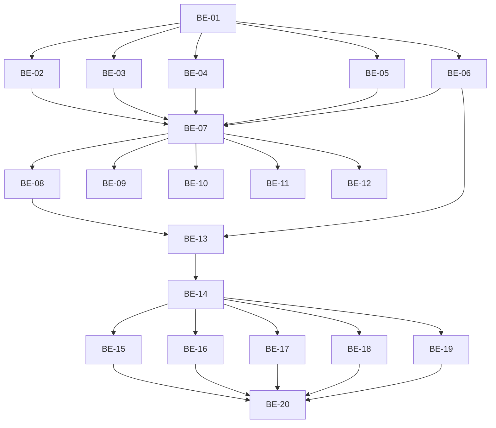

# TASKS — ADR-002 API privilegiada: RPCs + Edge Functions (scoped)

## 1. Origem

- **SPEC:** `.spec/backend/cobranca-formas-pagamento-adr-002/SPEC.md`
- **PLAN:** `.spec/backend/cobranca-formas-pagamento-adr-002/PLAN.md`
- **ADR:** `.spec/prd/cobranca-formas-pagamento/ADRs/ADR-002-api-privilegiada-rpc-edges/ADR.md`
- **Meta:** 20 microtasks atômicas, todas teste-primeiro (RED → GREEN), com caminho físico, RF
  rastreável e 3 cenários BDD.

---

## 2. Backlog

| Task | Tipo | Prioridade | Risco | Complexidade | Status |
|---|---|---|---|---|---|
| BE-01 | Migration / Helpers SQL | P0 | High | 2h30 | Done |
| BE-02 | Migration / RPC register | P0 | High | 4h | Done |
| BE-03 | Migration / RPC settle | P0 | High | 2h30 | Done |
| BE-04 | Migration / RPC cancel | P0 | Medium | 1h30 | Done |
| BE-05 | Migration / RPC void | P0 | Medium | 1h30 | Done |
| BE-06 | Migration / Primitivas de cobrança | P0 | High | 3h | Done |
| BE-07 | Edge / Helpers compartilhados | P0 | High | 2h30 | Done |
| BE-08 | Edge / register | P0 | High | 2h30 | Done |
| BE-09 | Edge / settlement | P0 | High | 2h30 | Done |
| BE-10 | Edge / cancel-charge | P1 | Medium | 1h30 | Done |
| BE-11 | Edge / confirm-charge-manual | P1 | Medium | 1h | Done |
| BE-12 | Edge / void-appointment-payment | P1 | Medium | 1h | Done |
| BE-13 | Edge / create-charge estendida | P0 | High | 3h | Done |
| BE-14 | Test infra | P0 | Medium | 1h30 | Done |
| BE-15 | Test / RPCs (contrato e atomicidade) | P0 | High | 3h | Done |
| BE-16 | Test / concorrência | P0 | High | 2h | Done |
| BE-17 | Test / settle-cancel-void | P0 | High | 2h | Done |
| BE-18 | Test / autorização e PII | P0 | High | 3h | Done |
| BE-19 | Test / falha de gateway | P0 | High | 2h | Done |
| BE-20 | Verificação final | P0 | Medium | 1h | Done |

---

## 3. Grafo de dependências

---

## 4. Rastreabilidade RF → task

| RF | Task(s) |
|---|---|
| RF-01 (funções e grants) | BE-01, BE-02..BE-06, BE-15 |
| RF-02 (atomicidade concluir+registrar) | BE-02, BE-15 |
| RF-03 (replay / conflito) | BE-02, BE-15, BE-19 |
| RF-04 (concorrência e saldo) | BE-06, BE-13, BE-16 |
| RF-05 (concluir sem pagamento) | BE-02, BE-15 |
| RF-06 (total zero) | BE-02, BE-15 |
| RF-07 (profissional só o próprio) | BE-02, BE-09, BE-18 |
| RF-08 (recepção sem faturamento; QR) | BE-09, BE-18 |
| RF-09 (settle) | BE-03, BE-11, BE-17 |
| RF-10 (cancelar cobrança) | BE-04, BE-10, BE-17 |
| RF-11 (estorno lógico) | BE-05, BE-12, BE-17 |
| RF-12 (sem PII) | BE-07, BE-08..BE-13, BE-18 |
| RF-13 (tenant/role só do JWT) | BE-07, BE-08..BE-13, BE-18 |
| RF-14 (`create-charge` estendida) | BE-06, BE-13, BE-19 |
| RF-15 (`db reset` 2×) | BE-01, BE-20 |
| RF-16 (summary único) | BE-01, BE-09, BE-18 |
| RF-17 (nenhum grant novo) | BE-01..BE-06, BE-15 |

---

## 5. Task Backlog

### Task `BE-01`: Migration base — `lote_signature`, `appointment_payment_summary` e grants

- **Constraint Ref:** SPEC §3.1, §3.2, §3.6, I14, I16; RF-01, RF-15, RF-16, RF-17
- **Depends on (PLAN):** —
- **Dependency Type:** Hard (raiz)
- **Layer:** Data / Migration
- **Task Type:** Infra
- **Priority:** P0
- **Risk Level:** High
- **Parallelizable:** No
- **Artifact:** `supabase/migrations/20261106130000_appointment_payments_api_helpers.sql`
- **Framework Detail:** PostgreSQL 15, `create or replace function`, `revoke`/`grant`,
  `alter table … add column if not exists`

#### 📝 Contexto e impacto

- **Descrição:** adicionar `appointment_payments.lote_signature` (hash `^[0-9a-f]{32}$`, nullable)
  e a função de leitura `appointment_payment_summary(p_tenant_id, p_appointment_id)` — fonte única
  de `paid/tip/reserved/remaining/payment_status`.
- **Impacto no domínio:** sem essa função, cada Edge recalcularia saldo em TS e divergiria.

#### 🛡️ Enforcement técnico

- **Regra:** `security invoker`, `stable`, `search_path = public, pg_temp`, `execute` só
  `service_role`; nenhuma policy/grant novo em tabela.
- **Modo de falha:** `anon` executando a função; status divergente entre RPC e Edge.

#### ✅ Critérios de aceite (BDD)

- **Cenário 1 (sucesso):** estado com 6000 pago, 3000 pendente, total 10000 → summary devolve
  `remaining=1000`, `payment_status='aguardando_pix'`, `pending_charge_id` preenchido.
- **Cenário 2 (falha):** `authenticated`/`anon` chamando a função → erro (sem execute);
  `has_function_privilege('service_role', …, 'execute') = true`.
- **Cenário 3 (borda):** total 0 e sem linhas → `quitado`; linha estornada não soma;
  cobrança pendente com `expires_at` no passado não conta em `reserved`.

#### 🛠️ Passos (TDD — teste primeiro)

- [x] `tests/integration/security/payments-rpcs.test.ts`: bloco “catálogo/grants/summary” com os 3
      cenários (RED — função não existe).
- [x] Migration: `alter table` + `create or replace function` + `revoke`/`grant` + `comment on`.
- [x] `npx supabase db reset` e rodar o teste (GREEN); segundo reset (RF-15).

#### 🏁 Definition of Done

- [x] Teste escrito antes da migration.
- [x] `npx supabase db reset` 2× exit 0.
- [x] `prosecdef = false` e `proconfig` com `search_path` verificados no teste.
- [x] `anon`/`authenticated` sem `execute`; `service_role` com.

---

### Task `BE-02`: RPC `register_appointment_payments`

- **Constraint Ref:** SPEC §3.3, §5.1, §8.1, §8.2, I2, I4, I5, I6, I9; RF-02, RF-03, RF-05, RF-06, RF-07
- **Depends on (PLAN):** BE-01
- **Dependency Type:** Hard
- **Layer:** Data / RPC
- **Task Type:** Feature
- **Priority:** P0
- **Risk Level:** High
- **Parallelizable:** No
- **Artifact:** `supabase/migrations/20261106131000_appointment_payments_api_rpcs.sql`
- **Framework Detail:** PL/pgSQL, `jsonb`, `for update`, `on conflict do nothing`

#### 📝 Contexto e impacto

- **Descrição:** registrar lote manual (não-PIX), validar ator/papel/vínculo, travar atendimento,
  validar estado, idempotência por `lote_signature`, saldo e concluir no mesmo commit.
- **Impacto no domínio:** é o único caminho de fechamento com pagamento; substitui a mudança de
  status isolada quando a feature `payments` está ligada.

#### 🛡️ Enforcement técnico

- **Regra:** identidade por parâmetro resolvido na Edge; ator revalidado no SQL; `pix_sistema`
  nunca vira linha; erro por `PT400/403/404/409`.
- **Modo de falha:** cliente escrevendo receita, saldo estourado, lote duplicado, PIX fantasma.

#### ✅ Critérios de aceite (BDD)

- **Cenário 1 (sucesso):** `em_atendimento`, total 10000, lote 6000 dinheiro + 4000 débito,
  `close=true` → 2 linhas, `status='concluido'`, comissão gravada, `payment_status='quitado'`,
  `replayed=false`.
- **Cenário 2 (falha):** total 10000, lote 6000+5000 → `PT409 AMOUNT_EXCEEDS_REMAINING` e
  **nenhuma** linha/status alterado; lote vazio com `close=false` → `PT400 INVALID_BODY`;
  profissional em atendimento alheio → `PT403 PROFESSIONAL_NOT_OWNER`.
- **Cenário 3 (borda):** replay idêntico → `replayed=true` sem escrever; mesma chave com soma
  diferente → `PT409 IDEMPOTENCY_CONFLICT`; `[]` + `close=true` → conclui, audita
  `appointment_concluded_without_payment`, não cria cobrança; total 0 com linha positiva →
  `AMOUNT_EXCEEDS_REMAINING`.

#### 🛠️ Passos (TDD — teste primeiro)

- [x] `tests/integration/security/payments-rpcs.test.ts`: casos 1–3 chamando a RPC via
      `serviceClient()` com fixtures de dois tenants (RED).
- [x] Implementar validação de payload (inteiros, chaves extras, ≤10, ≤1 PIX).
- [x] Implementar lock + estado + idempotência (`lote_signature`) + saldo + inserts + update +
      auditoria + retorno.
- [x] GREEN; repetir cenário de falha com `raise` forçado para provar rollback.

#### 🏁 Definition of Done

- [x] Teste antes do código.
- [x] `create or replace function` + `revoke`/`grant` (sem execute para `anon`/`authenticated`).
- [x] Nenhuma mensagem de erro carrega valor, id ou SQL.
- [x] `npx supabase db reset` 2× exit 0.

---

### Task `BE-03`: RPC `settle_charge_payment`

- **Constraint Ref:** SPEC §3.4, §5.2, I6, I8, I9; RF-09, RF-17
- **Depends on (PLAN):** BE-01
- **Dependency Type:** Hard
- **Layer:** Data / RPC
- **Task Type:** Feature
- **Priority:** P0
- **Risk Level:** High
- **Parallelizable:** Não (mesmo arquivo de migration do BE-02)
- **Artifact:** `supabase/migrations/20261106131000_appointment_payments_api_rpcs.sql`
- **Framework Detail:** PL/pgSQL, `for update` em `charges`, `on conflict (tenant_id, charge_id)`

#### 📝 Contexto e impacto

- **Descrição:** liquidar cobrança: criar a linha `pix_sistema` idempotente, promover `pago`,
  tratar cancelada como anomalia e paga como replay; nunca rebaixar.
- **Impacto no domínio:** é o ponto único de receita PIX (webhook e baixa manual convergem aqui).

#### 🛡️ Enforcement técnico

- **Regra:** `source='asaas'` ⇒ ator nulo; `source='manual'` ⇒ admin ativo; `appointment_id` vem
  da cobrança, nunca do cliente.
- **Modo de falha:** receita dupla, receita fantasma pós-cancelamento, downgrade de `pago`.

#### ✅ Critérios de aceite (BDD)

- **Cenário 1 (sucesso):** cobrança pendente 3000 → 1 linha `pix_sistema/asaas/3000`,
  `charge_status='pago'`, `paid_at` preenchido, auditoria `charge_paid`.
- **Cenário 2 (falha):** `source='manual'` com ator recepção → `PT403 FORBIDDEN`; cobrança de
  assinatura (`appointment_id` nulo) → `PT409 CHARGE_NOT_APPOINTMENT`; charge inexistente no
  tenant → `PT404 CHARGE_NOT_FOUND`.
- **Cenário 3 (borda):** cancelada → `anomaly='charge_paid_after_cancel'`, `payment=null`, nenhuma
  linha, `charges.status` continua `cancelado`; paga com linha → `replayed=true`; paga sem linha
  (legado) → cria 1 linha; `amount_cents=0` → `anomaly='charge_invalid_amount'`.

#### 🛠️ Passos (TDD — teste primeiro)

- [x] `tests/integration/security/payments-settlement-rpcs.test.ts`: 3 cenários (RED).
- [x] Implementar a função com `for update`, coalesce de `paid_at` e auditoria condicional.
- [x] GREEN + reset 2×.

#### 🏁 Definition of Done

- [x] Teste antes do código.
- [x] `update charges … where status <> 'pago'` (nunca rebaixa).
- [x] Unique `(tenant_id, charge_id)` cobre a corrida com a baixa manual.
- [x] Grants conforme SPEC §3.1.

---

### Task `BE-04`: RPC `cancel_charge`

- **Constraint Ref:** SPEC §3.5, §5.3, I7, I8; RF-10
- **Depends on (PLAN):** BE-01
- **Dependency Type:** Hard
- **Layer:** Data / RPC
- **Task Type:** Feature
- **Priority:** P0
- **Risk Level:** Medium
- **Parallelizable:** Sim
- **Artifact:** `supabase/migrations/20261106131000_appointment_payments_api_rpcs.sql`
- **Framework Detail:** PL/pgSQL, `for update`, `raise … using errcode='PT422'`

#### 📝 Contexto e impacto

- **Descrição:** cancelar cobrança localmente após (ou sem) o gateway; `force` só admin; nunca
  apagar; replay idempotente.
- **Impacto no domínio:** remove a reserva de “a receber” sem tocar em receita.

#### 🛡️ Enforcement técnico

- **Regra:** papéis `admin|receptionist`; `force` só admin; `pago` nunca é cancelado.
- **Modo de falha:** cobrança paga virando cancelada; cancelamento local divergente do gateway.

#### ✅ Critérios de aceite (BDD)

- **Cenário 1 (sucesso):** pendente + `gateway_cancelled=true` → `cancelado`, auditoria
  `charge_cancelled`, `replayed=false`.
- **Cenário 2 (falha):** pendente + `gateway_cancelled=false` + `force=false` →
  `PT422 GATEWAY_CANCEL_FAILED` e status **inalterado**; profissional → `PT403 FORBIDDEN`.
- **Cenário 3 (borda):** `pago` → `PT409 CHARGE_NOT_PENDING`; já `cancelado` → `replayed=true`;
  `expirado` + `force=true` de admin → cancela com `gateway_divergence_risk=true`; `expirado` +
  `force=false` sem gateway → `PT422`.

#### 🛠️ Passos (TDD — teste primeiro)

- [x] Casos em `payments-settlement-rpcs.test.ts` (RED).
- [x] Implementar lock, ordem de checagens, auditoria por ação e retorno.
- [x] GREEN + reset 2×.

#### 🏁 Definition of Done

- [x] Teste antes do código.
- [x] Nenhum `DELETE`; status `pago` intocado em todos os caminhos.
- [x] `force` gera `gateway_divergence_risk=true` e ação de auditoria própria.

---

### Task `BE-05`: RPC `void_appointment_payment`

- **Constraint Ref:** SPEC §3.5, §5.3, I7, I-PII; RF-11
- **Depends on (PLAN):** BE-01
- **Dependency Type:** Hard
- **Layer:** Data / RPC
- **Task Type:** Feature
- **Priority:** P0
- **Risk Level:** Medium
- **Parallelizable:** Sim
- **Artifact:** `supabase/migrations/20261106131000_appointment_payments_api_rpcs.sql`
- **Framework Detail:** PL/pgSQL, `btrim`, `for update`, `check` de `voided_*` existente

#### 📝 Contexto e impacto

- **Descrição:** estorno lógico com motivo obrigatório (1..500), ator admin, retorno do resumo e
  `refund_required` quando a linha veio de cobrança.
- **Impacto no domínio:** correção sem apagar receita nem reescrever valor.

#### 🛡️ Enforcement técnico

- **Regra:** nenhum `UPDATE` de `amount_cents`/`tip_cents`/`method`; `voided_at` só na primeira vez.
- **Modo de falha:** “apagar” receita; segunda chamada alterando a data do estorno.

#### ✅ Critérios de aceite (BDD)

- **Cenário 1 (sucesso):** linha 3000 com `charge_id` → `voided=true`, `refund_required=true`,
  `settlement.total_paid_cents` cai 3000, linha permanece.
- **Cenário 2 (falha):** recepção → `PT403 FORBIDDEN`; motivo vazio/só espaços → `PT400
  INVALID_BODY`; pagamento de outro tenant → `PT404 PAYMENT_NOT_FOUND`.
- **Cenário 3 (borda):** segunda chamada → `replayed=true` e `voided_at` original preservado;
  linha sem `charge_id` → `refund_required=false`.

#### 🛠️ Passos (TDD — teste primeiro)

- [x] Casos em `payments-settlement-rpcs.test.ts` (RED).
- [x] Implementar validação do motivo, lock, update e auditoria (`reason` + `reason_length`).
- [x] GREEN + reset 2×.

#### 🏁 Definition of Done

- [x] Teste antes do código.
- [x] `voided_at/by/reason` consistentes (check da ADR-001 satisfeito).
- [x] Log técnico não recebe o texto do motivo (só `reason_length`).

---

### Task `BE-06`: Primitivas `reserve_appointment_charge` / `attach_charge_gateway_data`

- **Constraint Ref:** SPEC §3.7, §8.1, §9.1, I1, I4; RF-14, RF-04
- **Depends on (PLAN):** BE-01
- **Dependency Type:** Hard
- **Layer:** Data / RPC interna
- **Task Type:** Feature
- **Priority:** P0
- **Risk Level:** High
- **Parallelizable:** Não (concorrência depende dela)
- **Artifact:** `supabase/migrations/20261106130000_appointment_payments_api_helpers.sql`
- **Framework Detail:** PL/pgSQL, `for update` em `appointments`, `insert … on conflict do nothing`

#### 📝 Contexto e impacto

- **Descrição:** reservar a cobrança PIX sob o **mesmo lock** do atendimento (saldo + idempotência
  + auditoria numa transação) e anexar os dados do gateway depois.
- **Impacto no domínio:** fecha a corrida `register` × `create-charge` que violaria RF-15 (D-06).

#### 🛡️ Enforcement técnico

- **Regra:** saldo calculado dentro da função; nunca em TypeScript; reserva nunca é apagada.
- **Modo de falha:** duas cobranças no mesmo atendimento; saldo estourado; cobrança órfã no gateway.

#### ✅ Critérios de aceite (BDD)

- **Cenário 1 (sucesso):** atendimento concluído 10000, pago 6000, sem cobrança, `amount=3000` →
  cobrança `pendente` 3000, `reused=false`, auditoria `charge_reserved`.
- **Cenário 2 (falha):** `amount=5000` → `PT409 AMOUNT_EXCEEDS_REMAINING`; atendimento
  `em_atendimento` → `PT409 APPOINTMENT_INVALID_STATE`; profissional não dono → `PT403`.
- **Cenário 3 (borda):** segunda chamada com a mesma `idempotency_key` → `reused=true`, 1 linha;
  `amount_cents` nulo → usa o saldo restante; saldo 0 → `AMOUNT_EXCEEDS_REMAINING`; reserva
  `cancelada` sem `asaas_payment_id` + mesma chave → reabre para `pendente`.

#### 🛠️ Passos (TDD — teste primeiro)

- [x] `tests/integration/security/payments-concurrency.test.ts`: bloco “reserva sob lock” (RED).
- [x] Implementar `reserve_appointment_charge` e `attach_charge_gateway_data` + grants.
- [x] GREEN + reset 2×.

#### 🏁 Definition of Done

- [x] Teste antes do código.
- [x] `for update` em `appointments` presente nas duas chamadas que consomem saldo.
- [x] `attach` grava os 3 campos numa instrução; idempotente quando já coincidem.
- [x] Nenhuma linha de `charges` é apagada em nenhum caminho.

---

### Task `BE-07`: Helpers compartilhados de Edge (`identity`, `http`, `payments`)

- **Constraint Ref:** SPEC §6.7, §7, I2, I3, I11, I13, I-PII; RF-12, RF-13, RF-16
- **Depends on (PLAN):** BE-02..BE-06
- **Dependency Type:** Hard
- **Layer:** Edge / Shared
- **Task Type:** Infra
- **Priority:** P0
- **Risk Level:** High
- **Parallelizable:** Não
- **Artifact:** `supabase/functions/_shared/{identity,http,payments}.ts`
- **Framework Detail:** Deno, `jsr:@supabase/supabase-js@2`, `npm:zod@3.23.8`

#### 📝 Contexto e impacto

- **Descrição:** um `resolveIdentity` (JWT → `auth.getUser` → `profiles` `tenant_id, role, active`),
  um envelope HTTP com `ApiError`/`mapRpcError`/`logEvent` (whitelist) e um `loadSettlement` único.
- **Impacto no domínio:** elimina 6 cópias de identidade e a aritmética de saldo em TS.

#### 🛡️ Enforcement técnico

- **Regra:** `role/tenant` só do profile; `active=false` ⇒ 403; log só com campos da whitelist.
- **Modo de falha:** vazamento de PII em log; settlement divergente entre endpoints.

#### ✅ Critérios de aceite (BDD)

- **Cenário 1 (sucesso):** `resolveIdentity` com JWT válido devolve `{userId, tenantId, role}`;
  `loadSettlement` devolve os números do `appointment_payment_summary` sem recalcular.
- **Cenário 2 (falha):** token ausente → 401 `UNAUTHENTICATED`; `active=false` → 403 `FORBIDDEN`;
  `PT409` da RPC → HTTP 409 com `code` estável.
- **Cenário 3 (borda):** `error.message` fora do padrão de código → 500 `INTERNAL` (não ecoa o
  texto); `logEvent` com payload contendo `phone`/`name` não inclui as chaves.

#### 🛠️ Passos (TDD — teste primeiro)

- [x] `supabase/functions/register-appointment-payments/handler.test.ts` (fake service): asserções
      de ordem identidade→body→RPC e de mapeamento (RED).
- [x] Implementar os 3 módulos; migrar `create-charge` para `_shared/identity.ts`.
- [x] `npm run check:functions` (GREEN).

#### 🏁 Definition of Done

- [x] Nenhuma Edge nova duplica `resolveIdentity`.
- [x] `logEvent` só aceita chaves da whitelist (tipo TS fechado).
- [x] `mapRpcError` cobre `PT400/403/404/409/422/500` e `INTERNAL` como fallback.

---

### Task `BE-08`: Edge `register-appointment-payments`

- **Constraint Ref:** SPEC §5.4, §6.1, I2, I5, I9; RF-02, RF-03, RF-14
- **Depends on (PLAN):** BE-07
- **Dependency Type:** Hard
- **Layer:** Edge / Handler
- **Task Type:** Feature
- **Priority:** P0
- **Risk Level:** High
- **Parallelizable:** Sim
- **Artifact:** `supabase/functions/register-appointment-payments/{index,handler,schemas}.ts`
- **Framework Detail:** Deno + zod `strict`, RPC + `reserve`/`attach`/`cancel_charge`

#### 📝 Contexto e impacto

- **Descrição:** orquestrar o fechamento: RPC de registro → (se PIX) reserva → gateway → attach →
  settlement relido; falha do gateway devolve 422 com settlement persistido.
- **Impacto no domínio:** é o endpoint que a UI de fechamento chama.

#### 🛡️ Enforcement técnico

- **Regra:** `tenant_id`/`role` no corpo ⇒ 400; `payments` 0..10; `pix_sistema` ≤1; nenhuma
  escrita direta no ledger.
- **Modo de falha:** PIX vira receita sem pagamento; lote aplicado duas vezes; 500 com PII.

#### ✅ Critérios de aceite (BDD)

- **Cenário 1 (sucesso):** 6000 dinheiro + 3000 PIX, gateway ok → 200 `{settlement, charge}` com
  `payment_status='aguardando_pix'`, `reserved=3000`.
- **Cenário 2 (falha):** gateway falha → 422 `GATEWAY_ERROR` com `settlement` (6000 persistidos),
  `pix_amount_cents=3000`, cobrança `cancelado`, **nenhuma** linha PIX.
- **Cenário 3 (borda):** body com `tenant_id` → 400 `INVALID_BODY` e nada escrito; `idempotency_key`
  ausente → 400 `IDEMPOTENCY_KEY_REQUIRED`; replay após 422 com a mesma chave → `replayed=true` e
  nova reserva PIX sem duplicar linhas.

#### 🛠️ Passos (TDD — teste primeiro)

- [x] `schemas.test.ts` (strict, limites) e casos de Edge em `payments-edges-auth.test.ts` (RED).
- [x] `schemas.ts`, `handler.ts`, `index.ts`; registrar o diretório em `package.json`.
- [x] `npm run check:functions` + `deno test` do diretório (GREEN).

#### 🏁 Definition of Done

- [x] `saída` usa apenas `_shared/http.ts`.
- [x] Settlement relido **depois** da cobrança (nunca o snapshot anterior).
- [x] Nenhum `insert` em `appointment_payments` no código da Edge.

---

### Task `BE-09`: Edge `get-appointment-settlement`

- **Constraint Ref:** SPEC §5.5, §6.2, I3, I11, I12; RF-07, RF-08, RF-16
- **Depends on (PLAN):** BE-07
- **Dependency Type:** Hard
- **Layer:** Edge / Read
- **Task Type:** Feature
- **Priority:** P0
- **Risk Level:** High
- **Parallelizable:** Sim
- **Artifact:** `supabase/functions/get-appointment-settlement/{index,handler,schemas}.ts`
- **Framework Detail:** Deno, `service_role`, `loadSettlement`

#### 📝 Contexto e impacto

- **Descrição:** leitura financeira de **um** atendimento, com RBAC por papel, vínculo do
  profissional, janela de QR e `permissions` derivadas no servidor.
- **Impacto no domínio:** única leitura financeira de recepção/profissional.

#### 🛡️ Enforcement técnico

- **Regra:** sem lista/período/agregado; QR só admin ou `em_atendimento`; `void_reason` só admin.
- **Modo de falha:** recepção montando relatório; QR exposto após conclusão.

#### ✅ Critérios de aceite (BDD)

- **Cenário 1 (sucesso):** admin em `em_atendimento` → settlement completo, `can_view_qr=true`,
  `can_confirm_manual=true`, `remaining` correto.
- **Cenário 2 (falha):** profissional em atendimento alheio → 403 `PROFESSIONAL_NOT_OWNER`;
  atendimento de outro tenant → 404; sem JWT → 401.
- **Cenário 3 (borda):** recepção em `concluido` com cobrança pendente → `pix_qr_code=null`,
  `can_view_qr=false`, `void_reason=null`, mas `voided_at` visível; admin em `concluido` → QR
  visível.

#### 🛠️ Passos (TDD — teste primeiro)

- [x] `payments-edges-auth.test.ts`: matriz por papel + QR (RED).
- [x] Implementar handler com `loadSettlement`; sem query sem `tenant_id`.
- [x] GREEN + `check:functions`.

#### 🏁 Definition of Done

- [x] Toda query com `.eq("tenant_id", identity.tenantId)`.
- [x] `permissions` calculadas no servidor.
- [x] Nenhum endpoint de lista criado.

---

### Task `BE-10`: Edge `cancel-charge`

- **Constraint Ref:** SPEC §5.6, §6.3, I7, I8; RF-10
- **Depends on (PLAN):** BE-07
- **Dependency Type:** Hard
- **Layer:** Edge / Handler
- **Task Type:** Feature
- **Priority:** P1
- **Risk Level:** Medium
- **Parallelizable:** Sim
- **Artifact:** `supabase/functions/cancel-charge/{index,handler,schemas}.ts`
- **Framework Detail:** Deno, `asaasFetch` (`DELETE /payments/{id}`), RPC `cancel_charge`

#### 📝 Contexto e impacto

- **Descrição:** gateway primeiro, local depois; 404 do gateway = já cancelada; falha mantém local.
- **Impacto no domínio:** tira a reserva de “a receber” sem divergência silenciosa.

#### 🛡️ Enforcement técnico

- **Regra:** `force` só admin; `asaas_payment_id is null` nunca chama o gateway.
- **Modo de falha:** status local cancelado com cobrança ativa no gateway (sem sinalizar).

#### ✅ Critérios de aceite (BDD)

- **Cenário 1 (sucesso):** pendente com `asaas_payment_id` → gateway 200 → local `cancelado`,
  `gateway_divergence_risk=false`.
- **Cenário 2 (falha):** gateway 500 e `force=false` → 422 `GATEWAY_CANCEL_FAILED`, status local
  inalterado; profissional → 403.
- **Cenário 3 (borda):** `asaas_payment_id=null` → cancela local sem chamada externa; gateway 404
  → trata como cancelada; `pago` → 409 `CHARGE_NOT_PENDING`; `force=true` de admin com gateway
  falhando → 200 com `gateway_divergence_risk=true`.

#### 🛠️ Passos (TDD — teste primeiro)

- [x] `payments-settlement-rpcs.test.ts`: casos de Edge (usando gateway apontado para porta
  fechada) (RED).
- [x] Implementar handler; adicionar `cancelPayment` em `_shared/asaas.ts`.
- [x] GREEN + `check:functions`.

#### 🏁 Definition of Done

- [x] Falha do gateway nunca altera o local sem `force` de admin.
- [x] Log com `charge_id`, `code` — sem QR/copia-e-cola.
- [x] 404 do gateway coberto por teste.

---

### Task `BE-11`: Edge `confirm-charge-manual`

- **Constraint Ref:** SPEC §5.7, §6.4, I8; RF-09
- **Depends on (PLAN):** BE-07
- **Dependency Type:** Hard
- **Layer:** Edge / Handler
- **Task Type:** Feature
- **Priority:** P1
- **Risk Level:** Medium
- **Parallelizable:** Sim
- **Artifact:** `supabase/functions/confirm-charge-manual/{index,handler,schemas}.ts`
- **Framework Detail:** Deno, RPC `settle_charge_payment(source='manual')`

#### 📝 Contexto e impacto

- **Descrição:** admin confirma PIX manualmente; cobrança cancelada ⇒ 409 sem receita; paga ⇒
  replay.
- **Impacto no domínio:** recebe o dinheiro que chegou fora do webhook.

#### 🛡️ Enforcement técnico

- **Regra:** só admin; `paid_at` opcional e `timestamptz`; nenhuma chamada ao gateway.
- **Modo de falha:** receita em cobrança cancelada; webhook posterior duplicando.

#### ✅ Critérios de aceite (BDD)

- **Cenário 1 (sucesso):** pendente → 200 `{settlement, payment, replayed:false}`,
  `source='manual'`, `received_by` = admin.
- **Cenário 2 (falha):** recepção → 403 `FORBIDDEN`; cancelada → 409 `CHARGE_CANCELLED` e nenhuma
  linha; `paid_at` inválido → 400 `INVALID_BODY`.
- **Cenário 3 (borda):** já paga → 200 `replayed=true`; `paid_at` explícito no passado → usado como
  `received_at`.

#### 🛠️ Passos (TDD — teste primeiro)

- [x] Casos em `payments-settlement-rpcs.test.ts` (RED).
- [x] Implementar pré-leitura do charge + chamada da RPC.
- [x] GREEN + `check:functions`.

#### 🏁 Definition of Done

- [x] Nenhuma chamada ao gateway neste endpoint.
- [x] `CHARGE_CANCELLED` distinto de `CHARGE_NOT_PENDING` (testado).
- [x] Settlement relido após a RPC.

---

### Task `BE-12`: Edge `void-appointment-payment`

- **Constraint Ref:** SPEC §5.8, §6.5, I7; RF-11
- **Depends on (PLAN):** BE-07
- **Dependency Type:** Hard
- **Layer:** Edge / Handler
- **Task Type:** Feature
- **Priority:** P1
- **Risk Level:** Medium
- **Parallelizable:** Sim
- **Artifact:** `supabase/functions/void-appointment-payment/{index,handler,schemas}.ts`
- **Framework Detail:** Deno, RPC `void_appointment_payment`

#### 📝 Contexto e impacto

- **Descrição:** admin estorna com motivo; devolve settlement e `refund_required`; não chama o
  gateway.
- **Impacto no domínio:** correção auditável sem apagar receita.

#### 🛡️ Enforcement técnico

- **Regra:** motivo 1..500 após `btrim`; log só com `reason_length`.
- **Modo de falha:** PII em log; estorno silencioso sem motivo.

#### ✅ Critérios de aceite (BDD)

- **Cenário 1 (sucesso):** 200 `{settlement, refund_required:true}`.
- **Cenário 2 (falha):** recepção → 403; motivo > 500 → 400 `INVALID_BODY`; pagamento de outro
  tenant → 404.
- **Cenário 3 (borda):** replay → 200 com `replayed=true` e settlement recalculado; linha sem
  `charge_id` → `refund_required=false`.

#### 🛠️ Passos (TDD — teste primeiro)

- [x] Casos em `payments-edges-auth.test.ts` (RED).
- [x] Implementar handler + schema `reason`.
- [x] GREEN + `check:functions`.

#### 🏁 Definition of Done

- [x] Nenhum `console.*` com o texto do motivo.
- [x] Settlement relido após a RPC.
- [x] Erros mapeados por `_shared/http.ts`.

---

### Task `BE-13`: Extensão de `create-charge` (valor da parcela, idempotência, reserva)

- **Constraint Ref:** SPEC §5.9, §6.6, §9.1, I4, I9; RF-14, RF-03, RF-04
- **Depends on (PLAN):** BE-06, BE-07, BE-08
- **Dependency Type:** Hard
- **Layer:** Edge / Handler
- **Task Type:** Feature
- **Priority:** P0
- **Risk Level:** High
- **Parallelizable:** Não
- **Artifact:** `supabase/functions/create-charge/{handler,schemas}.ts`, `_shared/asaas.ts`
- **Framework Detail:** Deno, `reserve_appointment_charge` → Asaas → `attach_charge_gateway_data`

#### 📝 Contexto e impacto

- **Descrição:** aceitar `amount_cents` (parcela) e `idempotency_key`; reservar antes do gateway;
  reapresentar cobrança pendente; retomar por `externalReference`; 422 quando o gateway falha.
- **Impacto no domínio:** o PIX deixa de ser “preço cheio automático” e passa a ser parcela
  escolhida, com 1 cobrança por atendimento.

#### 🛡️ Enforcement técnico

- **Regra:** saldo validado na função SQL; `externalReference = charges.id`; `description` sem PII;
  `value` só formatação.
- **Modo de falha:** cobrança órfã no gateway; duas cobranças no mesmo atendimento; saldo estourado.

#### ✅ Critérios de aceite (BDD)

- **Cenário 1 (sucesso):** `amount_cents=3000` num atendimento concluído com saldo 3000 → 200 com
  `charge_id`, `reused=false`; segunda chamada com a mesma chave → `reused=true`, 1 linha.
- **Cenário 2 (falha):** `amount_cents=5000` com saldo 3000 → 409 `AMOUNT_EXCEEDS_REMAINING`;
  tenant sem config → 422 `ASAAS_NOT_CONFIGURED`; gateway indisponível → 422 `GATEWAY_ERROR` com
  reserva `cancelado` e sem QR.
- **Cenário 3 (borda):** `amount_cents` ausente → usa saldo restante; saldo 0 → 409; cobrança
  `pago` existente → 409 `CHARGE_NOT_PENDING`; crash entre reserva e gateway (reserva com
  `asaas_payment_id=null`) → retoma a mesma cobrança, não cria outra.

#### 🛠️ Passos (TDD — teste primeiro)

- [x] `payments-gateway.test.ts` + `schemas.test.ts` de `create-charge` (RED).
- [x] `asaasBaseUrl` com `ASAAS_API_BASE_URL`; `asaasFetch` com `try/catch` e `cancelPayment`.
- [x] `schemas.ts` + handler em fases reserva→gateway→attach; auditoria de falha na Edge.
- [x] GREEN + `check:functions` + `test:functions`.

#### 🏁 Definition of Done

- [x] Nenhum saldo calculado em TypeScript.
- [x] Reserva cancelada (não apagada) em falha de gateway.
- [x] Cliente antigo (sem `amount_cents`) continua funcionando (RNF-11).

---

### Task `BE-14`: Infra de teste (fixtures, gateway determinístico, `test:functions`)

- **Constraint Ref:** SPEC §12.1, §12.2; RF-15
- **Depends on (PLAN):** BE-13
- **Dependency Type:** Hard
- **Layer:** Test / Infra
- **Task Type:** Infra
- **Priority:** P0
- **Risk Level:** Medium
- **Parallelizable:** Não
- **Artifact:** `tests/integration/helpers/payments-fixtures.ts`,
  `tests/integration/global-setup.ts`, `package.json`
- **Framework Detail:** Vitest, helpers existentes (`sql`, `clients`, `users`), Deno

#### 📝 Contexto e impacto

- **Descrição:** estender fixtures (status, vínculo de profissional, recebimentos, cobrança com QR),
  fixar `ASAAS_API_BASE_URL=http://127.0.0.1:1` na suíte e registrar os 5 diretórios em
  `test:functions`.
- **Impacto no domínio:** sem isso, os testes de BE-15..BE-19 não são determinísticos.

#### 🛡️ Enforcement técnico

- **Regra:** nenhum teste com rede externa; limpeza `appointment_payments → charges → appointments`.
- **Modo de falha:** suíte flaky; funções novas sem teste unitário no `test:functions`.

#### ✅ Critérios de aceite (BDD)

- **Cenário 1 (sucesso):** `seedAppointment({status:'em_atendimento', professionalProfileId})` cria
  o grafo e o `cleanupPaymentFixtures` limpa sem violar FK.
- **Cenário 2 (falha):** tentar criar `charges` duplicada para o mesmo atendimento → erro do
  helper com o código (não silencioso); `ASAAS_API_BASE_URL` ausente → teste de gateway falha
  explicitamente.
- **Cenário 3 (borda):** dois tenants no mesmo `afterAll` → limpeza por lista; usuário profissional
  sem `professionals.profile_id` → 403 esperado.

#### 🛠️ Passos (TDD — teste primeiro)

- [x] Estender fixtures e escrever um caso de fumaça em `payments-rpcs.test.ts` (RED).
- [x] `global-setup.ts`: definir o override antes de `ensureFunctionsDefault()`.
- [x] `package.json`: adicionar os 5 diretórios ao script `test:functions`.

#### 🏁 Definition of Done

- [x] `npm run test:functions` inclui os novos diretórios e passa.
- [x] Nenhum teste depende de `sandbox.asaas.com`.
- [x] `cleanupPaymentFixtures` antes de `deleteTestUsers` em todos os arquivos novos.

---

### Task `BE-15`: Integração — contrato das RPCs, atomicidade e grants

- **Constraint Ref:** SPEC §3, §7, §8, §10; RF-01, RF-02, RF-03, RF-05, RF-06, RF-15, RF-17
- **Depends on (PLAN):** BE-14
- **Dependency Type:** Hard
- **Layer:** Test / Integration
- **Task Type:** Test
- **Priority:** P0
- **Risk Level:** High
- **Parallelizable:** Sim
- **Artifact:** `tests/integration/security/payments-rpcs.test.ts`
- **Framework Detail:** Vitest, `serviceClient()`, `sql()`, `createTenantMember`

#### 📝 Contexto e impacto

- **Descrição:** cobrir catálogo/grants, assinatura, rollback forçado, replay/conflito, lote vazio,
  total zero e a superfície de funções.
- **Impacto no domínio:** prova que o cliente não escreve e que o commit é único.

#### 🛡️ Enforcement técnico

- **Regra:** asserts de `error.code === 'PT4xx'` **e** `error.message`; `has_function_privilege`.
- **Modo de falha:** função executável por `authenticated`; status concluído sem linha.

#### ✅ Critérios de aceite (BDD)

- **Cenário 1 (sucesso):** `register` em `em_atendimento` com `close=true` → linha + `concluido` +
  `appointment_commissions` no mesmo commit.
- **Cenário 2 (falha):** `raise` forçado na inserção de auditoria → transação revertida (status
  continua `em_atendimento`, sem linha, sem comissão).
- **Cenário 3 (borda):** `[]` + `close=true` → `sem_pagamento` + auditoria; total 0 → `quitado`;
  `anon`/`authenticated` chamando a RPC → não-2xx e `has_function_privilege=false`.

#### 🛠️ Passos (TDD — teste primeiro)

- [x] Escrever os casos (RED onde a função ainda não existe; GREEN após BE-02..BE-05).
- [x] Rodar `npm run test:integration -- tests/integration/security/payments-rpcs.test.ts`.

#### 🏁 Definition of Done

- [x] Todos os casos verdes; nenhum `skip`.
- [x] `db reset` 2× verde.
- [x] Nenhuma asserção por mensagem em português.

---

### Task `BE-16`: Integração — concorrência e saldo

- **Constraint Ref:** SPEC §8.1; RF-04, RF-14
- **Depends on (PLAN):** BE-14
- **Dependency Type:** Hard
- **Layer:** Test / Integration
- **Task Type:** Test
- **Priority:** P0
- **Risk Level:** High
- **Parallelizable:** Sim
- **Artifact:** `tests/integration/security/payments-concurrency.test.ts`
- **Framework Detail:** Vitest, `Promise.all`, dois tenants, RPC/Edge

#### 📝 Contexto e impacto

- **Descrição:** provar que o lock do atendimento serializa register × register e register ×
  reserve, sem estourar `price_cents`.
- **Impacto no domínio:** RF-15 é o requisito que o desenho da ADR-003 violaria sem D-06.

#### 🛡️ Enforcement técnico

- **Regra:** `sum(amount_cents) ≤ price_cents` ao final de todo cenário.
- **Modo de falha:** duas receitas concorrentes aceitas; replay tratado como conflito.

#### ✅ Critérios de aceite (BDD)

- **Cenário 1 (sucesso):** total 10000, saldo 1000; dois `register` de 1000 com chaves diferentes
  → exatamente um 200 e um `PT409 AMOUNT_EXCEEDS_REMAINING`/`replayed`.
- **Cenário 2 (falha):** total 10000, pago 6000; `register(4000)` e `reserve(3000)` em paralelo →
  nunca `paid + reserved > 10000`.
- **Cenário 3 (borda):** duas `reserve` com a **mesma** chave em paralelo → 1 cobrança,
  `reused=true` na segunda; chaves diferentes → 1 cobrança e `PENDING_CHARGE_EXISTS`/
  `CHARGE_NOT_PENDING` na outra.

#### 🛠️ Passos (TDD — teste primeiro)

- [x] Escrever os 3 casos; rodar 10× para checar não-flakiness (RED/GREEN).
- [x] Ajustar a função se algum caso revelar janela sem lock.

#### 🏁 Definition of Done

- [x] 3 casos verdes em 10 execuções consecutivas.
- [x] Nenhuma escrita concorrente gera `5xx`.
- [x] Evidência de `sum(amount) ≤ price` em cada caso.

---

### Task `BE-17`: Integração — settle, cancel e void (RPC + Edge)

- **Constraint Ref:** SPEC §3.4, §3.5, §5.6..§5.8, §6.3..§6.5; RF-09, RF-10, RF-11
- **Depends on (PLAN):** BE-14
- **Dependency Type:** Hard
- **Layer:** Test / Integration
- **Task Type:** Test
- **Priority:** P0
- **Risk Level:** High
- **Parallelizable:** Sim
- **Artifact:** `tests/integration/security/payments-settlement-rpcs.test.ts`
- **Framework Detail:** Vitest, seed de `charges` com QR, Edge com gateway fechado

#### 📝 Contexto e impacto

- **Descrição:** cobrir anomalia pós-cancelamento, replay de settle, legado sem linha, `force` de
  cancelamento, `pago` intocável e estorno lógico.
- **Impacto no domínio:** fecha os três caminhos que não passam pelo fechamento.

#### 🛡️ Enforcement técnico

- **Regra:** nenhum caminho pode rebaixar `pago` nem apagar linha.
- **Modo de falha:** receita fantasma; estorno que apaga histórico.

#### ✅ Critérios de aceite (BDD)

- **Cenário 1 (sucesso):** settle de pendente → 1 linha `pix_sistema`, `pago`, auditoria
  `charge_paid`.
- **Cenário 2 (falha):** settle de cancelada → `anomaly`, sem linha; cancel com gateway falhando e
  `force=false` → 422 sem mudança local; void de recepção → 403.
- **Cenário 3 (borda):** settle de paga com linha → `replayed=true`; paga sem linha → cria 1;
  cancelar `pago` → 409; estorno duplo → `replayed=true` com `voided_at` original.

#### 🛠️ Passos (TDD — teste primeiro)

- [x] Escrever os casos (RED).
- [x] Rodar contra as RPCs e as Edges; corrigir handlers conforme necessário.

#### 🏁 Definition of Done

- [x] 100% dos casos verdes.
- [x] `charges.status='pago'` em todos os cenários de cancel/settle.
- [x] Nenhuma linha apagada em nenhum cenário.

---

### Task `BE-18`: Integração — autorização por papel, cross-tenant, QR e PII

- **Constraint Ref:** SPEC §4, §5.5, §6.7, I2, I3, I11, I12, I-PII; RF-07, RF-08, RF-12, RF-13, RF-16
- **Depends on (PLAN):** BE-14
- **Dependency Type:** Hard
- **Layer:** Test / Integration
- **Task Type:** Test
- **Priority:** P0
- **Risk Level:** High
- **Parallelizable:** Sim
- **Artifact:** `tests/integration/security/payments-edges-auth.test.ts`
- **Framework Detail:** Vitest, `callFunction`, `createTenantMember`, `signInWithPassword`

#### 📝 Contexto e impacto

- **Descrição:** provar a matriz de autorização de ponta a ponta nas 5 edges + `create-charge`,
  incluindo body com `tenant_id`, `active=false`, QR e ausência de PII.
- **Impacto no domínio:** é o teste que impede escrita/leitura financeira indevida.

#### 🛡️ Enforcement técnico

- **Regra:** cada caso negativo também verifica o **estado do banco** (nada escrito).
- **Modo de falha:** recepção lendo faturamento; profissional operando atendimento alheio.

#### ✅ Critérios de aceite (BDD)

- **Cenário 1 (sucesso):** admin, recepção e profissional dono registram/leem conforme a matriz;
  profissional dono recebe 200.
- **Cenário 2 (falha):** recepção em `confirm-charge-manual`/`void` → 403; profissional alheio →
  403 `PROFESSIONAL_NOT_OWNER`; usuário do tenant B em atendimento do A → 404 e nenhuma escrita;
  body com `tenant_id` → 400 e nenhuma escrita.
- **Cenário 3 (borda):** recepção em atendimento `concluido` → QR `null`, `can_view_qr=false`,
  `void_reason=null`; `active=false` → 403 em todos os endpoints; resposta e `audit_log` sem
  nome/telefone/documento/QR/copia-e-cola.

#### 🛠️ Passos (TDD — teste primeiro)

- [x] Escrever a matriz completa (6 endpoints × 4 identidades) (RED).
- [x] Inspecionar `audit_log` do cenário e assertar whitelist de `metadata`.
- [x] Rodar até verde; nenhum `test.skip`.

#### 🏁 Definition of Done

- [x] Matriz completa coberta (sem lacuna de papel).
- [x] Cross-tenant com dois tenants reais.
- [x] Assert de PII em `audit_log` e no corpo da resposta.

---

### Task `BE-19`: Integração — falha de gateway e retry

- **Constraint Ref:** SPEC §6.1, §6.6, §9.1, §12.2; RF-03, RF-14
- **Depends on (PLAN):** BE-14, BE-13
- **Dependency Type:** Hard
- **Layer:** Test / Integration
- **Task Type:** Test
- **Priority:** P0
- **Risk Level:** High
- **Parallelizable:** Sim
- **Artifact:** `tests/integration/security/payments-gateway.test.ts`
- **Framework Detail:** Vitest, `ASAAS_API_BASE_URL=http://127.0.0.1:1`, Edge functions

#### 📝 Contexto e impacto

- **Descrição:** provar o 422 `GATEWAY_ERROR` com settlement persistido, reserva cancelada, zero
  linha PIX e retry idempotente.
- **Impacto no domínio:** é a garantia de que o dinheiro recebido não se perde com PIX indisponível.

#### 🛡️ Enforcement técnico

- **Regra:** nenhuma dependência de rede externa; assert de estado local além do HTTP.
- **Modo de falha:** linha PIX criada sem pagamento; atendimento não concluído; cobrança órfã.

#### ✅ Critérios de aceite (BDD)

- **Cenário 1 (sucesso):** `register` 6000 dinheiro + 3000 PIX com gateway fechado → 422 com
  `settlement.total_paid_cents=6000`, `payment_status='parcial'`, `pix_amount_cents=3000`,
  `charges['cancelado']`, zero linha `pix_sistema`.
- **Cenário 2 (falha):** `create-charge` isolado com gateway fechado → 422, reserva `cancelado`,
  nenhum QR gravado.
- **Cenário 3 (borda):** retry do lote com a mesma chave → `replayed=true`, sem linhas duplicadas;
  retry da cobrança com a mesma chave reabre a reserva e falha de novo sem criar segunda linha.

#### 🛠️ Passos (TDD — teste primeiro)

- [x] Escrever os casos (RED).
- [x] Garantir que `global-setup` fixa o override (BE-14).
- [x] Rodar 5× para checar determinismo.

#### 🏁 Definition of Done

- [x] Nenhuma chamada a host externo (assert de tempo < 2s por caso).
- [x] Estado local verificado por query direta.
- [x] Retry não duplica receita.

---

### Task `BE-20`: Portão de verificação final

- **Constraint Ref:** SPEC §12.4, PLAN §9; RF-15
- **Depends on (PLAN):** BE-15..BE-19
- **Dependency Type:** Hard
- **Layer:** Verificação
- **Task Type:** Gate
- **Priority:** P0
- **Risk Level:** Medium
- **Parallelizable:** Não
- **Artifact:** relatório de harness (`harness/cobranca-formas-pagamento-adr-002.json`)
- **Framework Detail:** `harness.config.json` (`commands.suiteFull`)

#### 📝 Contexto e impacto

- **Descrição:** executar a bateria completa e registrar evidência, incluindo ausência de regressão
  na suíte existente.
- **Impacto no domínio:** sem este portão, a entrega não pode ser declarada pronta.

#### 🛡️ Enforcement técnico

- **Regra:** qualquer falha (nova ou pré-existente) bloqueia a conclusão.
- **Modo de falha:** “verde” declarado sem evidência de comando.

#### ✅ Critérios de aceite (BDD)

- **Cenário 1 (sucesso):** `db reset` 2×, `check:functions`, `test:functions`, os 5 arquivos de
  integração, `npm test` e `npm run typecheck` terminam com exit 0.
- **Cenário 2 (falha):** qualquer comando não-zero → parar, registrar classe/linha e corrigir.
- **Cenário 3 (borda):** suíte pré-existente vermelha → tratar como débito P1 antes de concluir;
  registrar no Brain.

#### 🛠️ Passos

- [x] Rodar os comandos de SPEC §12.4 na ordem.
- [x] Preencher o report: comandos, counts, falhas, arquivos tocados, lacunas D-01..D-13.
- [x] Conferir que `supabase/functions/asaas-webhook/**` e `src/**` não foram alterados.
- [x] `brain_store` da sessão (scope `projetos`).

#### 🏁 Definition of Done

- [x] Todos os comandos com exit 0 e evidence no report.
- [x] `git status` sem alteração em `asaas-webhook`/`src`.
- [x] D-09 encaminhada ao merge da ADR-003 (nota no report).
