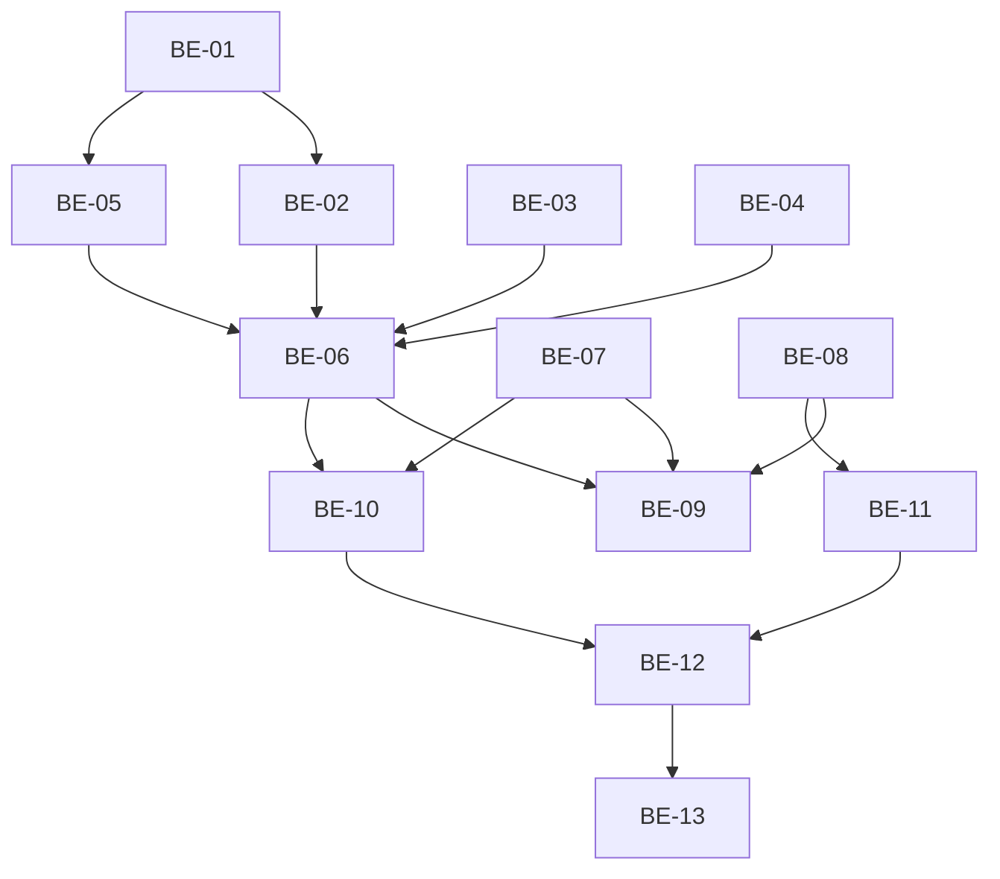

# PLAN — ADR-003 PIX do sistema: webhook idempotente + cutover/backfill (scoped)

## 1. Contexto e rastreabilidade

- **SPEC:** `.spec/backend/cobranca-formas-pagamento-adr-003/SPEC.md`
- **ADR:** `.spec/prd/cobranca-formas-pagamento/ADRs/ADR-003-pix-sistema-idempotente/ADR.md`
- **Depende de (entregue):** ADR-001 (`20261106120000_appointment_payments_ledger.sql`) e ADR-002
  (`20261106130000`, `20261106131000`, `20261106132000`, 5 Edges, `create-charge`).
- **PRD:** `.spec/prd/cobranca-formas-pagamento/PRD.md` (RF-14, RF-16..RF-19; RNF-07/08/11/12).
- **Goal:** substituir `supabase/functions/asaas-webhook/**` por um consumidor idempotente que
  liquida só via `settle_charge_payment`, nunca rebaixa `pago`, registra anomalias e sobrevive a
  reenvio; endurecer o dedupe de `webhook_events`; entregar o backfill reexecutável de cutover e
  os testes que provam os critérios 8–15 da ADR-003.

### 1.1 Validação da SPEC

- **Status:** validada com 10 lacunas declaradas (D-01..D-10 da SPEC §12). Nenhuma reabre decisão
  congelada da ADR-001/002.
- **D-03** (payment id anterior perdido na reemissão) é débito **declarado**, não bloqueio: o
  evento tardio cai em `charge_unknown_webhook` e a conciliação é por `externalReference`.
- **D-04** (`event.id` obrigatório) é o único ponto que depende do sandbox; se o Asaas não enviar
  `id`, a SPEC degrada para `event + payment.id` (decisão registrada na ADR-003, pergunta 1).
- **D-08** (`drop default` de `processed_at`) foi verificado: nenhum código lê `processed_at`
  (`whatsapp-inbound`, `asaas-subscription-webhook` não usam a coluna).
- **D-06** (janela entre backfill e deploy) é operacional: a função de backfill é reexecutável e o
  runbook exige rodá-la imediatamente antes do deploy.

### 1.2 Assumptions

- `charges.asaas_payment_id` é `unique` global (`20250306100000_asaas_charges.sql:20`), logo o
  lookup por `payment.id` devolve 0 ou 1 linha.
- `webhook_events` tem RLS sem policy de escrita (só `service_role`) e unique
  `(event_id, payment_id)` (`20250306100000:106-108`).
- `settle_charge_payment` já implementa todas as anomalias e o replay (ADR-002); o webhook é
  **apenas chamador**.
- A Edge local é servida pela suíte (`tests/integration/helpers/functions-server.ts`) e
  `ASAAS_WEBHOOK_TOKEN` está disponível no env gerenciado; testes leem, nunca hardcodam.
- O Asaas envia `payment.value` como número decimal em reais e `paymentDate` como `YYYY-MM-DD`.

---

## 2. Estratégia técnica

- **Camada pura primeiro.** Classificação de evento, conversão de valor e parsing de data viram
  funções puras (`events.ts`, helpers em `_shared/asaas.ts`), testadas sem `SupabaseClient`.
- **Dedupe explícito.** Um módulo `dedupe.ts` encapsula insert/select/update de `webhook_events`;
  o handler nunca monta query de dedupe inline.
- **Autenticação isolada.** `auth.ts` resolve o token esperado a partir da cobrança
  (`tenant_asaas_config`) e do env; o handler só decide `401`/prossegue.
- **Liquidação por RPC.** `service.rpc("settle_charge_payment", …)`; nenhum `update` em
  `appointment_payments`, nenhum `update` em `charges` para `pago`.
- **Transições guardadas.** Overdue/deleted usam `.eq("id").eq("status","pendente")`; o teste
  prova que `pago` não muda.
- **Falha fecha o evento.** Qualquer erro depois do insert retorna `500` sem `processed_at`; o
  retry do Asaas é o mecanismo de recuperação.
- **Cutover versionado.** O backfill vira função SQL `service_role`-only, idempotente, chamada
  pela própria migration e reexecutável em produção.

---

## 3. Mapeamento de restrições → ponto de aplicação

| Ref. SPEC | Restrição | Onde é imposta | Modo de falha | Verificação |
|---|---|---|---|---|
| §3.2 (ordem) | auth antes do dedupe | `handler.ts` (passos 7→8) | dedupe envenenado | teste: token inválido ⇒ 0 linhas em `webhook_events` |
| §3.3, I3 | nunca rebaixar `pago` | `.eq("status","pendente")` | `pago → expirado` | integração: overdue/deleted em `pago` |
| §3.3, I1 | `pago` só via `settle` | handler não escreve `pago` | receita sem ledger | grep + teste `pago` sem linha |
| §3.4, I6 | valor da receita | `settle` lê `charges.amount_cents` | receita pelo payload | teste de divergência |
| §4.2, I4/I5 | dedupe durável | `dedupe.ts` + `processed_at` | perda/dupla | teste de falha + reenvio |
| §4.3, I10 | payload vazio | insert fixo `payload: {}` | PII no banco | integração lê `webhook_events.payload` |
| §5.1, I12 | backfill idempotente e fail-closed | função SQL `not exists` + contagem | backfill parcial | teste 2× + `missing_after=0` |
| §6.8, I11 | log sem PII | `logEvent` + `LOG_FIELDS` | vazamento | captura de `console.log` |
| §3.6, I7 | 4xx só para entrada inválida | tabela HTTP no handler | retry infinito | testes de status |
| §7 I13 | nada entregue é alterado | escopo de arquivos | regressão | `git diff --stat` no portão |

---

## 4. Estrutura de arquivos

```text
supabase/
├── functions/
│   ├── asaas-webhook/
│   │   ├── index.ts              # inalterado (bootstrap do Deno.serve)
│   │   ├── handler.ts            # reescrito (orquestra auth/dedupe/dispatch/resposta)
│   │   ├── schemas.ts            # reescrito (id/event/payment.id obrigatórios)
│   │   ├── events.ts             # novo (classificação pura)
│   │   ├── auth.ts               # novo (token do tenant/global)
│   │   ├── dedupe.ts             # novo (insert/select/markProcessed)
│   │   ├── events.test.ts        # novo
│   │   ├── schemas.test.ts       # novo
│   │   ├── auth.test.ts          # novo
│   │   ├── dedupe.test.ts        # novo
│   │   └── handler.test.ts       # reescrito (fake com `rpc`)
│   ├── _shared/
│   │   ├── asaas.ts              # + centsFromGatewayValue, parseGatewayDate
│   │   └── http.ts               # + event_id, event_type na LOG_FIELDS
└── migrations/
    ├── 20261106140000_appointment_payments_cutover_backfill.sql   # novo
    └── 20261106141000_webhook_events_durable_dedupe.sql           # novo

tests/integration/security/
├── payments-webhook.test.ts      # novo
├── payments-cutover.test.ts      # novo
└── helpers/payments-fixtures.ts  # aditivo: seedAsaasConfig({ webhookToken })
```

Proibido tocar: `20261106120000*`, `20261106130000*`, `20261106131000*`, `20261106132000*`,
`create-charge/**`, as 5 Edges da ADR-002, `src/**`.

---

## 5. Fases e dependências

### Fase 0 — Núcleo puro (test-first)
- **Tasks:** BE-01, BE-02.
- **Entrega:** `classifyAsaasEvent`, `centsFromGatewayValue`, `parseGatewayDate` e schema zod
  cobertos por teste Deno. Nenhum I/O.

### Fase 1 — Infra do webhook (test-first)
- **Tasks:** BE-03, BE-04, BE-05.
- **Entrega:** `dedupe.ts`, `auth.ts`, whitelist de log.

### Fase 2 — Handler
- **Tasks:** BE-06.
- **Depende de:** Fase 0/1.
- **Entrega:** `handler.ts` com a ordem §3.2, tabela de eventos, anomalias e tabela HTTP.

### Fase 3 — Migrations
- **Tasks:** BE-07, BE-08.
- **Paralelo:** sim, independente do handler.
- **Entrega:** dedupe durável de `webhook_events`; função/migration de backfill.

### Fase 4 — Unitários de consolidação
- **Tasks:** BE-09.
- **Depende de:** Fase 2 e 3.
- **Entrega:** `handler.test.ts` completo (sucesso/falha/borda) + `events.test.ts`; 100% dos RFs
  unit-testáveis cobertos.

### Fase 5 — Integração
- **Tasks:** BE-10, BE-11.
- **Depende de:** Fase 3 (migrations aplicadas) e Fase 2.
- **Entrega:** webhook real contra Postgres + Edge; cutover com `reconcile…()` 2×.

### Fase 6 — Regressão e PII
- **Tasks:** BE-12.
- **Depende de:** Fase 5.
- **Entrega:** varredura de `update … pago`, captura de logs, revisão de `webhook_events.payload`,
  suíte ADR-001/002 sem regressão.

### Fase 7 — Cutover
- **Tasks:** BE-13.
- **Depende de:** todas.
- **Entrega:** runbook executado/ensaiado, evidência de `pagos_sem_ledger=0`, monitoramento.



---

## 6. Ordem de deploy e cutover

1. Merge/deploy das migrations `20261106140000` (backfill) e `20261106141000` (dedupe).
   - A migration de backfill executa a função uma vez ao ser aplicada.
2. Executar manualmente e conferir:
   ```sh
   psql "$DATABASE_URL" -c "select public.reconcile_appointment_payments_backfill();"
   ```
   Esperado: `missing_after = 0`, `inserted = candidates AND missing_after = 0 (skipped_invalid_amount reportado à parte)`.
3. Verificar:
   ```sql
   select count(*) as pagos_sem_ledger
   from public.charges c
   where c.status = 'pago' and c.appointment_id is not null and c.amount_cents > 0
     and not exists (select 1 from public.appointment_payments p
                     where p.tenant_id = c.tenant_id and p.charge_id = c.id);
   -- 0
   ```
4. Deploy do `asaas-webhook`.
5. Smoke de sandbox (cobrança de teste):
   - `PAYMENT_RECEIVED` ⇒ `200`, 1 linha no ledger, `charges.status='pago'`;
   - mesmo `id` novamente ⇒ `200`, ainda 1 linha;
   - `PAYMENT_OVERDUE` em cobrança já paga ⇒ status continua `pago`.
6. Monitoramento 24h (queries na SPEC §10, passo 7).

**Rollback**: não republicar o handler antigo. Desabilitar o webhook no Asaas, corrigir, reabilitar;
reexecutar o backfill se necessário (idempotente).

### 6.1 Comandos

```sh
# banco e migrations
npx supabase db reset
npx supabase db reset                                   # idempotência (2×)
npx supabase db push                                    # ambiente alvo

# backfill de cutover (idempotente; rodar 2×)
psql "$DATABASE_URL" -c "select public.reconcile_appointment_payments_backfill();"

# verificação (consulta da SPEC §5.3)
psql "$DATABASE_URL" -c "
  select count(*) as pagos_sem_ledger
  from public.charges c
  where c.status = 'pago' and c.appointment_id is not null and c.amount_cents > 0
    and not exists (select 1 from public.appointment_payments p
                    where p.tenant_id = c.tenant_id and p.charge_id = c.id);"

# Deno (classificador, auth, dedupe, handler)
deno check supabase/functions/asaas-webhook/index.ts
deno test --allow-env supabase/functions/asaas-webhook/

# suíte do projeto
npm run check:functions
npm run test:functions
npm run test:integration -- tests/integration/security/payments-webhook.test.ts
npm run test:integration -- tests/integration/security/payments-cutover.test.ts
npm run test:integration
npm test
npm run typecheck
```


---

## 7. Riscos e mitigação de implementação

| Risco | Impacto | Mitigação |
|---|---|---|
| `service.rpc` com nome/param errado | webhook sempre `500` | teste Deno assere argumentos exatos; integração liquida de verdade |
| Atualizar `charges` sem filtro de status | rebaixa `pago` | helper `transitionFromPendente` único + teste com `pago` |
| `23505` tratado como sucesso sem checar `processed_at` | evento perdido | máquina de estados §4.2 + teste de takeover |
| Insert de dedupe antes do auth | envenenamento | ordem §3.2 + teste de 401 sem linha |
| Log do corpo por engano | PII | `logEvent` whitelist; teste captura `console.log` |
| Backfill sem `amount_cents > 0` | migration falha em dado legado | filtro + `skipped_invalid_amount` + contagem |
| Migration de dedupe quebrar WhatsApp | eventos sem `processed_at` | verificado que a coluna não é lida; teste de fumaça de `whatsapp-inbound` |
| `payment.value` string | falso mismatch | helper tolerante + teste |
| Dois deploys concorrentes do handler | versão antiga atendendo | deploy único; monitorar `processed_at` nulo |
| Backfill antes do deploy com cobrança paga no intervalo | receita faltando | reexecutar imediatamente antes do deploy (runbook, passo 2) |

---

## 8. Dependências externas

| Dependência | Estado | Observação |
|---|---|---|
| ADR-001/ADR-002 | implementadas (não commitadas) | base do webhook |
| `settle_charge_payment` | implementada | contrato congelado |
| Asaas sandbox | fora do CI | smoke manual no cutover |
| `deno`, `vitest`, Supabase CLI | já usados | `npm run check:functions`, `test:functions`, `test:integration` |
| `supabase/functions/.env` | local | `ASAAS_WEBHOOK_TOKEN` usado como fallback; nunca hardcodar |

---

## 9. Definição de pronto do plano

- [ ] SPEC aprovada (este documento + `SPEC.md`).
- [ ] `BE-01..BE-13` com DoD marcado.
- [ ] `npx supabase db reset` 2× verde (migrations idempotentes).
- [ ] `npm run check:functions`, `npm run test:functions` verdes.
- [ ] Integração nova verde e suíte completa sem regressão (215 casos anteriores).
- [ ] `pagos_sem_ledger = 0` com backfill executado 2×.
- [ ] Nenhum arquivo de RPC/`create-charge`/`src/**` alterado (`git diff --stat` no portão).
- [ ] Evidência de logs sem PII (captura de `console.log` no teste).
