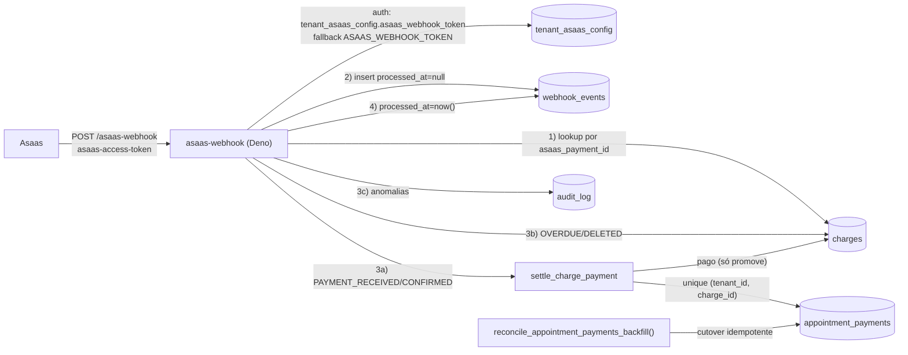
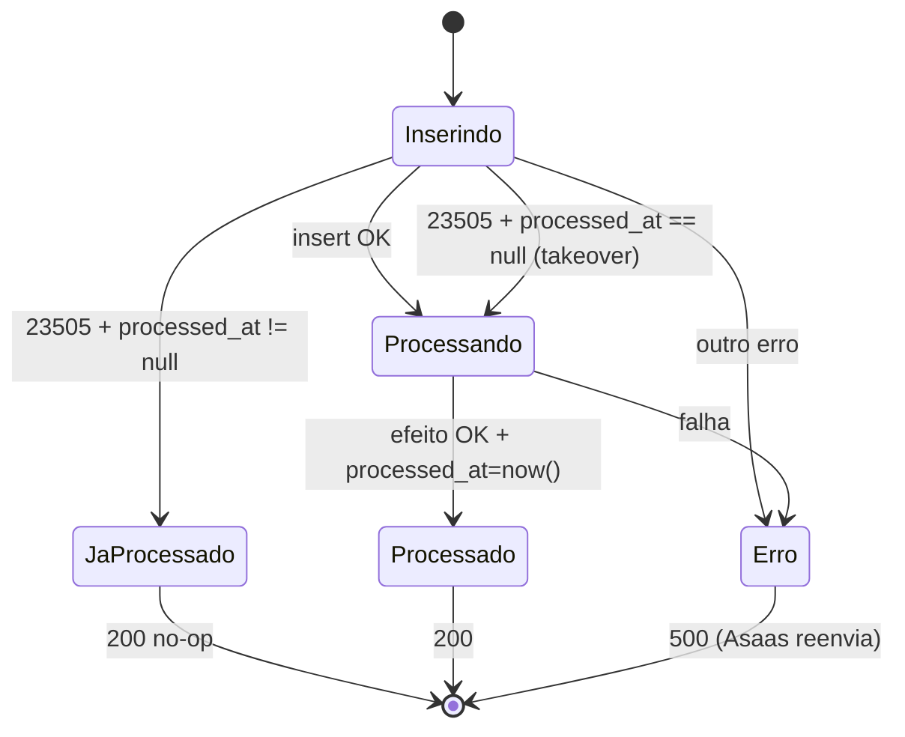

# SPEC — ADR-003 PIX do sistema: webhook idempotente + cutover/backfill (scoped)

**Feature slug:** `cobranca-formas-pagamento-adr-003`
**ADR de origem:** `.spec/prd/cobranca-formas-pagamento/ADRs/ADR-003-pix-sistema-idempotente/ADR.md`
**ADRs dependentes já implementadas:** ADR-001 (`supabase/migrations/20261106120000_appointment_payments_ledger.sql`), ADR-002 (`20261106130000`, `20261106131000`, `20261106132000` + 5 Edges + `create-charge`)
**PRD:** `.spec/prd/cobranca-formas-pagamento/PRD.md` (RF-05, RF-06, RF-14, RF-16..RF-19, RF-23, RF-27; RNF-07, RNF-08, RNF-11, RNF-12)
**Escopo:** reescrever `supabase/functions/asaas-webhook/**`, endurecer o dedupe de `webhook_events`, criar o backfill reexecutável de cutover, testes Deno + integração e runbook. **Sem** UI, **sem** relatórios, **sem** reimplementar RPC/`create-charge`.

---

## 1. Decisão

O `asaas-webhook` é o **único consumidor confiável** do ciclo de vida da cobrança PIX. Ele:

1. autentica o chamador por token de tenant (fallback global) antes de qualquer efeito;
2. registra o evento em `webhook_events` com `processed_at = null` **antes** de processar;
3. liquida pagamento **exclusivamente** por `settle_charge_payment` — nunca `update charges set status='pago'`;
4. só transiciona `pendente → expirado|cancelado`; `pago` nunca é rebaixado;
5. resolve anomalias com `200` (sem receita) para não transformar erro de negócio em retry infinito;
6. devolve `500` somente quando o processamento falhou, mantendo `processed_at = null` para o
   reenvio at-least-once do Asaas.

O cutover garante que nenhuma cobrança `pago` do regime antigo fique fora do ledger antes de o
handler novo assumir.

## 2. Superfície entregue



| # | Artefato | Tipo | Caminho |
|---|---|---|---|
| 1 | `asaas-webhook` reescrito | Deno | `supabase/functions/asaas-webhook/handler.ts`, `schemas.ts` |
| 2 | Classificador de eventos puro | Deno | `supabase/functions/asaas-webhook/events.ts` (novo) |
| 3 | Whitelist de log (aditiva) | Deno | `supabase/functions/_shared/http.ts` (`event_id`, `event_type`) |
| 4 | Helpers de valor/data do gateway | Deno | `supabase/functions/_shared/asaas.ts` (`centsFromGatewayValue`, `parseGatewayDate`) |
| 5 | Dedupe durável de `webhook_events` | migration | `supabase/migrations/20261106141000_webhook_events_durable_dedupe.sql` |
| 6 | Backfill reexecutável de cutover | migration | `supabase/migrations/20261106140000_appointment_payments_cutover_backfill.sql` |
| 7 | Testes unitários Deno | Deno | `supabase/functions/asaas-webhook/handler.test.ts`, `events.test.ts` |
| 8 | Testes de integração | Vitest | `tests/integration/security/payments-webhook.test.ts`, `payments-cutover.test.ts` |

> Nada em `supabase/migrations/20261106120000*`, `…130000*`, `…131000*`, `…132000*` é alterado.
> Nada em `src/**` é alterado.

## 3. Contrato do webhook

### 3.1 Entrada, autenticação e parsing

```text
POST /functions/v1/asaas-webhook          verify_jwt = false (supabase/config.toml:156-157)
Header: asaas-access-token: <token>
Body (JSON): {
  id: string,                              -- id do evento; obrigatório
  event: string,                           -- tipo; obrigatório
  payment?: {
    id: string,                            -- obrigatório quando payment existe
    value?: number,
    paymentDate?: string,                  -- ISO-8601 (date)
    confirmedDate?: string,
    externalReference?: string,            -- NÃO confiável para escrita
    status?: string,
    ...
  },
  ...
}
```

Regras:

- `OPTIONS` ⇒ `200` sem tocar em service client. Método ≠ `POST` ⇒ `405`.
- Token ausente ⇒ `401`. Token inválido ⇒ `401`. Nenhum desses caminhos cria linha em
  `webhook_events`.
- Token esperado: `tenant_asaas_config.asaas_webhook_token` do tenant da cobrança; se vazio,
  `ASAAS_WEBHOOK_TOKEN`; se nenhum dos dois existir ⇒ `401` (fail-closed).
- Cobrança desconhecida: **somente** o token global autentica (não há tenant para consultar).
- Comparação em tempo constante (`constantTimeEqual`).
- `zod`: `id`/`event`/`payment.id` como `z.string().min(1)`; `.passthrough()` em todos os níveis.
  Campos extras nunca quebram o evento.
- `payment` ausente ⇒ `200` no-op (evento não financeiro), sem lookup e sem dedupe.
- `payment.value`/`paymentDate`/`confirmedDate` são lidos por helpers tolerantes: tipo inválido
  vira `null`, nunca `400`.
- O corpo nunca é persistido: `webhook_events.payload = {}`.

### 3.2 Ordem de execução (normativa)

```text
1  OPTIONS/405
2  createService()                      falha ⇒ 500
3  header token presente?               não ⇒ 401
4  JSON parse + zod?                    não ⇒ 400
5  payment.id?                          não ⇒ 200 (no-op)
6  lookup charges por asaas_payment_id  (unique global; nunca por externalReference)
7  token do tenant (ou global)          inválido ⇒ 401
8  insert webhook_events (processed_at=null)  23505 ⇒ avaliar §4
9  dispatch (§3.3)
10 update webhook_events processed_at=now(), status='processado'
11 logEvent + 200
```

Etapas 8–10 são a fronteira de idempotência. Falha em 9/10 ⇒ `500` e `processed_at` continua
`null`; o evento é reentregue.

### 3.3 Eventos e ações

| Evento (classificação) | Ação | Estado final |
|---|---|---|
| `PAYMENT_RECEIVED`, `PAYMENT_CONFIRMED` | `service.rpc("settle_charge_payment", { p_tenant_id, p_charge_id, p_paid_at, p_source:'asaas', p_actor_id:null, p_event_id })` | recebimento +1 (idempotente) e `charges.status='pago'` |
| `PAYMENT_OVERDUE` | `update charges set status='expirado' where tenant_id and id and status='pendente'` + audit `charge_expired` | `pendente → expirado` |
| `PAYMENT_DELETED` | `update charges set status='cancelado' where tenant_id and id and status='pendente'` + audit `charge_deleted_gateway` | `pendente → cancelado` |
| contém `REFUND` ou `CHARGEBACK` | audit `gateway_refund_out_of_scope`; nenhum `rpc`, nenhum update | inalterado |
| qualquer outro | `200`, nenhum efeito | inalterado |

- A classificação é feita por `events.ts` (função pura `classifyAsaasEvent(event: string)` →
  `"settle" | "overdue" | "deleted" | "refund" | "ignore"`), nunca por `if` espalhado no handler.
- `p_paid_at = parseGatewayDate(payment.paymentDate) ?? parseGatewayDate(payment.confirmedDate) ?? null`.
- `p_event_id = id` do evento.
- `PAYMENT_RECEIVED` em `charges.status='expirado'` **liquida** (dinheiro real; D-10 da ADR-002).
- `PAYMENT_OVERDUE`/`PAYMENT_DELETED` em `pago` ou `cancelado` não fazem nada (o filtro
  `status='pendente'` é a garantia; nunca usar `.update().eq('id', …)` sem esse filtro).
- `PAYMENT_DELETED` em `pendente` com claim vivo: o `attach_charge_gateway_data` posterior falha
  com `GATEWAY_CLAIM_LOST`; a Edge da ADR-002 cancela o payment órfão. Não há tratamento especial
  no webhook.

### 3.4 Valor, divergência e tempo

- A receita usa `charges.amount_cents` (fonte), **nunca** `payment.value`.
- Divergência: `centsFromGatewayValue(payment.value)` ≠ `charges.amount_cents` ⇒
  `audit_log(action='payment_amount_mismatch', metadata={ event_id, event_type, charge_id, amount_cents, payment_value_cents })`
  **e** liquida pelo valor da cobrança. `payment.value` ausente/inválido ⇒ não há anomalia (não se
  inventa divergência).
- A anomalia é gravada **depois** do `settle` (se o settle falhar, não há anomalia falsa; se o
  retry acontecer, a anomalia pode ser registrada mais de uma vez — auditoria, não receita).

### 3.5 Resultados anômalos (sempre `200`)

| Situação | Origem | Ação do webhook | Receita |
|---|---|---|---|
| `charge_paid_after_cancel` | retorno de `settle` (`anomaly`) | nenhuma auditoria extra (a RPC já gravou) | não |
| `charge_invalid_amount` | retorno de `settle` (`anomaly`) | nenhuma auditoria extra | não |
| `charge_not_appointment` | erro `PT409` do `settle` | `200` + log `code=CHARGE_NOT_APPOINTMENT` | não |
| cobrança desconhecida | lookup vazio | audit `charge_unknown_webhook` (`tenant_id=null`; `metadata={ payment_id, event_type, reported_external_reference? }`) | não |
| refund/chargeback | classificação | audit `gateway_refund_out_of_scope` | não |
| valor divergente | §3.4 | audit `payment_amount_mismatch` + `settle` | sim (valor da cobrança) |

`reported_external_reference` é registrado **apenas** para conciliação; nunca é usado para localizar
ou gravar a cobrança.

### 3.6 Tabela HTTP

| HTTP | Quando | Corpo |
|---|---|---|
| `200` | processado, no-op, duplicata já processada, anomalia | `{ "ok": true }` |
| `400` | JSON inválido ou schema (`id`/`event`/`payment.id` ausente) | `{ "error": "..." }` |
| `401` | token ausente/inválido, ou nenhum token configurado | `{ "error": "..." }` |
| `405` | método ≠ POST/OPTIONS | `{ "error": "..." }` |
| `500` | falha de service client, insert, RPC, update ou auditoria obrigatória | `{ "error": "..." }` |

Nenhum `4xx` para evento autenticado e bem formado. Mensagem é pt-BR genérica; nenhum detalhe de
SQL, payload, QR ou token.

## 4. Dedupe durável

### 4.1 Estado em `webhook_events`

| Coluna | Uso no Asaas |
|---|---|
| `event_id` | `id` do evento |
| `payment_id` | `payment.id` |
| `event_type` | `event` |
| `tenant_id` | tenant da cobrança (obrigatório; desconhecida não gera linha) |
| `source` | `'asaas'` (enum estendido pela migration) |
| `external_event_id` | `id` do evento (coluna legada not-null) |
| `instance_name` | `'asaas'` |
| `status` | `'recebido'` no insert; `'processado'` no sucesso |
| `processed_at` | `null` no insert; `now()` no sucesso. **Default removido pela migration** |
| `payload` | sempre `{}` (nunca corpo cru) |

Unique de dedupe: `webhook_events_asaas_dedupe_uidx (event_id, payment_id)` (já existe).

### 4.2 Máquina de estados



- Takeover concorrente (`processed_at == null`) é **aceito**: `settle` é idempotente pelo unique
  `(tenant_id, charge_id)`; no pior caso há auditoria duplicada, nunca receita duplicada.
- `processed_at` é a única fonte de verdade. `status` é rótulo operacional.
- Cobrança desconhecida não entra em `webhook_events` porque `tenant_id` é `not null`; o
  `200 + audit` é a evidência (aceito: volume baixo, dedupe não é necessário para não-efeito).

### 4.3 Migration `20261106141000_webhook_events_durable_dedupe.sql`

```sql
-- 1) Um evento inserido sem processed_at passa a ser "não processado", não "processado agora".
alter table public.webhook_events alter column processed_at drop default;

-- 2) Fonte do Asaas deixa de se disfarçar de 'evolution'.
alter table public.webhook_events drop constraint if exists webhook_events_source_check;
alter table public.webhook_events add constraint webhook_events_source_check
  check (source in ('evolution', 'asaas'));

-- 3) Observabilidade de eventos presos (nunca processados).
create index if not exists webhook_events_asaas_pending_idx
  on public.webhook_events (created_at)
  where payment_id is not null and processed_at is null;
```

Idempotente (`drop default`/`drop constraint if exists`/`create index if not exists`). Não altera
RLS nem grants (continua escrita só por `service_role`; leitura admin-only).

### 4.4 Migration `20261106142000_webhook_events_pending_asaas_only.sql`

A `20261106141000` já pode ter sido aplicada em outro ambiente; por isso o predicado do índice é
corrigido em migration nova (idempotente), sem editar a anterior:

```sql
drop index if exists public.webhook_events_asaas_pending_idx;

create index if not exists webhook_events_asaas_pending_idx
  on public.webhook_events (created_at)
  where payment_id is not null
    and processed_at is null
    and source = 'asaas';
```

Motivo: `processed_at` é a fonte de retry do Asaas; eventos do WhatsApp (`source='evolution'`)
não usam essa coluna para reprocessar e não devem aparecer como pendentes no runbook.

## 5. Backfill reexecutável de cutover

### 5.1 Função `reconcile_appointment_payments_backfill`

```text
reconcile_appointment_payments_backfill(p_tenant_id uuid default null) returns jsonb
  language plpgsql security invoker set search_path = public, pg_temp
  -- execute: service_role only
```

Comportamento:

1. **Candidatos** (`amount_cents > 0`): `charges.status='pago'`, `appointment_id is not null`,
   tenant opcional, sem linha em `appointment_payments` com o mesmo `charge_id`.
2. **Insere** uma linha por candidato:
   `method='pix_sistema'`, `source='asaas'`, `amount_cents=charges.amount_cents`, `tip_cents=0`,
   `received_at=coalesce(charges.paid_at, charges.created_at)`, `received_by=null`,
   `idempotency_key=null`, `line_index=0`, `charge_id=charges.id`.
3. **Idempotente** por `not exists (... where tenant_id = c.tenant_id and charge_id = c.id)` **e**
   `on conflict (tenant_id, charge_id) where charge_id is not null do nothing` — a segunda
   proteção cobre a corrida com um `settle` concorrente quando a função é reexecutada após o
   deploy (não aborta a função com `23505`).
4. **Inválidos**: `status='pago'` com `amount_cents <= 0` são **contados** em
   `skipped_invalid_amount` e **não** inseridos (o ledger proíbe `amount_cents <= 0`); não
   bloqueiam o cutover.
5. **Validação**: recalcula `missing_after` com o **mesmo filtro** (`amount_cents > 0`); se
   `> 0` ⇒ `raise exception 'BACKFILL_COUNT_MISMATCH' using errcode='PT500'` (nada fica “meio
   aplicado”: a transação da função reverte).
6. **Auditoria**: uma linha `audit_log(action='appointment_payments_backfill_reconciled',
   tenant_id=p_tenant_id, metadata={candidates, inserted, missing_after, skipped_invalid_amount})`.
7. **Retorno**: `{ candidates, inserted, missing_after, skipped_invalid_amount }`.

Aritmética do check de cutover: `inserted = candidates` e `missing_after = 0`.
`skipped_invalid_amount` é reportado à parte (cobranças `pago` com `amount_cents <= 0` não
entram em `candidates`) e exige conciliação manual; nunca é somado a `candidates`.

Regras: nunca altera `charges`, nunca recalcula comissão, nunca toca `pago → outro status`,
nunca faz update no ledger. `revoke execute from public, anon, authenticated` +
`grant execute to service_role`.

> Fronteira de dono: a ADR-001 entrega o **backfill inicial** dentro da migration do schema; a
> SPEC da ADR-002 (§9.1) delega a **reexecução no cutover** a esta ADR. Por isso a função acima
> reusa a mesma regra (`not exists` por `charge_id`) em vez de redefinir o que é receita.

### 5.2 Migration `20261106140000_appointment_payments_cutover_backfill.sql`

Contém a função acima e, no fim, executa `select public.reconcile_appointment_payments_backfill();`
— aplicar a migration **é** o primeiro backfill do cutover. Reaplicar o arquivo (ou chamar a função)
é seguro e é o runbook de reconciliação.

### 5.3 Consulta de verificação

```sql
select count(*) as pagos_sem_ledger
from public.charges c
where c.status = 'pago'
  and c.appointment_id is not null
  and c.amount_cents > 0
  and not exists (
    select 1 from public.appointment_payments p
    where p.tenant_id = c.tenant_id and p.charge_id = c.id
  );
-- esperado: 0 antes de publicar o webhook novo
```

## 6. Regras de ouro (normativas)

1. **Nunca** `update charges set status='pago'` no webhook. Só `settle_charge_payment` grava
   recebimento + `pago` na mesma transação.
2. **Nunca** rebaixar `pago`: toda transição do webhook filtra `status='pendente'`.
3. Cobrança `cancelado` + evento de pagamento ⇒ `settle` devolve `charge_paid_after_cancel`, sem
   receita; `200`.
4. Duplicata com `processed_at` não nulo ⇒ `200` e **nenhum** efeito (nem RPC, nem update).
5. Valor da receita = `charges.amount_cents`; divergência ⇒ anomalia e liquidação pelo valor da
   cobrança.
6. Refund/chargeback ⇒ anomalia `gateway_refund_out_of_scope`, sem ledger.
7. Falha ⇒ `500` + `processed_at` nulo.
8. Logs/auditoria sem payload, QR, copia-e-cola, token, nome, telefone ou documento.
9. O webhook não escreve em `appointment_payments` diretamente.
10. Nenhuma query do webhook usa `appointment_id`/`tenant_id` do payload.

## 7. Invariantes

| # | Invariante | Mecanismo |
|---|---|---|
| I1 | `charges.status='pago'` só existe com recebimento (salvo legado pré-cutover) | `settle` + cutover §5 |
| I2 | No máximo 1 recebimento por `(tenant_id, charge_id)` | unique da ADR-001 + `settle` |
| I3 | `pago` nunca é rebaixado | filtros `.eq('status','pendente')` + RPC só promove |
| I4 | Duplicata já processada não dispara efeito | `processed_at` não nulo ⇒ retorno antecipado |
| I5 | Falha deixa `processed_at` nulo | `500` só após insert sem update de sucesso |
| I6 | Receita nunca vem de `payment.value`/payload | §3.4 |
| I7 | Evento autenticado e válido nunca recebe `4xx` | §3.6 |
| I8 | Evento desconhecido não cria estado | lookup + audit nullable |
| I9 | Dedupe é inserido **depois** da autenticação | §3.2 (passo 8 após 7) |
| I10 | `webhook_events.payload` nunca contém o corpo | insert fixo `{}` |
| I11 | Log só com campos da whitelist | `logEvent` + `LOG_FIELDS` |
| I12 | Backfill é idempotente e fail-closed na contagem | `not exists` + `BACKFILL_COUNT_MISMATCH` |
| I13 | Nenhuma RPC/Edge entregue é alterada | escopo de arquivos §2 |

## 8. Requisitos funcionais

| RF | Entrada → saída observável | Invariante |
|---|---|---|
| **RF-08** | `PAYMENT_RECEIVED` autenticado para cobrança `pendente` ⇒ `200`, exatamente 1 linha em `appointment_payments` com `charge_id`, `charges.status='pago'`; reenvio do mesmo `id` ⇒ `200` e ainda 1 linha | I1, I2, I4 |
| **RF-09** | `PAYMENT_RECEIVED` após baixa manual (`pago` + recebimento manual) ⇒ `200`, `settle` devolve `replayed=true`, nenhuma segunda linha | I2, I4 |
| **RF-10** | `PAYMENT_RECEIVED` em cobrança `cancelado` ⇒ `200`, zero linhas novas, `audit_log` contém `charge_paid_after_cancel` | I1, I8 |
| **RF-11** | `PAYMENT_OVERDUE` em `pendente` ⇒ `expirado`; em `pago` ⇒ `pago`; em `cancelado` ⇒ `cancelado` | I3 |
| **RF-12** | Falha simulada no `settle` ⇒ `500`, `webhook_events.processed_at is null`, `status='recebido'`; reenvio com o mesmo `id` processa e cria 1 linha | I5, I4 |
| **RF-13** | Nenhum caminho do webhook soma `charges.status='pago'` como receita; receita = `sum(appointment_payments.amount_cents) where voided_at is null` | I1, I6 |
| **RF-14** | Nenhum log/auditoria do webhook contém QR, copia-e-cola, payload cru, token, nome, telefone ou documento; `webhook_events.payload = {}` | I10, I11 |
| **RF-15** | **Cutover**: `reconcile_appointment_payments_backfill()` cria 1 linha por `pago` sem ledger, retorna `missing_after=0`, e a segunda execução retorna `inserted=0`; `pagos_sem_ledger=0` | I12, I1 |
| **RF-16** | `payment.value` ≠ `charges.amount_cents` ⇒ `200`, receita pelo valor da cobrança, `audit_log` com `payment_amount_mismatch` | I6 |
| **RF-17** | `PAYMENT_REFUNDED`/`PAYMENT_PARTIALLY_REFUNDED`/chargeback ⇒ `200`, nenhuma linha, `audit_log` com `gateway_refund_out_of_scope` | I1 |
| **RF-18** | `payment.id` sem cobrança local ⇒ `200`, nenhuma escrita em `charges`/ledger, `audit_log` com `charge_unknown_webhook` e `tenant_id null` | I8 |
| **RF-19** | Sem token, token errado ou nenhum token configurado ⇒ `401` e **zero** linhas em `webhook_events`; cobrança de tenant com token próprio rejeita o token global | I9 |

### Rastreabilidade ADR → SPEC

| Critério da ADR | Cobertura |
|---|---|
| 8 | RF-08 (§3.2, §3.3, §4) |
| 9 | RF-09 (§3.3, §5.1) |
| 10 | RF-10 (§3.5) |
| 11 | RF-11 (§3.3) |
| 12 | RF-12 (§4.2) |
| 13 | RF-13 (§6, regressão de painel na ADR-005) |
| 14 | RF-14 (§3.7) |
| 15 (cutover) | RF-15 (§5) |
| Regras 5–7 da ADR | RF-16, RF-17, RF-18 (§3.4, §3.5) |
| Regra 1 (auth) | RF-19 (§3.1) |

## 9. Estratégia de teste

### 9.1 Arquivos e cobertura

| Arquivo | Tipo | Cobre |
|---|---|---|
| `supabase/functions/asaas-webhook/events.test.ts` | Deno | classificação pura (`REFUND`/`CHARGEBACK` antes de prefixos, eventos desconhecidos, case-insensitive) |
| `supabase/functions/asaas-webhook/handler.test.ts` | Deno | RF-08, 09, 10, 11, 12, 14, 16, 17, 18, 19 com `SupabaseClient` fake (charges, tenant_asaas_config, webhook_events, audit_log, `rpc`) |
| `tests/integration/security/payments-webhook.test.ts` | Vitest | RF-08..RF-14, RF-16..RF-19 contra Postgres real + Edge servida (`callFunction("asaas-webhook", { headers: { "asaas-access-token": token } })`) |
| `tests/integration/security/payments-cutover.test.ts` | Vitest | RF-15: `pago` sem ledger, `reconcile…()` 2×, `pagos_sem_ledger=0` |

### 9.2 Casos obrigatórios no handler (Deno)

Sucesso:

- `PAYMENT_CONFIRMED` chama `settle_charge_payment` com `p_source='asaas'`, `p_actor_id=null`,
  `p_event_id=id` e `p_paid_at=paymentDate`;
- `paymentDate` ausente ⇒ `p_paid_at=confirmedDate`; ambas ausentes ⇒ `null`;
- duplicata processada ⇒ `200` e **zero** chamadas a `rpc`/`update`;
- cobrança `pendente` + overdue ⇒ update com dois filtros (`id` e `status='pendente'`).

Falha:

- `rpc` devolve erro ⇒ `500` e nenhum `update` de `processed_at`;
- insert de `webhook_events` devolve erro ≠ 23505 ⇒ `500`, sem processar;
- update de `processed_at` falha ⇒ `500` (o efeito já ocorreu; o retry é idempotente).

Borda:

- `23505` + `processed_at=null` ⇒ reprocessa (takeover) e liquida uma única vez no banco real;
- cobrança desconhecida ⇒ `200`, audit `charge_unknown_webhook`, nenhum insert em
  `webhook_events`;
- `settle` devolve `anomaly=charge_paid_after_cancel` ⇒ `200` e nenhuma auditoria duplicada;
- `settle` devolve `PT409 CHARGE_NOT_APPOINTMENT` ⇒ `200`;
- refund/chargeback ⇒ `200`, `audit_log` e nenhum `rpc`;
- `payment.value=2000` com `charges.amount_cents=3000` ⇒ anomalia e `rpc` com valor da cobrança;
- `payment` ausente ⇒ `200` sem lookup;
- `id` ausente ⇒ `400` sem insert;
- o fake de `console.log` prova que QR/token/payload não são logados.

### 9.3 Casos obrigatórios na integração

- `seedAsaasConfig({ tenantId, encryptedKey: encryptAsaasKey("x"), webhookToken })` — estender o
  helper com `webhookToken?: string` (aditivo) para gravar
  `tenant_asaas_config.asaas_webhook_token`; o teste lê o token, nunca o hardcoda;
- evento real: cobrança `pendente` + `asaas_payment_id` ⇒ 1 linha no ledger, `pago`, `paid_at`
  preenchido, `webhook_events.processed_at not null`;
- reenvio **do mesmo `id`** ⇒ `200`, 1 linha; **novo `id` para o mesmo payment** ⇒ `200`,
  `replayed`, 1 linha;
- baixa manual antes do evento (`confirm-charge-manual` ou `settle` manual) ⇒ evento posterior
  não cria segunda linha;
- cancelada + evento ⇒ 0 linhas e `audit_log` `charge_paid_after_cancel`;
- overdue/deleted em `pago` ⇒ status permanece `pago`;
- valor divergente ⇒ 1 linha com `amount_cents` da cobrança + anomalia;
- cobrança desconhecida ⇒ `200`, zero linhas; token inválido ⇒ `401`, zero linhas em
  `webhook_events`;
- dois tenants: evento do tenant A nunca toca cobrança do B (lookup por `payment.id` + token);
- cutover: cria `charges` `pago` sem ledger via `seedCharge`, chama a função 2×, confere
  `inserted`/`missing_after` e a consulta §5.3.

### 9.4 Regras de teste

- Nenhum teste usa rede externa; o webhook **não** chama o Asaas.
- Nenhum teste imprime token, QR, copia-e-cola ou payload.
- `cleanupPaymentFixtures(...)` antes de `deleteTestUsers()` (FKs `restrict`); sem `deleteAll`.
- Erros de domínio são assertados por `status` HTTP + `audit_log`, não por mensagem.
- O teste de concorrência do dedupe usa `Promise.all` com o mesmo `id` e assere
  `count(appointment_payments) = 1`.

### 9.5 Comandos

```sh
npx supabase db reset
npx supabase db reset                      # idempotência das migrations novas
select public.reconcile_appointment_payments_backfill();   -- via psql, 2×
npm run check:functions
npm run test:functions
npm run test:integration -- tests/integration/security/payments-webhook.test.ts
npm run test:integration -- tests/integration/security/payments-cutover.test.ts
npm run test:integration                  # suíte completa (não regredir 215 casos)
npm test
npm run typecheck
```

## 10. Cutover e rollback

1. Backup/lag check: confirmar que `charges` e `appointment_payments` estão acessíveis e sem
   migrations pendentes anteriores.
2. Aplicar `20261106140000`, `20261106141000` e `20261106142000` (`supabase db push` no ambiente
   alvo).
3. Rodar `select public.reconcile_appointment_payments_backfill();` e exigir
   `missing_after = 0` e `inserted = candidates`; conferir `skipped_invalid_amount` à parte
   (não entra em `candidates`).
4. Rodar a consulta §5.3 (`pagos_sem_ledger = 0`).
5. Publicar `asaas-webhook` (deploy único).
6. Smoke de sandbox: `PAYMENT_RECEIVED` ⇒ 1 linha; reenvio ⇒ 200 sem linha nova.
7. Monitorar 24h:
   ```sql
   select count(*) from public.webhook_events
   where source = 'asaas'
     and payment_id is not null and processed_at is null
     and created_at < now() - interval '1 hour';
   select action, count(*) from public.audit_log
   where action in ('charge_unknown_webhook','payment_amount_mismatch',
                    'gateway_refund_out_of_scope','charge_paid_after_cancel')
     and created_at > now() - interval '24 hours'
   group by 1;
   ```
8. Se houver divergência: reexecutar a função de backfill (idempotente) e reconciliar no Asaas por
   `externalReference = charges.id`.

**Rollback**: proibido republicar o handler antigo (rebaixaria `pago` sem recebimento). Em
incidente, desabilitar o webhook no painel do Asaas, corrigir, reabilitar e reexecutar o backfill.

## 11. Fora de escopo

- Qualquer alteração nas RPCs, nas 5 Edge Functions e em `create-charge` (ADR-002 entregue).
- Remoção do fallback `amount_cents` opcional (fase 6 do rollout).
- UI/diálogo/comprovante/i18n (ADR-004); painel/aba Recebimentos/RBAC (ADR-005).
- Estorno financeiro real, refund automático, chargeback automático.
- Conciliação automática de PIX órfão no Asaas (consulta à API no webhook).
- `asaas-subscription-webhook` (cobranças de assinatura continuam no handler próprio).
- WhatsApp, maquininha/TEF, parcelamento, desconto, caixa/turno.
- Qualquer escrita em `src/**`.

## 12. Riscos e lacunas declaradas

| # | Risco/lacuna | Mitigação |
|---|---|---|
| D-01 | O `settle` grava `charge_paid` mesmo em replay; takeover concorrente pode duplicar auditoria | aceito: auditoria duplicada ≠ receita duplicada; teste assere 1 linha no ledger |
| D-02 | Cobrança desconhecida não gera dedupe (`tenant_id not null`) ⇒ auditoria repetida | volume baixo; consulta de monitoramento agrupa por `payment_id` |
| D-03 | PIX anterior à reemissão perde o vínculo local (`asaas_payment_id` limpo) | evento cai em `charge_unknown_webhook`; conciliação por `externalReference`; débito declarado (ADR-003 R-06) |
| D-04 | `event.id` ausente derruba para `400` | validar no sandbox antes do cutover (ADR-003 pergunta aberta 1) |
| D-05 | `payment.value` em formato inesperado (string) | helper tolerante; divergência só é assertada quando o número é válido |
| D-06 | Backfill roda e uma cobrança é paga no intervalo até o deploy | reexecutar a função imediatamente antes do deploy e após o smoke (passo 3 e passo 8) |
| D-07 | `charges.amount_cents = 0` em `pago` não entra no ledger | `skipped_invalid_amount` no retorno + `notice`; conciliação manual; não bloqueia o cutover |
| D-08 | Alterar `webhook_events.processed_at` default afeta WhatsApp | `whatsapp-inbound` não lê `processed_at` (verificado no código); efeito é apenas `null` em vez de `now()` |
| D-09 | Token global vale para cobrança desconhecida | necessário para autenticar evento órfão; não há tenant para resolver; `401` continua fail-closed quando não configurado |
| D-10 | `PAYMENT_RECEIVED` em `expirado` pode fazer `sum(payments) > price` | aceito na ADR-002 (D-10): dinheiro real não é descartado; `remaining_cents` fica 0 |
