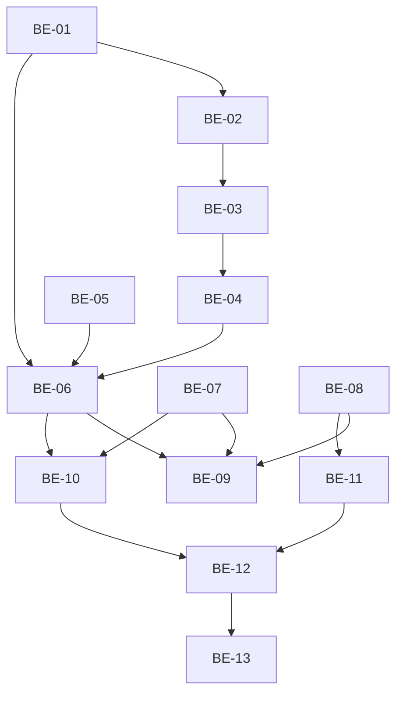

# TASKS — ADR-003 PIX do sistema: webhook idempotente + cutover/backfill (scoped)

## 1. Origem

- **SPEC:** `.spec/backend/cobranca-formas-pagamento-adr-003/SPEC.md`
- **PLAN:** `.spec/backend/cobranca-formas-pagamento-adr-003/PLAN.md`
- **ADR:** `.spec/prd/cobranca-formas-pagamento/ADRs/ADR-003-pix-sistema-idempotente/ADR.md`
- **Meta:** 13 microtasks atômicas, todas **teste-primeiro** (RED → GREEN), com caminho físico,
  RF rastreável e 3 cenários BDD. Nenhuma task altera RPC, `create-charge` ou `src/**`.

---

## 2. Backlog

| Task | Tipo | Prioridade | Risco | Complexidade | Status |
|---|---|---|---|---|---|
| BE-01 | Deno / funções puras (`events.ts`) | P0 | Low | 1h | Done |
| BE-02 | Deno / schema zod | P0 | Medium | 1h | Done |
| BE-03 | Deno / auth do webhook | P0 | High | 1h30 | Done |
| BE-04 | Deno / dedupe durável | P0 | High | 2h | Done |
| BE-05 | Deno / whitelist de log | P1 | Low | 30min | Done |
| BE-06 | Deno / handler reescrito | P0 | High | 4h | Done |
| BE-07 | Migration / dedupe `webhook_events` | P0 | Medium | 1h | Done |
| BE-08 | Migration / backfill de cutover | P0 | High | 2h30 | Done |
| BE-09 | Test / unitários Deno consolidados | P0 | High | 3h | Done |
| BE-10 | Test / integração do webhook | P0 | High | 3h | Done |
| BE-11 | Test / integração do cutover | P0 | High | 2h | Done |
| BE-12 | Regressão / PII / não-rebaixamento | P0 | High | 2h | Done |
| BE-13 | Cutover / runbook e evidência | P0 | Medium | 1h30 | Done |

---

## 3. Grafo de dependências

---

## 4. Rastreabilidade RF → task

| RF | Task(s) |
|---|---|
| RF-08 (recebimento único + pago) | BE-04, BE-06, BE-09, BE-10 |
| RF-09 (baixa manual anterior) | BE-06, BE-09, BE-10 |
| RF-10 (cancelada + pagamento) | BE-06, BE-09, BE-10 |
| RF-11 (overdue não rebaixa `pago`) | BE-06, BE-09, BE-10, BE-12 |
| RF-12 (falha deixa `processed_at` nulo) | BE-04, BE-06, BE-09, BE-10 |
| RF-13 (receita só do ledger) | BE-06, BE-12 |
| RF-14 (sem PII em log/audit) | BE-05, BE-06, BE-09, BE-12 |
| RF-15 (cutover/backfill) | BE-08, BE-11, BE-13 |
| RF-16 (valor divergente) | BE-01, BE-06, BE-09, BE-10 |
| RF-17 (refund/chargeback fora) | BE-01, BE-06, BE-09 |
| RF-18 (cobrança desconhecida) | BE-03, BE-06, BE-09, BE-10 |
| RF-19 (token e dedupe após auth) | BE-03, BE-04, BE-09, BE-10 |

---

## 5. Task Backlog

### Task `BE-01`: Classificador de eventos e helpers de valor/data

- **Constraint Ref:** SPEC §3.3, §3.4, I6; RF-16, RF-17
- **Depends on (PLAN):** —
- **Dependency Type:** Hard (raiz)
- **Layer:** Deno / domínio puro
- **Task Type:** Implementação + teste
- **Priority:** P0 · **Risk:** Low · **Parallelizable:** Sim
- **Artifact:** `supabase/functions/asaas-webhook/events.ts`,
  `supabase/functions/_shared/asaas.ts` (aditivo), `supabase/functions/asaas-webhook/events.test.ts`
- **Framework Detail:** TypeScript puro, sem `SupabaseClient`, `Deno.test`.

#### 📝 Contexto e impacto

- **Descrição:** `classifyAsaasEvent(event)` → `"settle" | "overdue" | "deleted" | "refund" |
  "ignore"`; `centsFromGatewayValue(value)` → `number | null`; `parseGatewayDate(value)` →
  `string | null`. Nenhum `if` de evento fica no handler.
- **Teste primeiro (RED):** `events.test.ts` com os casos abaixo falhando antes da implementação.
- **Implementação (GREEN):** funções puras exportadas, ordem de precedência
  `REFUND/CHARGEBACK` **antes** de qualquer prefixo `PAYMENT_*`, comparação case-insensitive.
- **Impacto:** evita divergência de classificação entre handler e testes; base para RF-16/17.

#### ✅ DoD

- [x] `classifyAsaasEvent("PAYMENT_RECEIVED") === "settle"` e `"PAYMENT_CONFIRMED" === "settle"`.
- [x] `"PAYMENT_OVERDUE" === "overdue"`; `"PAYMENT_DELETED" === "deleted"`.
- [x] `"PAYMENT_PARTIALLY_REFUNDED"`, `"PAYMENT_CHARGEBACK_REQUESTED"`, `"x_refund_y"` ⇒ `"refund"`.
- [x] `"PAYMENT_CREATED"`, `""` ⇒ `"ignore"`.
- [x] `centsFromGatewayValue(30.5) === 3050`; `"30.50"` ⇒ `3050`; `null`/`NaN` ⇒ `null`.
- [x] `parseGatewayDate("2026-11-06")` ⇒ `"2026-11-06T00:00:00.000Z"`; inválida ⇒ `null`.
- [x] Nenhuma dependência de rede/DB.

#### 🧪 BDD

- **Sucesso:** dado `event="PAYMENT_RECEIVED"`, quando classificar, então `"settle"` e o valor
  numérico `30.5` vira `3050` centavos.
- **Falha:** dado `event="PAYMENT_PARTIALLY_REFUNDED"`, quando classificar, então `"refund"`
  (nunca `"settle"`), mesmo contendo `PAYMENT_`.
- **Borda:** dado `event=""` e `value="abc"`, quando classificar/parsear, então `"ignore"` e
  `null`, sem exceção.

---

### Task `BE-02`: Schema zod do payload

- **Constraint Ref:** SPEC §3.1; RF-19
- **Depends on (PLAN):** BE-01
- **Dependency Type:** Hard
- **Layer:** Deno / validação
- **Task Type:** Implementação + teste
- **Priority:** P0 · **Risk:** Medium · **Parallelizable:** Não
- **Artifact:** `supabase/functions/asaas-webhook/schemas.ts`, `schemas.test.ts` (novo)
- **Framework Detail:** `npm:zod@3.23.8`, `.passthrough()` em todos os níveis.

#### 📝 Contexto e impacto

- **Descrição:** exigir `id`, `event` e, quando `payment` existir, `payment.id`; nunca rejeitar
  campos extras (F8); datas/valores tolerantes (`unknown` + helper da BE-01).
- **Teste primeiro (RED):** schema rejeita `{}`, `{ event }`, `{ id, event, payment: {} }`; aceita
  payload real com campos extras; aceita `payment` ausente.
- **Implementação (GREEN):** schema exportado `payloadSchema`; tipo `Payload`.

#### ✅ DoD

- [x] `{}` ⇒ falha; `{ event: "X" }` ⇒ falha; `{ id: "e", event: "X", payment: {} }` ⇒ falha.
- [x] `{ id: "e", event: "X", payment: { id: "p", value: 10, extra: true }, extra: 1 }` ⇒ passa.
- [x] `{ id: "e", event: "X" }` (sem payment) ⇒ passa (no-op é decidido no handler).
- [x] `payment.value` como string **não** derruba o parse (campo tolerante).

#### 🧪 BDD

- **Sucesso:** dado payload do Asaas com `id`, `event`, `payment.id` e atributos novos, quando
  validar, então sucesso e os três campos presentes.
- **Falha:** dado payload sem `id`, quando validar, então erro ⇒ handler responde `400` sem
  insert.
- **Borda:** dado payload sem `payment`, quando validar, então sucesso e o handler responde `200`
  sem lookup.

---

### Task `BE-03`: Autenticação do webhook (tenant × global)

- **Constraint Ref:** SPEC §3.1, §3.2, I9; RF-19
- **Depends on (PLAN):** BE-02
- **Dependency Type:** Hard
- **Layer:** Deno / segurança
- **Task Type:** Implementação + teste
- **Priority:** P0 · **Risk:** High · **Parallelizable:** Não
- **Artifact:** `supabase/functions/asaas-webhook/auth.ts`, `auth.test.ts` (novo)
- **Framework Detail:** `constantTimeEqual` de `_shared/asaas.ts`; `Deno.env`.

#### 📝 Contexto e impacto

- **Descrição:** `resolveExpectedToken(service, charge, env)` devolve o token esperado:
  `tenant_asaas_config.asaas_webhook_token` do tenant da cobrança, senão `ASAAS_WEBHOOK_TOKEN`;
  cobrança desconhecida ⇒ só o global; nada configurado ⇒ `null` (fail-closed).
  `isAuthorized(header, expected)` usa comparação em tempo constante.
- **Teste primeiro (RED):** quatro cenários de token + ausência de config.
- **Implementação (GREEN):** módulo sem efeito colateral; sem log de token.

#### ✅ DoD

- [x] Cobrança com token de tenant: token do tenant autoriza; global **não** autoriza.
- [x] Cobrança com token de tenant vazio: global autoriza.
- [x] Cobrança desconhecida: só global autoriza.
- [x] Nenhum token configurado ⇒ `null` ⇒ handler `401`.
- [x] Nenhum caminho loga ou retorna o token.

#### 🧪 BDD

- **Sucesso:** dado tenant com `asaas_webhook_token="t"`, quando receber header `"t"`, então
  autorizado.
- **Falha:** dado tenant com token `"t"` e global `"g"`, quando receber header `"g"`, então
  negado (`401`) — o global não substitui o token do tenant.
- **Borda:** dado cobrança desconhecida e global `"g"`, quando receber `"g"`, então autorizado
  (sem tenant para resolver) e o handler segue para `charge_unknown_webhook`.

---

### Task `BE-04`: Dedupe durável de `webhook_events`

- **Constraint Ref:** SPEC §4.1, §4.2, I4, I5, I10; RF-08, RF-12, RF-19
- **Depends on (PLAN):** BE-03
- **Dependency Type:** Hard
- **Layer:** Deno / persistência
- **Task Type:** Implementação + teste
- **Priority:** P0 · **Risk:** High · **Parallelizable:** Não
- **Artifact:** `supabase/functions/asaas-webhook/dedupe.ts`, `dedupe.test.ts` (novo)
- **Framework Detail:** `SupabaseClient` injetado; fake nos testes.

#### 📝 Contexto e impacto

- **Descrição:** `beginEvent(service, { tenantId, eventId, paymentId, eventType })` insere com
  `processed_at: null`, `status: "recebido"`, `source: "asaas"`, `payload: {}`,
  `external_event_id: eventId`, `instance_name: "asaas"`. Retorna
  `"process" | "already_processed"`. `23505` ⇒ relê: `processed_at` nulo ⇒ `"process"`
  (takeover); não nulo ⇒ `"already_processed"`. `finishEvent(service, eventId, paymentId)` grava
  `processed_at=now(), status="processado"`.
- **Teste primeiro (RED):** insert OK; `23505` já processado; `23505` não processado; erro
  genérico; update de conclusão.
- **Implementação (GREEN):** nunca `select` sem `event_id` + `payment_id`; nunca incluir payload.

#### ✅ DoD

- [x] Insert inclui `processed_at: null` explícito e `payload: {}`.
- [x] `23505` + `processed_at` não nulo ⇒ `"already_processed"` sem update.
- [x] `23505` + `processed_at` nulo ⇒ `"process"`.
- [x] Erro diferente de `23505` ⇒ lança/propaga (handler devolve `500`).
- [x] `finishEvent` filtra por `event_id` + `payment_id`.

#### 🧪 BDD

- **Sucesso:** dado evento novo, quando `beginEvent`, então linha com `processed_at=null` e
  `payload={}`; `finishEvent` grava `processed_at`.
- **Falha:** dado insert com erro de conexão, quando `beginEvent`, então erro propagado e nada
  processado.
- **Borda:** dado `23505` com `processed_at=null`, quando `beginEvent`, então `"process"`
  (takeover) e o `settle` idempotente garante uma única receita.

---

### Task `BE-05`: Whitelist de log do webhook

- **Constraint Ref:** SPEC §3.7, I11; RF-14
- **Depends on (PLAN):** —
- **Dependency Type:** Soft
- **Layer:** Deno / observabilidade
- **Task Type:** Implementação + teste
- **Priority:** P1 · **Risk:** Low · **Parallelizable:** Sim
- **Artifact:** `supabase/functions/_shared/http.ts` (aditivo), `log.test.ts` (novo)
- **Framework Detail:** `LOG_FIELDS` é `as const`; adicionar `"event_id"` e `"event_type"`.

#### 📝 Contexto e impacto

- **Descrição:** permitir `event_id`/`event_type` no log técnico (ids opacos do gateway). Nenhum
  outro campo novo. `logEvent` continua descartando o que não está na whitelist.
- **Teste primeiro (RED):** captura `console.log`, passa `{ event_id, event_type, qr: "xxx" }` e
  espera que `qr` não apareça.
- **Implementação (GREEN):** duas entradas novas no array; nenhuma mudança de assinatura.

#### ✅ DoD

- [x] `event_id` e `event_type` aparecem no JSON logado quando fornecidos.
- [x] `qr`, `payload`, `token`, `name` continuam descartados.
- [x] Nenhum consumidor existente de `LOG_FIELDS` quebra (`npm run check:functions`).

#### 🧪 BDD

- **Sucesso:** dado `logEvent("asaas_webhook", { event_id: "e", event_type: "PAYMENT_RECEIVED" })`,
  então o stdout contém apenas `event`, `event_id`, `event_type`.
- **Falha:** dado `{ qr: "000201" }`, então o stdout não contém `qr` nem o valor.
- **Borda:** dado `{ event_id: null }`, então a chave é omitida (sem `null` no log).

---

### Task `BE-06`: Reescrever `handler.ts`

- **Constraint Ref:** SPEC §2, §3.1–§3.7, §6, I1..I13; RF-08..RF-14, RF-16..RF-19
- **Depends on (PLAN):** BE-01, BE-02, BE-03, BE-04, BE-05
- **Dependency Type:** Hard
- **Layer:** Deno / Edge
- **Task Type:** Implementação + teste
- **Priority:** P0 · **Risk:** High · **Parallelizable:** Não
- **Artifact:** `supabase/functions/asaas-webhook/handler.ts`
- **Framework Detail:** `createHandler({ createService })` mantido (contrato de teste), `deno test`.

#### 📝 Contexto e impacto

- **Descrição:** implementar a ordem §3.2 e a tabela de eventos §3.3.
  - `settle` via `service.rpc("settle_charge_payment", { p_tenant_id, p_charge_id, p_paid_at,
    p_source: "asaas", p_actor_id: null, p_event_id: eventId })`.
  - Overdue/deleted: `.update({ status }).eq("tenant_id", …).eq("id", …).eq("status", "pendente")`
    + audit; nunca `pago`.
  - Anomalias §3.5 com `audit_log` (tenant da cobrança ou `null`).
  - `200`/`400`/`401`/`405`/`500` da tabela §3.6.
  - `logEvent("asaas_webhook", { event_id, event_type, tenant_id, charge_id, status, code })`.
- **Teste primeiro (RED):** o fake de `SupabaseClient` ganha `rpc` e `update` com filtros; os
  casos de §9.2 da SPEC falham antes da implementação.
- **Implementação (GREEN):** handler enxuto, sem query inline de dedupe; helpers das BE-01..BE-05.
- **Proibido:** `update charges` com `status='pago'`; `insert` em `appointment_payments`;
  `JSON.stringify(body)` em log.

#### ✅ DoD

- [x] `PAYMENT_RECEIVED` chama `settle` com os 6 parâmetros exatos e `p_actor_id=null`.
- [x] `PAYMENT_CONFIRMED` idem.
- [x] `PAYMENT_OVERDUE`/`PAYMENT_DELETED` usam dois filtros (`id` e `status='pendente'`).
- [x] `REFUND`/`CHARGEBACK` não chamam `rpc` nem update; auditam `gateway_refund_out_of_scope`.
- [x] `settle` com `anomaly` ⇒ `200`, sem audit duplicado.
- [x] `settle` com `PT409 CHARGE_NOT_APPOINTMENT` ⇒ `200` + log.
- [x] Cobrança desconhecida ⇒ `200` + `charge_unknown_webhook`, sem `webhook_events`.
- [x] Qualquer erro após o insert ⇒ `500`, sem `finishEvent`.
- [x] Sucesso ⇒ `finishEvent` antes de responder `200`.
- [x] Nenhum `4xx` para evento autenticado e válido.
- [x] Log capturado não contém payload/QR/token/PII.

#### 🧪 BDD

- **Sucesso:** dada cobrança `pendente` + `PAYMENT_RECEIVED`, quando o webhook processa, então
  `200`, `settle` chamado uma vez e `processed_at` gravado.
- **Falha:** dado `settle` que lança erro, quando o webhook processa, então `500` e
  `processed_at` permanece `null`.
- **Borda:** dado `PAYMENT_OVERDUE` em cobrança `pago`, quando processa, então `200` e o status
  **não** muda (nenhum update é emitido).

---

### Task `BE-07`: Migration de dedupe durável de `webhook_events`

- **Constraint Ref:** SPEC §4.3, I10; RF-12
- **Depends on (PLAN):** —
- **Dependency Type:** Hard
- **Layer:** Data / Migration
- **Task Type:** Infra
- **Priority:** P0 · **Risk:** Medium · **Parallelizable:** Sim
- **Artifact:** `supabase/migrations/20261106141000_webhook_events_durable_dedupe.sql`
- **Framework Detail:** PostgreSQL 15; `alter column … drop default`, `drop constraint if exists`,
  `add constraint`, `create index if not exists`.

#### 📝 Contexto e impacto

- **Descrição:** remover o default `now()` de `processed_at`, estender `source` para `'asaas'` e
  criar índice parcial de eventos pendentes.
- **Teste primeiro (RED):** `tests/integration/security/migrations.test.ts` consulta
  `information_schema.columns.column_default` de `webhook_events.processed_at` e espera `null`;
  falha antes da migration.
- **Implementação (GREEN):** DDL idempotente; `npx supabase db reset` 2×.
- **Impacto:** sem isso, um insert sem `processed_at` parece processado e o retry é perdido.

#### ✅ DoD

- [x] `processed_at` sem default (`column_default is null`).
- [x] `source in ('evolution','asaas')` aceito; `'outro'` rejeitado.
- [x] Índice `webhook_events_asaas_pending_idx` existe.
- [x] `db reset` 2× exit 0.
- [x] Nenhuma policy/RLS alterada.

#### 🧪 BDD

- **Sucesso:** dado insert em `webhook_events` sem `processed_at`, então a coluna fica `null`.
- **Falha:** dado `source='outro'`, então o insert viola o check.
- **Borda:** dado `source='evolution'` (WhatsApp), então o insert continua válido.

---

### Task `BE-08`: Migration/função de backfill de cutover

- **Constraint Ref:** SPEC §5, I12; RF-15
- **Depends on (PLAN):** —
- **Dependency Type:** Hard
- **Layer:** Data / Migration + função SQL
- **Task Type:** Infra
- **Priority:** P0 · **Risk:** High · **Parallelizable:** Sim
- **Artifact:** `supabase/migrations/20261106140000_appointment_payments_cutover_backfill.sql`
- **Framework Detail:** `plpgsql`, `security invoker`, `search_path = public, pg_temp`,
  `revoke/grant execute`, `raise … errcode='PT500'`.

#### 📝 Contexto e impacto

- **Descrição:** `reconcile_appointment_payments_backfill(p_tenant_id uuid default null)` com
  contagem de candidatos, insert `not exists`, `skipped_invalid_amount`, validação
  `missing_after=0`, auditoria e retorno JSON. A migration chama a função uma vez.
- **Teste primeiro (RED):** `payments-cutover.test.ts` cria `charges` pago sem ledger, chama a
  RPC 2× e espera `inserted=1`/`missing_after=0` na primeira e `inserted=0` na segunda.
- **Implementação (GREEN):** função + `select public.reconcile_appointment_payments_backfill();`.
- **Impacto:** é o gate do cutover; sem ele, cobranças pagas pelo handler antigo ficam fora da
  receita nova.

#### ✅ DoD

- [x] Primeira chamada insere 1 linha por `pago` sem ledger e retorna `missing_after=0`.
- [x] Segunda chamada retorna `inserted=0` (idempotente).
- [x] `on conflict (tenant_id, charge_id) do nothing` impede `23505` em corrida com `settle`.
- [x] `amount_cents=0` conta em `skipped_invalid_amount` e não bloqueia.
- [x] `missing_after>0` ⇒ `PT500 BACKFILL_COUNT_MISMATCH` (nada parcial).
- [x] `audit_log` recebe `appointment_payments_backfill_reconciled`.
- [x] `has_function_privilege('anon'/'authenticated', …, 'execute') = false`.
- [x] Não altera `charges`/comissão; não atualiza ledger existente.
- [x] `db reset` 2× exit 0 com a migration chamando a função.

#### 🧪 BDD

- **Sucesso:** dado 2 `charges` `pago` sem ledger, quando rodar a função, então 2 linhas criadas,
  `missing_after=0`, `inserted=2`.
- **Falha:** dada uma linha que não pode ser inserida (ex.: `amount_cents<=0`), então ela é
  contada em `skipped_invalid_amount` e não gera exceção de contagem.
- **Borda:** dado `p_tenant_id` de um tenant, então nenhuma cobrança de outro tenant é tocada.

---

### Task `BE-09`: Consolidar unitários Deno

- **Constraint Ref:** SPEC §9.1, §9.2; RF-08..RF-14, RF-16..RF-19
- **Depends on (PLAN):** BE-06, BE-07, BE-08
- **Dependency Type:** Hard
- **Layer:** Test / Deno
- **Task Type:** Teste
- **Priority:** P0 · **Risk:** High · **Parallelizable:** Não
- **Artifact:** `supabase/functions/asaas-webhook/handler.test.ts` (reescrito),
  `events.test.ts`, `auth.test.ts`, `dedupe.test.ts`, `schemas.test.ts`
- **Framework Detail:** `deno test --allow-env`; fake de `SupabaseClient` com
  `from(table)` e `rpc(name, args)`; captura de `console.log`.

#### 📝 Contexto e impacto

- **Descrição:** cobrir os 3 grupos de §9.2 (sucesso, falha, borda) e garantir que o fake suporta
  `rpc` (o teste atual não suporta).
- **Teste primeiro (RED):** escrever os casos e ver falhar contra o handler antigo.
- **Implementação (GREEN):** ajustar handler/fakes até verde; nenhum teste depende de rede.

#### ✅ DoD

- [x] Todos os casos de §9.2 da SPEC existem e passam.
- [x] Nenhum teste imprime token/QR/payload.
- [x] `npm run test:functions` verde (inclui a suíte existente das 5 Edges).
- [x] Teste de `23505` cobre `processed_at` nulo e não nulo.

#### 🧪 BDD

- **Sucesso:** dado o fake com `rpc` OK, quando `PAYMENT_RECEIVED`, então `settle` é chamado e a
  resposta é `200`.
- **Falha:** dado o fake com `rpc` retornando erro, então `500` e `finishEvent` não é chamado.
- **Borda:** dado `console.log` capturado, então nenhum campo fora da whitelist aparece.

---

### Task `BE-10`: Integração do webhook (Postgres + Edge real)

- **Constraint Ref:** SPEC §9.1, §9.3; RF-08..RF-14, RF-16..RF-19
- **Depends on (PLAN):** BE-06, BE-07
- **Dependency Type:** Hard
- **Layer:** Test / Integração
- **Task Type:** Teste
- **Priority:** P0 · **Risk:** High · **Parallelizable:** Não
- **Artifact:** `tests/integration/security/payments-webhook.test.ts`,
  `tests/integration/helpers/payments-fixtures.ts` (aditivo: `seedAsaasConfig({ webhookToken })`)
- **Framework Detail:** Vitest + `callFunction("asaas-webhook", { headers })`;
  `seedAsaasConfig`, `seedCharge`, `seedAppointment`, `readSummary`, `serviceClient`.

#### 📝 Contexto e impacto

- **Descrição:** provar no banco real que o webhook cria **uma** linha, não rebaixa `pago`, não
  cria receita em cobrança cancelada e não duplica em retry.
- **Teste primeiro (RED):** casos de §9.3 falham contra o handler antigo.
- **Implementação (GREEN):** usar o token do tenant semeado; ler o token global do env das
  funções quando necessário (nunca hardcodar); limpar fixtures.

#### ✅ DoD

- [x] `PAYMENT_RECEIVED` ⇒ 1 linha, `pago`, `paid_at` preenchido, `processed_at` não nulo.
- [x] Mesmo `id` 2× ⇒ 1 linha; novo `id` para o mesmo payment ⇒ 1 linha (`replayed`).
- [x] Baixa manual antes ⇒ evento posterior não cria segunda linha.
- [x] Cancelada + evento ⇒ 0 linhas + `charge_paid_after_cancel`.
- [x] `pago` + overdue/deleted ⇒ status continua `pago`.
- [x] Valor divergente ⇒ linha com `amount_cents` da cobrança + `payment_amount_mismatch`.
- [x] Cobrança desconhecida ⇒ `200` + `charge_unknown_webhook`, 0 linhas.
- [x] Token inválido ⇒ `401` + 0 linhas em `webhook_events`.
- [x] Cross-tenant: evento do tenant A não toca cobrança do B.
- [x] `webhook_events.payload = {}` em todas as linhas.
- [x] Nenhuma chamada externa ao Asaas.

#### 🧪 BDD

- **Sucesso:** dada cobrança pendente de 3000 e evento `value=30`, quando o webhook recebe, então
  `appointment_payments` tem 1 linha de 3000 e `charges.status='pago'`.
- **Falha:** dada cobrança `cancelado`, quando recebe `PAYMENT_RECEIVED`, então 0 linhas e audit
  `charge_paid_after_cancel`, resposta `200`.
- **Borda:** dado o mesmo evento entregue duas vezes em paralelo (`Promise.all`), então
  `count(appointment_payments) = 1`.

---

### Task `BE-11`: Integração do cutover/backfill

- **Constraint Ref:** SPEC §5, §9.1, §9.3; RF-15
- **Depends on (PLAN):** BE-08
- **Dependency Type:** Hard
- **Layer:** Test / Integração
- **Task Type:** Teste
- **Priority:** P0 · **Risk:** High · **Parallelizable:** Não
- **Artifact:** `tests/integration/security/payments-cutover.test.ts`
- **Framework Detail:** Vitest + `serviceClient().rpc("reconcile_appointment_payments_backfill")`.

#### 📝 Contexto e impacto

- **Descrição:** semear `charges` pago sem ledger (situação do handler antigo), chamar a função 2×
  e validar a consulta `pagos_sem_ledger`.
- **Teste primeiro (RED):** falha enquanto a função não existe.
- **Implementação (GREEN):** criar a função/migration; ajustar o teste.

#### ✅ DoD

- [x] 2 cobranças pagas sem ledger ⇒ `inserted=2`, `missing_after=0`.
- [x] Segunda chamada ⇒ `inserted=0`, `missing_after=0`.
- [x] Linha criada tem `source='asaas'`, `method='pix_sistema'`, `charge_id` correto.
- [x] `pagos_sem_ledger=0` após a execução.
- [x] `audit_log` com `appointment_payments_backfill_reconciled`.
- [x] `amount_cents=0` não gera linha e aparece em `skipped_invalid_amount`.
- [x] `p_tenant_id` limita o escopo (tenant B intocado).

#### 🧪 BDD

- **Sucesso:** dado um `pago` sem ledger, quando a função roda, então 1 linha e
  `pagos_sem_ledger=0`.
- **Falha:** dado um `pago` de 0 centavos, então nenhuma linha e `skipped_invalid_amount=1`, sem
  bloquear o cutover.
- **Borda:** dado reexecução após o webhook já ter liquidado uma cobrança, então `inserted=0` e
  nenhuma linha duplicada.

---

### Task `BE-12`: Regressão, PII e não-rebaixamento

- **Constraint Ref:** SPEC §6, §7, §8; RF-13, RF-14
- **Depends on (PLAN):** BE-10, BE-11
- **Dependency Type:** Hard
- **Layer:** Test / Regressão
- **Task Type:** Verificação
- **Priority:** P0 · **Risk:** High · **Parallelizable:** Não
- **Artifact:** `tests/integration/security/payments-webhook.test.ts` (casos adicionais),
  `supabase/functions/asaas-webhook/handler.test.ts` (captura de log)
- **Framework Detail:** grep + testes.

#### 📝 Contexto e impacto

- **Descrição:** provar que nenhum caminho novo escreve `pago` sem recebimento, que a receita é
  `sum(appointment_payments where voided_at is null)` e que log/audit não têm PII.
- **Teste primeiro (RED):** grep por `status.*pago` em `asaas-webhook/**` e asserção de
  `console.log` sem QR/token.
- **Implementação (GREEN):** corrigir qualquer vazamento encontrado.

#### ✅ DoD

- [x] `grep -rn "status.*pago" supabase/functions/asaas-webhook/` não encontra `update`
  (somente leitura/comparação).
- [x] Nenhum `insert` em `appointment_payments` no webhook.
- [x] `webhook_events.payload` é `{}` em 100% dos eventos de teste.
- [x] Logs capturados não contêm `qr`, `payload`, `token`, `name`, `phone`, `document`.
- [x] Suíte de ADR-001/002 continua verde (215 integração).
- [x] `npm test` e `npm run typecheck` verdes.

#### 🧪 BDD

- **Sucesso:** dada a suíte completa, quando roda, então 0 falhas e 0 skips novos.
- **Falha:** dado um `update charges` com `pago` reintroduzido, então o grep/teste falha.
- **Borda:** dado um audit de `payment_amount_mismatch`, então os metadados só têm ids/valores.

---

### Task `BE-13`: Executar/ensaiar o cutover e registrar evidência

- **Constraint Ref:** SPEC §10, §5.3; RF-15; ADR critério 15
- **Depends on (PLAN):** BE-12
- **Dependency Type:** Hard
- **Layer:** Operação / Runbook
- **Task Type:** Verificação
- **Priority:** P0 · **Risk:** Medium · **Parallelizable:** Não
- **Artifact:** evidência no report de verificação (queries + contagens); sem arquivo de código novo
- **Framework Detail:** `supabase db push`, `psql`, painel do Asaas.

#### 📝 Contexto e impacto

- **Descrição:** executar a ordem da SPEC §10: migrations → backfill 2× → `pagos_sem_ledger=0` →
  deploy do webhook → smoke → monitoramento.
- **Teste primeiro:** não se aplica (runbook); a evidência é a saída das queries.
- **Implementação:** registrar saída de `reconcile…()` e da consulta §5.3 antes/depois.

#### ✅ DoD

- [x] Migrations aplicadas sem erro; `db reset` local 2×.
- [x] `reconcile…()` retorna `missing_after=0` na primeira execução e `inserted=0` na segunda.
- [x] `pagos_sem_ledger=0` antes do deploy.
- [x] Smoke de sandbox: 1 linha por `PAYMENT_RECEIVED`; reenvio sem linha nova; overdue em pago
  sem mudança.
- [x] Monitoramento 24h com queries da SPEC §10, passo 7, documentado no report.
- [x] Rollback declarado: não republicar o handler antigo.

#### 🧪 BDD

- **Sucesso:** dado o banco com cobranças legadas pagas, quando o cutover roda, então
  `pagos_sem_ledger=0` e o smoke cria exatamente 1 recebimento.
- **Falha:** dada divergência de contagem no backfill, então a função levanta
  `BACKFILL_COUNT_MISMATCH` e o deploy do webhook **não** acontece.
- **Borda:** dado reenvio do mesmo evento após 24h, então `200` no-op e nenhuma linha nova.
