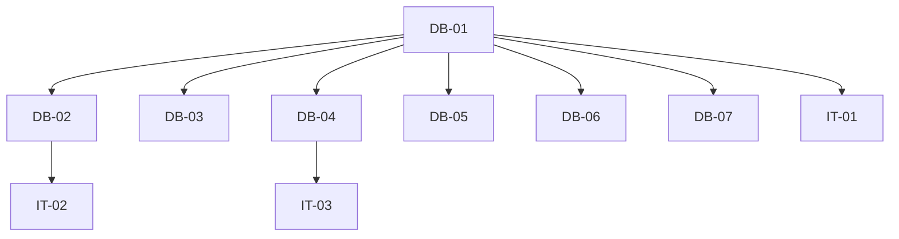

# Execution Backlog: ADR-001 (Schema: profiles.active/audit + invitations.professional_id)

## 1. Traceability Context

- **Source SPEC**: `./.spec/backend/gestao-usuarios-tenant-adr-001/SPEC.md`
- **Source PLAN**: `./.spec/backend/gestao-usuarios-tenant-adr-001/PLAN.md`
- **Goal**: Migration aditiva + guard + indice + FK composta + backfill + testes RLS/guard.

## 2. Sprint Summary

| Phase | Task ID | Type | Priority | Risk | Complexity | Status |
|-------|---------|------|----------|------|------------|--------|
| Phase 1 | DB-01 | Infra | P0 | High | M | Todo |
| Phase 1 | DB-02 | Infra | P0 | High | M | Todo |
| Phase 1 | DB-03 | Infra | P1 | Low | S | Todo |
| Phase 1 | DB-04 | Infra | P0 | Medium | S | Todo |
| Phase 1 | DB-05 | Infra | P0 | Medium | M | Todo |
| Phase 1 | DB-06 | Infra | P1 | Medium | M | Todo |
| Phase 1 | DB-07 | Infra | P2 | Low | S | Todo |
| Phase 2 | IT-01 | Test | P0 | High | M | Todo |
| Phase 2 | IT-02 | Test | P0 | High | S | Todo |
| Phase 2 | IT-03 | Test | P1 | Medium | S | Todo |

## 3. Dependency Graph

## 4. Task Backlog

### Task DB-01: Criar migration profiles_active_audit.sql

- **Constraint Ref**: SPEC 5.1
- **Depends on (PLAN)**: None
- **Dependency Type**: Hard
- **Layer**: Data
- **Task Type**: Infra
- **Priority**: P0
- **Risk Level**: High
- **Parallelizable**: No
- **Artifact**: `supabase/migrations/<ts>_profiles_active_audit.sql`
- **Framework Detail**: Supabase migration

#### Context & Domain Impact
- **Description**: Adicionar colunas active, deactivated_at/by, role_changed_at/by, email em profiles; backfill email.
- **Domain Impact**: Base para desativacao, auditoria e email desnormalizado.

#### Technical Enforcement
- **Rule**: Migration aditiva e idempotente (`add column if not exists`).
- **Failure Mode**: Re-run quebra ou perde dados.

#### Acceptance Criteria (BDD)
- **Scenario 1 (Success)**: Migration aplica em DB limpo e em DB com dados.
  - **Given** DB com profiles existentes
  - **When** migration roda
  - **Then** colunas existem, active=true, email preenchido.
- **Scenario 2 (Failure - re-run)**: Rodar migration 2x nao falha.
  - **Given** migration ja aplicada
  - **When** roda novamente
  - **Then** nenhuma alteracao/erro.
- **Scenario 3 (Edge - null email)**: Profile sem auth.users correspondente.
  - **Given** profile orfao
  - **When** backfill
  - **Then** email permanece null (sem erro).

#### Implementation Steps (TDD)
- [ ] Criar arquivo de migration com timestamp.
- [ ] Adicionar colunas + backfill + index.
- [ ] Rodar `supabase db reset` (local) e validar.

#### Definition of Done
- [ ] Migration aplica sem erro.
- [ ] Backfill idempotente.
- [ ] Sem TODOs.

---

### Task DB-02: Estender guard trigger profiles_guard_privileged_columns

- **Constraint Ref**: SPEC 4
- **Depends on (PLAN)**: DB-01
- **Dependency Type**: Hard
- **Layer**: Data
- **Task Type**: Infra
- **Priority**: P0
- **Risk Level**: High
- **Parallelizable**: No
- **Artifact**: trigger function
- **Framework Detail**: PostgreSQL trigger

#### Context & Domain Impact
- **Description**: Bloquear alteracao de active/deactivated_*/role_changed_*/email por sessao authenticated.
- **Domain Impact**: Impede burla de desativacao/auditoria.

#### Technical Enforcement
- **Rule**: BEFORE UPDATE; se auth.role()='authenticated' e coluna privilegiada mudou -> RAISE.
- **Failure Mode**: Cliente altera active/role/email diretamente.

#### Acceptance Criteria (BDD)
- **Scenario 1 (Success)**: service role altera colunas privilegiadas.
  - **Given** sessao service role
  - **When** UPDATE active
  - **Then** permitido.
- **Scenario 2 (Failure - authenticated)**: authenticated tenta alterar active.
  - **Given** sessao authenticated
  - **When** UPDATE active=true->false
  - **Then** RAISE EXCEPTION.
- **Scenario 3 (Edge - full_name)**: authenticated altera full_name.
  - **Given** sessao authenticated
  - **When** UPDATE full_name
  - **Then** permitido.

#### Implementation Steps (TDD)
- [ ] Editar trigger function para incluir novas colunas.
- [ ] Testar com sessao authenticated (SQL test).

#### Definition of Done
- [ ] Guard bloqueia privilegiadas.
- [ ] full_name editavel.
- [ ] Testes passando.

---

### Task DB-03: Adicionar indice profiles_tenant_id_active_idx

- **Constraint Ref**: SPEC 5.1
- **Depends on (PLAN)**: DB-01
- **Dependency Type**: Hard
- **Layer**: Data
- **Task Type**: Infra
- **Priority**: P1
- **Risk Level**: Low
- **Parallelizable**: Yes
- **Artifact**: index
- **Framework Detail**: PostgreSQL

#### Acceptance Criteria (BDD)
- **Scenario 1 (Success)**: indice existe apos migration.
- **Scenario 2 (Failure)**: N/A.
- **Scenario 3 (Edge)**: re-run nao duplica.

#### Implementation Steps
- [ ] `create index if not exists`.

#### Definition of Done
- [ ] Indice presente.

---

### Task DB-04: Backfill email em profiles (idempotente)

- **Constraint Ref**: SPEC 5.1
- **Depends on (PLAN)**: DB-01
- **Dependency Type**: Hard
- **Layer**: Data
- **Task Type**: Infra
- **Priority**: P0
- **Risk Level**: Medium
- **Parallelizable**: Yes
- **Artifact**: UPDATE statement
- **Framework Detail**: SQL

#### Acceptance Criteria (BDD)
- **Scenario 1 (Success)**: profiles com auth.users correspondente recebem email.
- **Scenario 2 (Failure - orfao)**: profile sem auth.users nao quebra.
- **Scenario 3 (Edge - re-run)**: backfill idempotente (where email is null).

#### Implementation Steps
- [ ] UPDATE ... from auth.users where email is null.

#### Definition of Done
- [ ] Emails preenchidos onde possivel.
- [ ] Re-run seguro.

---

### Task DB-05: Adicionar coluna invitations.professional_id

- **Constraint Ref**: SPEC 5.2
- **Depends on (PLAN)**: DB-01
- **Dependency Type**: Hard
- **Layer**: Data
- **Task Type**: Infra
- **Priority**: P0
- **Risk Level**: Medium
- **Parallelizable**: Yes
- **Artifact**: migration
- **Framework Detail**: Supabase migration

#### Acceptance Criteria (BDD)
- **Scenario 1 (Success)**: coluna existe, nullable.
- **Scenario 2 (Failure - cross-tenant)**: professional de outro tenant rejeitado (validacao na app/RLS).
- **Scenario 3 (Edge - null)**: convite sem professional_id permitido.

#### Implementation Steps
- [ ] ALTER TABLE invitations ADD COLUMN professional_id.
- [ ] FK para professionals(id) (nullable).
- [ ] Documentar validacao tenant na Edge Function.

#### Definition of Done
- [ ] Coluna presente, nullable.
- [ ] FK valida.

---

### Task DB-06: Garantir FK composta em professionals.profile_id (tenant match)

- **Constraint Ref**: SPEC 5.3
- **Depends on (PLAN)**: DB-01
- **Dependency Type**: Hard
- **Layer**: Data
- **Task Type**: Infra
- **Priority**: P1
- **Risk Level**: Medium
- **Parallelizable**: Yes
- **Artifact**: constraint
- **Framework Detail**: PostgreSQL

#### Acceptance Criteria (BDD)
- **Scenario 1 (Success)**: profile do mesmo tenant vincula.
- **Scenario 2 (Failure - cross-tenant)**: profile de outro tenant rejeitado.
- **Scenario 3 (Edge - null)**: professional sem profile permitido.

#### Implementation Steps
- [ ] Adicionar FK composta (tenant_id, profile_id) -> (tenant_id, id) em profiles, ou validacao na Edge Function se FK composta inviavel.
- [ ] Documentar decisao.

#### Definition of Done
- [ ] Tenant match garantido (constraint ou validacao documentada).

---

### Task DB-07: Helper current_user_is_active()

- **Constraint Ref**: SPEC 4
- **Depends on (PLAN)**: DB-01
- **Dependency Type**: Hard
- **Layer**: Data
- **Task Type**: Infra
- **Priority**: P2
- **Risk Level**: Low
- **Parallelizable**: Yes
- **Artifact**: function
- **Framework Detail**: PostgreSQL security definer

#### Acceptance Criteria (BDD)
- **Scenario 1 (Success)**: retorna true para usuario ativo.
- **Scenario 2 (Failure)**: retorna false para usuario inativo.
- **Scenario 3 (Edge)**: retorna false para usuario inexistente.

#### Implementation Steps
- [ ] CREATE OR REPLACE FUNCTION current_user_is_active().

#### Definition of Done
- [ ] Function presente e testada.

---

### Task IT-01: Teste RLS profile de outro tenant nao aparece

- **Constraint Ref**: RNF-01
- **Depends on (PLAN)**: DB-01..DB-07
- **Dependency Type**: Hard
- **Layer**: Integration
- **Task Type**: Test
- **Priority**: P0
- **Risk Level**: High
- **Parallelizable**: No
- **Artifact**: integration test
- **Framework Detail**: Supabase/Postgres test

#### Acceptance Criteria (BDD)
- **Scenario 1 (Success)**: usuario do tenant A ve profiles do tenant A.
- **Scenario 2 (Failure - cross-tenant)**: usuario do tenant A nao ve profiles do tenant B.
- **Scenario 3 (Edge)**: super_admin ve todos.

#### Implementation Steps
- [ ] Criar teste de integracao (SQL ou *IT).
- [ ] Validar RLS.

#### Definition of Done
- [ ] Teste passando.

---

### Task IT-02: Teste guard SQL authenticated nao altera colunas privilegiadas

- **Constraint Ref**: RNF-01
- **Depends on (PLAN)**: DB-02
- **Dependency Type**: Hard
- **Layer**: Integration
- **Task Type**: Test
- **Priority**: P0
- **Risk Level**: High
- **Parallelizable**: No
- **Artifact**: SQL test
- **Framework Detail**: Postgres

#### Acceptance Criteria (BDD)
- **Scenario 1 (Success)**: authenticated altera full_name.
- **Scenario 2 (Failure)**: authenticated altera active/role/email -> RAISE.
- **Scenario 3 (Edge)**: service role altera tudo.

#### Implementation Steps
- [ ] Criar teste SQL com set role authenticated.
- [ ] Validar RAISE.

#### Definition of Done
- [ ] Teste passando.

---

### Task IT-03: Teste backfill idempotente

- **Constraint Ref**: RNF-09
- **Depends on (PLAN)**: DB-04
- **Dependency Type**: Hard
- **Layer**: Integration
- **Task Type**: Test
- **Priority**: P1
- **Risk Level**: Medium
- **Parallelizable**: No
- **Artifact**: test
- **Framework Detail**: Supabase

#### Acceptance Criteria (BDD)
- **Scenario 1 (Success)**: re-run migration nao duplica/erro.
- **Scenario 2 (Failure)**: N/A.
- **Scenario 3 (Edge)**: profiles sem auth.users mantem null.

#### Implementation Steps
- [ ] Rodar migration 2x em DB de teste.
- [ ] Validar contagens.

#### Definition of Done
- [ ] Teste passando.

## 5. Coverage Validation

- [ ] All PLAN tasks converted and mapped.
- [ ] All constraints mapped to BDD scenarios.
- [ ] All tasks include failure mode.
- [ ] No circular dependencies.
- [ ] No orphan tasks.

## 6. Plan Feedback

- **Identified Issues**:
  - FK composta em professionals pode exigir ajuste de schema existente (validar na implementacao).
  - Transacao multi-tabela fica para ADR-002.
