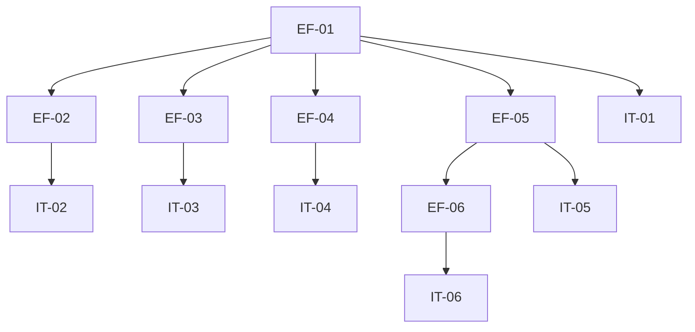

# Execution Backlog: ADR-002 (Edge Functions Privilegiadas)

## 1. Traceability Context

- **Source SPEC**: `./.spec/backend/gestao-usuarios-tenant-adr-002/SPEC.md`
- **Source PLAN**: `./.spec/backend/gestao-usuarios-tenant-adr-002/PLAN.md`
- **Goal**: Edge Functions privilegiadas + modificacao de invite/accept + testes.

## 2. Sprint Summary

| Phase | Task ID | Type | Priority | Risk | Complexity | Status |
|-------|---------|------|----------|------|------------|--------|
| Phase 1 | EF-01 | API | P0 | High | L | Todo |
| Phase 1 | EF-02 | API | P1 | Medium | M | Todo |
| Phase 1 | EF-03 | API | P0 | High | L | Todo |
| Phase 1 | EF-04 | API | P1 | Medium | M | Todo |
| Phase 2 | EF-05 | API | P0 | Medium | M | Todo |
| Phase 2 | EF-06 | API | P0 | High | L | Todo |
| Phase 3 | IT-01..IT-06 | Test | P0 | High | M | Todo |

## 3. Dependency Graph

## 4. Task Backlog

### Task EF-01: Criar deactivate-user Edge Function

- **Constraint Ref**: SPEC 2.1
- **Depends on (PLAN)**: ADR-001
- **Dependency Type**: Hard
- **Layer**: Interface
- **Task Type**: API
- **Priority**: P0
- **Risk Level**: High
- **Parallelizable**: No
- **Artifact**: `supabase/functions/deactivate-user/{index.ts,handler.ts,schemas.ts}`
- **Framework Detail**: Supabase Edge Function (Deno)

#### Context & Domain Impact
- **Description**: Desativar usuario (soft delete) com last-admin guard e revogacao de sessao.
- **Domain Impact**: Base para gestao de usuarios (RF-04).

#### Technical Enforcement
- **Rule**: admin do tenant; lock transacional; revogar sessoes; audit_log.
- **Failure Mode**: Lockout de tenant; token stale.

#### Acceptance Criteria (BDD)
- **Scenario 1 (Success)**: admin desativa usuario do tenant.
  - **Given** admin autenticado, usuario ativo do mesmo tenant
  - **When** POST deactivate-user
  - **Then** active=false, sessoes revogadas, audit_log registrado.
- **Scenario 2 (Failure - last admin)**: admin tenta desativar a si mesmo sendo unico admin.
  - **Given** unico admin ativo
  - **When** POST deactivate-user (self)
  - **Then** 409, nada muda.
- **Scenario 3 (Edge - cross-tenant)**: admin tenta desativar usuario de outro tenant.
  - **Given** admin do tenant A, usuario do tenant B
  - **When** POST deactivate-user
  - **Then** 403/404.

#### Implementation Steps (TDD)
- [ ] Criar handler.ts + schemas.ts (zod) + index.ts.
- [ ] Implementar validacao tenant, last-admin guard (lock), mutacao, revogacao, auditoria.
- [ ] Testes de integracao.

#### Definition of Done
- [ ] Edge Function deployada e testada.
- [ ] Last-admin guard funcional.
- [ ] Revogacao de sessao funcional.

---

### Task EF-02: Criar reactivate-user Edge Function

- **Constraint Ref**: SPEC 2.2
- **Depends on (PLAN)**: EF-01
- **Dependency Type**: Hard
- **Layer**: Interface
- **Task Type**: API
- **Priority**: P1
- **Risk Level**: Medium
- **Parallelizable**: Yes
- **Artifact**: `supabase/functions/reactivate-user/{index.ts,handler.ts,schemas.ts}`

#### Acceptance Criteria (BDD)
- **Scenario 1 (Success)**: admin reativa usuario inativo.
- **Scenario 2 (Failure - not admin)**: nao-admin tenta reativar -> 403.
- **Scenario 3 (Edge - ja ativo)**: reativar usuario ja ativo -> idempotente (200).

#### Implementation Steps
- [ ] Criar handler + schemas + index.
- [ ] Implementar mutacao active=true + audit_log.

#### Definition of Done
- [ ] Edge Function deployada e testada.

---

### Task EF-03: Criar change-user-role Edge Function

- **Constraint Ref**: SPEC 2.3
- **Depends on (PLAN)**: EF-01
- **Dependency Type**: Hard
- **Layer**: Interface
- **Task Type**: API
- **Priority**: P0
- **Risk Level**: High
- **Parallelizable**: No
- **Artifact**: `supabase/functions/change-user-role/{index.ts,handler.ts,schemas.ts}`

#### Acceptance Criteria (BDD)
- **Scenario 1 (Success)**: admin muda papel de usuario.
  - **Given** admin, usuario do mesmo tenant
  - **When** POST change-user-role
  - **Then** role atualizado, role_changed_at/by preenchidos, sessoes revogadas, audit_log.
- **Scenario 2 (Failure - last admin demotion)**: admin tenta rebaixar ultimo admin.
  - **Given** unico admin ativo
  - **When** POST change-user-role (admin->professional)
  - **Then** 409.
- **Scenario 3 (Edge - cross-tenant)**: admin tenta mudar papel de usuario de outro tenant -> 403/404.

#### Implementation Steps
- [ ] Criar handler + schemas + index.
- [ ] Validacao tenant, last-admin guard, mutacao, revogacao, auditoria.

#### Definition of Done
- [ ] Edge Function deployada e testada.

---

### Task EF-04: Criar unlink-professional-profile Edge Function

- **Constraint Ref**: SPEC 2.4
- **Depends on (PLAN)**: EF-01
- **Dependency Type**: Hard
- **Layer**: Interface
- **Task Type**: API
- **Priority**: P1
- **Risk Level**: Medium
- **Parallelizable**: Yes
- **Artifact**: `supabase/functions/unlink-professional-profile/{index.ts,handler.ts,schemas.ts}`

#### Acceptance Criteria (BDD)
- **Scenario 1 (Success)**: admin desvincula profile de professional.
  - **Given** professional com profile vinculado, mesmo tenant
  - **When** POST unlink-professional-profile
  - **Then** professionals.profile_id=null, audit_log.
- **Scenario 2 (Failure - not found)**: professional inexistente -> 404.
- **Scenario 3 (Edge - cross-tenant)**: admin de outro tenant -> 403/404.

#### Implementation Steps
- [ ] Criar handler + schemas + index.
- [ ] Implementar desvinculacao + auditoria.

#### Definition of Done
- [ ] Edge Function deployada e testada.

---

### Task EF-05: Modificar invite-member para aceitar professional_id

- **Constraint Ref**: SPEC 2.5
- **Depends on (PLAN)**: EF-01
- **Dependency Type**: Hard
- **Layer**: Interface
- **Task Type**: API
- **Priority**: P0
- **Risk Level**: Medium
- **Parallelizable**: No
- **Artifact**: `supabase/functions/invite-member/{handler.ts,schemas.ts}`

#### Acceptance Criteria (BDD)
- **Scenario 1 (Success)**: convite com professional_id valido.
  - **Given** admin, professional do mesmo tenant sem profile vinculado
  - **When** POST invite-member com professional_id
  - **Then** invitation criado com professional_id, email enviado.
- **Scenario 2 (Failure - cross-tenant)**: professional de outro tenant -> 400/403.
- **Scenario 3 (Edge - ja vinculado)**: professional ja tem profile -> 409.

#### Implementation Steps
- [ ] Adicionar professional_id ao schema (zod).
- [ ] Validar tenant + nao vinculado.
- [ ] Persistir em invitation.

#### Definition of Done
- [ ] invite-member aceita professional_id.
- [ ] Validacoes funcionais.

---

### Task EF-06: Modificar accept-invitation para vincular professional + email

- **Constraint Ref**: SPEC 2.6
- **Depends on (PLAN)**: EF-05
- **Dependency Type**: Hard
- **Layer**: Interface
- **Task Type**: API
- **Priority**: P0
- **Risk Level**: High
- **Parallelizable**: No
- **Artifact**: `supabase/functions/accept-invitation/handler.ts`

#### Acceptance Criteria (BDD)
- **Scenario 1 (Success)**: aceite de convite com professional_id vincula profile.
  - **Given** convite pendente com professional_id
  - **When** accept-invitation
  - **Then** profile criado, professionals.profile_id setado, email desnormalizado.
- **Scenario 2 (Failure - transacao)**: falha no vinculo -> rollback (profile nao criado ou professional nao vinculado).
- **Scenario 3 (Edge - sem professional_id)**: convite normal cria profile sem vinculo.

#### Implementation Steps
- [ ] Modificar handler para, apos criar profile, setar professionals.profile_id e email.
- [ ] Garantir transacao (rollback manual ou RPC).
- [ ] Desnormalizar email em profile.

#### Definition of Done
- [ ] Vinculacao funcional.
- [ ] Email desnormalizado.
- [ ] Testes passando.

---

### Task IT-01..IT-06: Testes de integracao

- **Constraint Ref**: SPEC 7
- **Depends on (PLAN)**: EF-01..EF-06
- **Dependency Type**: Hard
- **Layer**: Integration
- **Task Type**: Test
- **Priority**: P0
- **Risk Level**: High
- **Parallelizable**: No

#### Acceptance Criteria (BDD)
- Cada Edge Function tem teste de integracao cobrindo sucesso, falha (last-admin, cross-tenant) e edge.

#### Implementation Steps
- [ ] Criar testes em tests/integration/security/ para cada Edge Function.
- [ ] Validar RLS, tenant isolation, guard.

#### Definition of Done
- [ ] Todos os testes passando.
- [ ] Suite completa verde.

## 5. Coverage Validation

- [ ] All PLAN tasks converted and mapped.
- [ ] All constraints mapped to BDD scenarios.
- [ ] All tasks include failure mode.
- [ ] No circular dependencies.
- [ ] No orphan tasks.

## 6. Plan Feedback

- **Identified Issues**:
  - Transacao multi-tabela em accept-invitation requer cuidado (rollback manual ou RPC).
  - Lock transacional para last-admin (SELECT FOR UPDATE).
