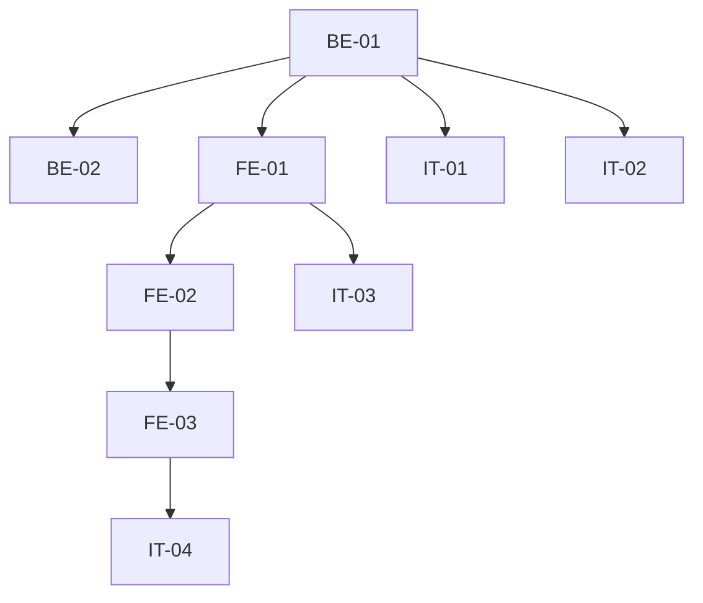

# Execution Backlog: ADR-003 (JWT Claim Active)

## 1. Traceability Context

- **Source SPEC**: `./.spec/backend/gestao-usuarios-tenant-adr-003/SPEC.md`
- **Source PLAN**: `./.spec/backend/gestao-usuarios-tenant-adr-003/PLAN.md`
- **Goal**: Emitir claim active no JWT + parse frontend + guard logout.

## 2. Sprint Summary

| Phase | Task ID | Type | Priority | Risk | Complexity | Status |
|-------|---------|------|----------|------|------------|--------|
| Phase 1 | BE-01 | API | P0 | High | M | Todo |
| Phase 1 | BE-02 | API | P0 | Medium | S | Todo |
| Phase 2 | FE-01 | Frontend | P0 | High | S | Todo |
| Phase 2 | FE-02 | Frontend | P0 | Medium | S | Todo |
| Phase 2 | FE-03 | Frontend | P0 | High | M | Todo |
| Phase 3 | IT-01..IT-04 | Test | P0 | High | M | Todo |

## 3. Dependency Graph

## 4. Task Backlog

### Task BE-01: Modificar hook custom-access-token para incluir claim active

- **Constraint Ref**: SPEC 2
- **Depends on (PLAN)**: ADR-001
- **Dependency Type**: Hard
- **Layer**: Interface
- **Task Type**: API
- **Priority**: P0
- **Risk Level**: High
- **Parallelizable**: No
- **Artifact**: `supabase/functions/custom-access-token/handler.ts` (ou hook SQL)
- **Framework Detail**: Supabase

#### Acceptance Criteria (BDD)
- **Scenario 1 (Success)**: usuario ativo recebe claim active=true.
  - **Given** usuario ativo
  - **When** hook roda
  - **Then** JWT contem active=true.
- **Scenario 2 (Inativo)**: usuario inativo -> hook responde 200 com claim active=false (cliente força logout).
  - **Given** usuario inativo
  - **When** hook roda
  - **Then** 200, JWT contem active=false; trava real via revogacao global (ADR-002) + RLS.
- **Scenario 3 (Edge)**: perfil ausente -> 200 com claims minimas (user_role=null, tenant_id=null, active=false) para fluxo de convite.

#### Implementation Steps
- [ ] Ler profiles.active no hook.
- [ ] Incluir active nas claims (active=false para inativos, 200).
- [ ] Nao falhar por active=false; trava real via revogacao global (ADR-002) + RLS.

#### Definition of Done
- [ ] Hook emite active para ativos.
- [ ] Hook emite active=false + 200 para inativos.

---

### Task BE-02: Atualizar profileRowSchema e buildHookClaims

- **Constraint Ref**: SPEC 2
- **Depends on (PLAN)**: BE-01
- **Dependency Type**: Hard
- **Layer**: Interface
- **Task Type**: API
- **Priority**: P0
- **Risk Level**: Medium
- **Parallelizable**: No
- **Artifact**: handler.ts

#### Acceptance Criteria (BDD)
- **Scenario 1 (Success)**: schema valida active boolean.
- **Scenario 2 (Failure)**: active ausente -> fail-closed.
- **Scenario 3 (Edge)**: active null -> fail-closed.

#### Implementation Steps
- [ ] Adicionar active: z.boolean() ao schema.
- [ ] Incluir active nas claims construidas.

#### Definition of Done
- [ ] Schema e claims atualizados.

---

### Task FE-01: Adicionar active ao tipo de claims e parser em auth-claims.ts

- **Constraint Ref**: SPEC 3
- **Depends on (PLAN)**: BE-01
- **Dependency Type**: Hard
- **Layer**: Frontend
- **Task Type**: Frontend
- **Priority**: P0
- **Risk Level**: High
- **Parallelizable**: No
- **Artifact**: `src/lib/auth-claims.ts`
- **Framework Detail**: TypeScript

#### Acceptance Criteria (BDD)
- **Scenario 1 (Success)**: claims com active=true parseiam active=true.
- **Scenario 2 (Failure - ausente)**: claims sem active -> active=false (fail-closed).
- **Scenario 3 (Edge - null)**: claims com active=null -> false.

#### Implementation Steps
- [ ] Adicionar active?: boolean ao tipo.
- [ ] Parser retorna active ?? false.

#### Definition of Done
- [ ] Parser fail-closed.

---

### Task FE-02: Expor active em useCurrentUser

- **Constraint Ref**: SPEC 3
- **Depends on (PLAN)**: FE-01
- **Dependency Type**: Hard
- **Layer**: Frontend
- **Task Type**: Frontend
- **Priority**: P0
- **Risk Level**: Medium
- **Parallelizable**: No
- **Artifact**: `src/hooks/useCurrentUser.ts`

#### Acceptance Criteria (BDD)
- **Scenario 1 (Success)**: useCurrentUser expoe active do claims.
- **Scenario 2 (Failure)**: claims null -> active=false.
- **Scenario 3 (Edge)**: sessao antiga sem claim -> false.

#### Implementation Steps
- [ ] Adicionar active ao CurrentUser interface.
- [ ] active = claims?.active ?? false.

#### Definition of Done
- [ ] active exposto.

---

### Task FE-03: Forcar logout em RequireAuth se active === false

- **Constraint Ref**: SPEC 3
- **Depends on (PLAN)**: FE-02
- **Dependency Type**: Hard
- **Layer**: Frontend
- **Task Type**: Frontend
- **Priority**: P0
- **Risk Level**: High
- **Parallelizable**: No
- **Artifact**: `src/app/guards/RequireAuth.tsx`

#### Acceptance Criteria (BDD)
- **Scenario 1 (Success)**: usuario ativo acessa normalmente.
- **Scenario 2 (Failure)**: usuario inativo -> logout + redirect /login com mensagem.
- **Scenario 3 (Edge)**: active ausente (sessao antiga) -> logout (fail-closed).

#### Implementation Steps
- [ ] Verificar active em RequireAuth.
- [ ] Se false: signOut + redirect /login.

#### Definition of Done
- [ ] Guard funcional.
- [ ] Sem loop de redirect.

---

### Task IT-01..IT-04: Testes

- **Constraint Ref**: SPEC 7
- **Depends on (PLAN)**: BE-01..FE-03
- **Dependency Type**: Hard
- **Layer**: Integration
- **Task Type**: Test
- **Priority**: P0
- **Risk Level**: High
- **Parallelizable**: No

#### Acceptance Criteria (BDD)
- Hook: ativo recebe claim active=true; inativo recebe claim active=false + 200; perfil ausente recebe 200 com claims minimas (fluxo de convite); erro de leitura/shape invalido -> 500.
- Frontend: active ausente -> false; guard forca logout.

#### Implementation Steps
- [ ] Criar testes de integracao (hook) e unit (frontend).
- [ ] Validar fail-closed.

#### Definition of Done
- [ ] Todos os testes passando.

## 5. Coverage Validation

- [ ] All PLAN tasks converted and mapped.
- [ ] All constraints mapped to BDD scenarios.
- [ ] All tasks include failure mode.
- [ ] No circular dependencies.
- [ ] No orphan tasks.

## 6. Plan Feedback

- **Identified Issues**:
  - Hook pode ser SQL (trigger) ou Edge Function; verificar implementacao existente antes de modificar.
  - Sessao antiga sem claim active deve ser tratada como inativa (fail-closed).
