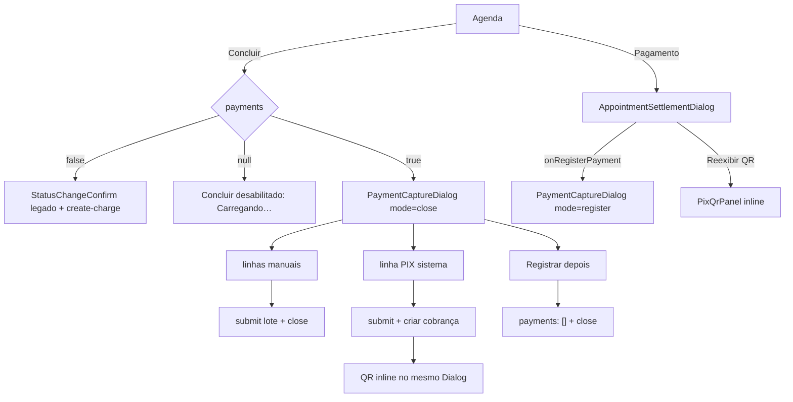

# SPEC — ADR-004 Frontend do fechamento do pagamento (scoped)

**Feature slug:** `cobranca-formas-pagamento-adr-004`
**ADR de origem:** `.spec/prd/cobranca-formas-pagamento/ADRs/ADR-004-frontend-fechamento-pagamento/ADR.md`
**Depende de:** ADR-001 (ledger/RLS), ADR-002 (RPC + 5 Edge Functions), ADR-003 (`create-charge` por parcela).
**Escopo:** `src/**` — componentes, catálogo, hooks, tipagem de wire, testes vitest. **Sem backend** (nenhuma migration, RPC, Edge ou `supabase/functions/**`).
**Stack real do repo:** React 18.3 + TS 5.6 + Vite 5 + shadcn/ui (Radix) + Tailwind + TanStack Query 5 + zod 3.23 + vitest 2.1/happy-dom. **Não há `react-i18next`** (ver §2.2).

---

## 1. Escopo funcional

Ao final desta entrega, em tenant `salao`/`barbearia`:

1. “Concluir” um atendimento abre `PaymentCaptureDialog` (`mode="close"`) e **não** cria cobrança automática.
2. O operador registra dinheiro/crédito/débito/PIX da maquininha/PIX do sistema em uma ou mais linhas, com gorjeta opcional e troco local.
3. “Registrar depois” conclui com `sem_pagamento`; o atendimento concluído mostra o selo “Pagamento pendente” e a ação “Pagamento”.
4. A ação “Pagamento” abre `AppointmentSettlementDialog` (total, pago, gorjeta, pendente, saldo, linhas, cobranças) com ações por papel.
5. Tenant `clinica`/legado (`payments === false`) mantém o fluxo atual sem regressão (RNF-12).

Fora: painel/aba Recebimentos, filtros por período e totais agregados (ADR-005); rota nova de detalhe; persistência de troco.

---

## 2. Regras vinculantes herdadas

### 2.1 Do ADR-004 §“Decisões do gate humano”

| # | Regra |
|---|---|
| D1 | Selo “Pagamento pendente” (texto + ícone + `aria-label`) e ação “Pagamento” no `AgendaItem` e no `AppointmentBlock`; toggle de filtro “Pagamento pendente (N)”. |
| D2 | Chips são **botões de ação** (`Adicionar <método>`), **sem** `aria-pressed`. “Registrar depois” fica **fora** da fileira de chips (rodapé). |
| D3 | Recepção pode reexibir QR de cobrança pendente não expirada após a conclusão, **se o servidor devolver**. A UI obedece `permissions.can_view_qr` + `pix_qr_code != null`; nunca fabrica nem cacheia QR. |
| D4 | i18n = catálogo local tipado `src/app/agenda/pagamentos/payments-messages.ts`; componentes recebem `messages` por prop. |
| D5 | `payments: boolean \| null` distingue desligado de não resolvido; “Concluir” bloqueado até resolver. |
| D6 | Confirmações são `InlineConfirmStep` **dentro do mesmo `Dialog`**; nunca `Dialog` sobre `Dialog`. |
| D7 | Tokens reais: jade (`--primary`), Space Grotesk (`font-display`), `--status-*`. Nenhum token novo, nenhum “Pulse”. |
| D8 | Sem rota nova de detalhe: settlement abre pelo item da agenda. |
| D9 | 10 componentes de design system + 2 shells + `PixQrDialog` refatorado sobre `PixQrPanel`. |
| D10 | Hooks: `useRegisterAppointmentPayments`, `useAppointmentSettlement`, `useCancelCharge`, `useVoidAppointmentPayment`; `useCreateCharge` com `{appointment_id, amount_cents, idempotency_key}`; `usePermissions` ganha 6 capacidades. |

### 2.2 Desvio documentado de i18n (RNF-03)

Mesmo desvio já aceito em `cadastro-messages.ts` (ADR-003 UI): o repo não tem infra `react-i18next`, então o catálogo é um módulo TS tipado. **Toda** string visível (inclui `title`, `aria-label`, `placeholder`, `alt`, texto de botão e mensagem de erro) vem do catálogo. Migração futura para `react-i18next` = troca mecânica de import.

### 2.3 Do `docs/FRONTEND_COMPONENTS_GUIDE.md` (§6 Dialog)

- `DialogTitle` + `DialogDescription` obrigatórios; foco preso; retorno de foco ao abridor; `X`/ESC respeitam as travas de estado.
- Corpo com `max-h-[70vh] overflow-y-auto pr-1` (diálogo nunca transborda a viewport).
- Footer desabilitado enquanto `submitting`, com `Loader2` animado.
- Proibido empilhar diálogos (guide §6.5 item 3).

---

## 3. Fluxo de telas



### 3.1 Regras de navegação (uma fonte de estado na página)

`AgendaPage` é o **único** dono de: `statusChange`, `captureTarget { appointment, mode }`, `settlementAppointmentId`.

- `handleChangeStatus(appointment, "concluido")`:
  - `payments === true` → **não** abre `StatusChangeConfirm`; abre `captureTarget = { appointment, mode: "close" }`.
  - `payments === null` → retorna sem efeito (item do menu está `disabled`).
  - `payments === false` → caminho atual (sensível → `StatusChangeConfirm`, que mantém `useCreateCharge` legado).
- `onRegisterPayment` do settlement: **fecha o settlement primeiro** (`setSettlementId(null)`) e só então abre o capture em `mode="register"` — no mesmo handler, no mesmo tick. Nunca dois `Dialog` abertos.
- Ação “Pagamento” no item/bloco: `setSettlementId(appointment.id)`, visível quando `payments === true && canRegisterPayments && status ∈ {em_atendimento, concluido}`.

---

## 4. Gating tri-state de segmento

### 4.1 Contrato

```ts
// src/lib/segment-features.ts
export interface SegmentFeatures {
  commission: boolean;
  combos: boolean;
  /** null = tenant ainda não resolvido. NÃO é "desligado". */
  payments: boolean | null;
}

export function resolveFeatures(
  segment: BusinessSegment | null | undefined,
  tenantResolved?: boolean, // default true
): SegmentFeatures;
```

- `resolveFeatures(segment, false)` → `payments: null` (estado “não resolvido”), `commission/combos` seguem o mapeamento atual.
- `resolveFeatures("salao" | "barbearia", true)` → `payments: true`.
- `resolveFeatures("clinica" | null | undefined | valor sujo, true)` → `payments: false`.
- `useSegmentFeatures()` passa `tenantResolved = !isLoadingAuth` de `useCurrentUser()`. **Sem request novo** (reusa `["tenant", tenantId]`).

### 4.2 Efeito na UI

| `payments` | “Concluir” | Ação “Pagamento” | Selo | Toggle de filtro |
|---|---|---|---|---|
| `null` | item `disabled`, rótulo `payments.gating.loading` (“Carregando…”) + `aria-describedby` com o motivo | oculto | oculto | oculto |
| `false` | fluxo legado (`StatusChangeConfirm`) | oculto | oculto | oculto |
| `true` | abre `PaymentCaptureDialog` | visível (RBAC §8) | conforme §7 | conforme §7 |

**Proibido** tratar `null` como `false`: cair no legado durante o load é o defeito D5 (cria cobrança automática indevida).

---

## 5. Componentes — 10 design system + 2 shells

Todos os componentes de §5.1 são **puros**: sem `fetch`, sem `supabase`, sem `useQuery`/`useMutation`, sem `sonner`, sem `useNavigate`, sem `useCurrentUser`. Recebem dados + `messages` por prop e emitem callbacks. Um componente = **um DOM** (card/row por CSS; sem tabela + cards duplicados).

### 5.1 Design system

| # | Componente | Arquivo | Props essenciais | Estados |
|---|---|---|---|---|
| 1 | `PaymentStatusBadge` | `src/app/agenda/pagamentos/PaymentStatusBadge.tsx` | `{ status: PaymentStatus; messages; className? }` | renderiza só `sem_pagamento`/`parcial`/`aguardando_pix`; `quitado` → `null` |
| 2 | `PaymentMethodChip` | `.../PaymentMethodChip.tsx` | `{ method; disabled?; disabledReason?; onSelect; messages }` | default/hover/focus/disabled |
| 3 | `PaymentLineRow` | `.../PaymentLineRow.tsx` | `{ line; remainingCents; disabled; onChange; onRemove; messages }` | valor válido, excedente, recebido < valor, cartão não confirmado |
| 4 | `PaymentLinesEditor` | `.../PaymentLinesEditor.tsx` | `{ lines; settlement; disabled; onAdd; onUpdate; onRemove; messages }` | vazio, 1 linha, split, PIX duplicado bloqueado |
| 5 | `PaymentTotalsSummary` | `.../PaymentTotalsSummary.tsx` | `{ totalCents; paidCents; reservedCents; draftCents; remainingCents; tipCents; messages }` | `aria-live="polite"`; total zero |
| 6 | `PaymentReceipt` | `.../PaymentReceipt.tsx` | `{ data: ReceiptData; timeZone; messages }` | quitado/parcial/sem_pagamento/aguardando_pix |
| 7 | `PendingChargeCard` | `.../PendingChargeCard.tsx` | `{ charge; canViewQr; canCancel; canReissue; expired; onShowQr; onCancel; onReissue; messages; timeZone }` | com QR, `pix_qr_code === null` (“PIX não gerado”), expirada |
| 8 | `SettlementPaymentRow` | `.../SettlementPaymentRow.tsx` | `{ payment; canVoid; onVoidRequest; messages; timeZone }` | ativa, estornada (motivo só para admin), origem `manual`/`asaas` |
| 9 | `InlineConfirmStep` | `.../InlineConfirmStep.tsx` | `{ title; description; confirmLabel; cancelLabel; tone?: "default"\|"destructive"; busy?; children?; onConfirm; onCancel; testId? }` | default/destructive/busy; `role="alertdialog"` interno **sem** portal |
| 10 | `PixQrPanel` | `.../PixQrPanel.tsx` | `{ qrCode; copyPaste; expiresAt; amountCents; status?; messages; timeZone; onCopyResult? }` | QR presente, QR ausente, expirado |

### 5.2 Shells (containers — podem usar hooks/sonner)

| Shell | Arquivo | Props (congeladas no ADR) |
|---|---|---|
| `PaymentCaptureDialog` | `src/app/agenda/pagamentos/PaymentCaptureDialog.tsx` | `{ open; mode: "close"\|"register"; appointment: { id; customerName; serviceName; professionalName; totalCents; status }; onOpenChange; onCompleted? }` |
| `AppointmentSettlementDialog` | `src/app/agenda/pagamentos/AppointmentSettlementDialog.tsx` | `{ open; appointmentId; onOpenChange; onRegisterPayment? }` |

`PixQrDialog` (existente em `CobrancasPage.tsx`) é extraído para `src/app/cobrancas/PixQrDialog.tsx`, mantém a assinatura `{ charge, open, onClose }` e passa a renderizar `<Dialog><PixQrPanel/></Dialog>` — **um** diálogo, zero duplicação de markup de QR.

### 5.3 Anatomia e comportamento por componente

#### 5.3.1 `PaymentStatusBadge`

- `<span>` com `bg-status-pendente text-status-pendente-foreground` + `<AlertCircle aria-hidden>` + texto.
- Texto sempre visível (nunca só cor). `aria-label` = `payments.badge.pendingAria` interpolado com o status legível.
- `data-testid="payment-badge"`.
- `aguardando_pix` usa o mesmo selo com sufixo “Aguardando PIX” (chave `payments.badge.awaitingPix`).

#### 5.3.2 `PaymentMethodChip`

- `<button type="button">`, `h-11 min-h-[44px]`, `aria-label = payments.actions.addMethodNamed` interpolado com `payments.method[method]`.
- **Sem** `aria-pressed`, **sem** `role="radio"` (D2): o chip não representa seleção; seleção = linha existente.
- `disabled` + `aria-describedby={reasonId}` quando `pix_sistema` já existe, quando o tenant não tem Asaas (`payments.error.noAsaas`) ou quando `disabled`.
- `data-testid="payment-method-chip-<method>"`.

#### 5.3.3 `PaymentLineRow`

Uma `<li>` com grid que colapsa (mobile 1 coluna; ≥md `[1.2fr_1fr_1fr_1fr_auto]`). Campos:

- Cabeçalho: nome do método (texto, não editável) + `source`? (não: rascunho não tem origem) + botão remover (`aria-label = payments.actions.removeLine`, só visível quando `!disabled`).
- `Valor` (MoneyInput, centavos) — `label htmlFor` obrigatório.
- `Gorjeta` (MoneyInput) + `tipHint` em `aria-describedby`.
- **Só dinheiro:** `Valor recebido` (MoneyInput) + `Troco` em `<output>`; `changeCents = max(received - amount, 0)`; se `received > 0 && received < amount` → erro inline `role="alert"` com `payments.error.cashShort` e `data-invalid`.
- **Só cartões e PIX maquininha:** `<Checkbox id>` + `<Label>` “Confirmei na maquininha” (obrigatório).
- **Nenhum campo de bandeira, NSU, adquirente, PAN ou CVV** (RNF/PCI).
- `data-testid="payment-line-<key>"`.

#### 5.3.4 `PaymentLinesEditor`

- Fileira de chips (5 métodos) + botão “Adicionar forma” (abre o próximo método disponível; nunca duplica `pix_sistema`).
- Lista de `PaymentLineRow`.
- Estado vazio: `payments.dialog.emptyLines` + ícone; nunca um espaço em branco.
- Não renderiza “Registrar depois” (D2 — fica no `DialogFooter` da shell).
- `data-testid="payment-lines-editor"`.

#### 5.3.5 `PaymentTotalsSummary`

- Bloco `role="group"` com 2–4 pares rótulo/valor: `Total`, `Já pago`, `Falta para quitar`, `Gorjeta` (quando > 0).
- Região `aria-live="polite" aria-atomic="true"` para “Falta para quitar” e “Troco”, para não interromper a digitação.
- Valores sempre via `formatCentsToBRL`. Nunca `Intl` local no componente.

#### 5.3.6 `PaymentReceipt`

- `<article data-testid="payment-receipt">` com `aria-labelledby` no título.
- Mostra: total do serviço, linhas por forma (serviço), gorjeta em linha própria, troco **somente** quando `changeCents != null`, status legível, data/hora do lançamento (fuso do tenant), cliente/serviço/profissional.
- **Proibido**: QR, copia-e-cola, token, id de gateway, dados de cartão.
- Não é documento fiscal (texto `payments.receipt.note`).

#### 5.3.7 `PendingChargeCard`

- Uma `<li>` por cobrança: valor, expiração, status; ações `Reexibir QR` (`canViewQr`), `Cancelar PIX` (`canCancel`), `Reemitir PIX` (`canReissue`).
- `pix_qr_code === null` → “PIX não gerado” + `Tentar de novo` (desabilita `Reexibir QR`), nunca QR vazio.
- Expirada/vencida → badge textual “Expirado” + `Reemitir PIX`.
- `data-testid="settlement-pending-charge-<id>"`.

#### 5.3.8 `SettlementPaymentRow`

- Uma `<li>`: forma, valor de serviço, gorjeta, origem (`Manual`/`PIX`), operador (quando o payload trouxer), data/hora no fuso do tenant, status.
- Estornada: linha visivelmente atenuada + `line-through` **e** texto “Estornada” + motivo (somente quando `voidReason != null` — o servidor já recorta para admin).
- Ação `Estornar` só quando `canVoid && !payment.voided`.
- `data-testid="settlement-payment-<id>"`.

#### 5.3.9 `InlineConfirmStep`

- `<div role="group" aria-labelledby>` (não `alertdialog`, para não duplicar semântica modal dentro do Dialog) com título, descrição, `children` opcional (ex.: textarea de motivo) e 2 botões.
- `tone="destructive"` → `variant="destructive"`; foco inicial no botão de cancelar (ação segura).
- **Nunca** monta `Dialog`/`DialogContent`/portal.
- `data-testid={testId ?? "inline-confirm"}`.

#### 5.3.10 `PixQrPanel`

- `<div>` com `` (`alt = payments.pix.qrAlt`), campo read-only com copia-e-cola + botão copiar, expiração e valor.
- Normaliza o QR: `value.startsWith("data:") ? value : "data:image/png;base64," + value`.
- Sem QR → mensagem `payments.pix.unavailable` (nunca ``).
- Copiar usa `navigator.clipboard` e reporta por `onCopyResult("ok"|"error")`; o toast é responsabilidade da shell (componente puro).
- `data-testid="pix-qr-panel"`.

---

## 6. Hooks e cache

### 6.1 Contratos (assinaturas congeladas)

```ts
// src/hooks/useAppointmentPayments.ts
export const SETTLEMENT_KEY = ["appointment-settlement"] as const;

export function useAppointmentSettlement(
  appointmentId: string | null,
  options?: { enabled?: boolean; poll?: boolean },
): UseQueryResult<AppointmentSettlement, PaymentApiError>;

export interface RegisterPaymentsInput {
  appointmentId: string;
  idempotencyKey: string;
  closeAppointment: boolean;
  payments: Array<{ method: PaymentMethod; amountCents: number; tipCents: number }>;
}
export interface RegisterPaymentsResponse {
  settlement: AppointmentSettlement;
  charge: PixCharge | null;
  replayed: boolean;
}
export function useRegisterAppointmentPayments(): UseMutationResult<
  RegisterPaymentsResponse, PaymentApiError, RegisterPaymentsInput
>;

export function useCancelCharge(): UseMutationResult<
  CancelChargeResponse, PaymentApiError, { chargeId: string; force?: boolean }
>;

export function useConfirmManualCharge(): UseMutationResult<
  ConfirmManualResponse, PaymentApiError, { chargeId: string }
>;

export function useVoidAppointmentPayment(): UseMutationResult<
  VoidPaymentResponse, PaymentApiError, { paymentId: string; reason: string }
>;
```

> `useConfirmManualCharge` é **necessário** para a ação admin “baixa manual de PIX” já congelada no ADR-004 §3 (`can_confirm_manual`). Não é hook novo de produto; é o consumo da Edge `confirm-charge-manual` entregue pela ADR-002.

```ts
// src/hooks/useCharges.ts (alterado)
export interface CreateChargeInput {
  appointmentId?: string;      // camelCase (novo)
  appointment_id?: string;     // snake_case (compat)
  amountCents?: number;        // parcela PIX (novo)
  amount_cents?: number;
  idempotencyKey?: string;     // novo
  idempotency_key?: string;
}
```

**Normalização do body** (o componente nunca monta JSON):
- `appointment_id = appointmentId ?? appointment_id`
- Se `amountCents`/`amount_cents` presentes → body `{ appointment_id, amount_cents, idempotency_key }` (novo, ADR-003).
- Ausentes → body `{ appointment_id }` (fallback de rollout, RNF-11).
- `amount_cents` inválido (≤ 0 / não inteiro) → erro local antes do `invoke`.

```ts
// src/hooks/useAgendaPaymentFlags.ts
export type AgendaPaymentFlag = PaymentStatus | "unknown";
export function useAgendaPaymentFlags(
  rows: ReadonlyArray<{ id: string; price_cents: number; status: AppointmentStatus }>,
  options?: { enabled?: boolean },
): {
  statusById: ReadonlyMap<string, AgendaPaymentFlag>;
  pendingCount: number;
  isLoading: boolean;
  isError: boolean;
};
```

### 6.2 Transporte e erros

- Toda chamada usa `supabase.functions.invoke(<nome>, { body })` **dentro de hook**. Nenhum componente importa `supabase`.
- Resposta validada por zod antes de sair do hook (`settlementSchema`, `registerResponseSchema`, `pixChargeSchema`, …). Campo desconhecido é preservado (`.passthrough()` apenas onde o contrato é aditivo: `stale_charges`, `can_reissue_pix`).
- Erro não-2xx: o hook lê `error.context` (Response), clona o body JSON e lança `PaymentApiError` (`code`, `status`, `retryable`, `settlement?`, `pixAmountCents?`). Falha de parse → `code: "NETWORK"`.
- `src/lib/payment-errors.ts` (puro): mapeia `code` → `{ messageKey, retryable, action }`. **Nenhum componente compara mensagem de texto.**

### 6.3 Keys e invalidação

| Query | Key |
|---|---|
| settlement | `["appointment-settlement", appointmentId]` |
| agenda | `["appointments"]` |
| cobranças | `["charges"]` |
| resumo financeiro (ADR-005) | `["financial-summary"]` |

Após sucesso de register/cancel/confirm/void: invalida settlement do atendimento + `["appointments"]` + `["charges"]` + `["financial-summary"]`. **Nunca** a cada tecla; **nunca** refetch da agenda durante a digitação.

### 6.4 Polling do PIX

`useAppointmentSettlement(id, { enabled: open, poll: phase === "awaiting_pix" })`:
- `staleTime: 0` enquanto aberto.
- `refetchInterval`: 5 s nos primeiros 60 s desde a abertura; 10 s depois (backoff); `false` quando `poll === false`.
- Para ao fechar, ao sucesso ou quando `payment_status === "quitado"`.
- Sem polling global, sem `setInterval` fora do TanStack Query.

---

## 7. Agenda — selo, ação e filtro (com lacuna declarada)

### 7.1 Fonte de dados (uma query em lote, nunca por linha)

`useAgendaPaymentFlags` faz **duas** leituras em lote, habilitadas apenas quando `canViewFinancials && payments === true`:

1. `appointment_payments` (`appointment_id, amount_cents, tip_cents, voided_at`) `.in("appointment_id", ids)`.
2. `charges` (`appointment_id, amount_cents, status, expires_at`) `.in("appointment_id", ids)`.

`derivePaymentStatus({ totalCents, paidCents, reservedCents })` aplica **exatamente** a precedência da ADR-002 (total zero → `quitado`; `paid >= total` → `quitado`; existe pendente → `aguardando_pix`; `paid = 0` → `sem_pagamento`; senão `parcial`).

### 7.2 Lacuna declarada (não silenciosa)

A RLS de `appointment_payments` e `charges` é **admin-only**. Para recepção/profissional o hook fica desabilitado e devolve `unknown`; nesse caso:

- **Não** renderizar selo e **não** exibir o toggle (um selo inventado seria mentira de dado).
- A ação “Pagamento” continua disponível: o settlement é server-autorizado e mostra o estado real.
- Se o produto exigir paridade do selo para recepção no v1, é necessário **adendo à ADR-002** (campo `payment_status` por atendimento no payload da agenda) — backend, fora deste escopo. Registrado como pendência para o orquestrador.

### 7.3 Distribuição de props

`AgendaPage` calcula `paymentFlags` e repassa:

- `AgendaItem` (lista): `paymentFlag`, `onOpenPayment`, `canRegisterPayments`.
- `AgendaCalendarDay` / `AgendaCalendarWeek` → `AppointmentBlock`: `paymentFlag`, `onOpenPayment` (pass-through, sem lógica).
- Toggle: `AgendaPaymentFilter` (inline em `AgendaPage`, `aria-pressed` **sim** — é filtro, não chip de método) com rótulo `payments.agenda.filterPending` interpolado com `pendingCount`; só renderiza quando `canViewFinancials && payments === true` e `pendingCount > 0`.

---

## 8. Matriz de permissões

### 8.1 CAPACIDADES CLIENTE (`usePermissions`, defesa em profundidade)

| Capacidade | admin | professional | receptionist |
|---|:--:|:--:|:--:|
| `canRegisterPayments` | ✅ | ✅ | ✅ |
| `canViewFinancials` | ✅ | ❌ | ❌ |
| `canViewOwnPayments` | ❌ | ✅ | ❌ |
| `canCancelCharge` | ✅ | ❌ | ✅ |
| `canConfirmManualCharge` | ✅ | ❌ | ❌ |
| `canVoidPayment` | ✅ | ❌ | ❌ |
| `canViewPaymentTotalsInClosing` | ✅ | ✅ | ✅ |

### 8.2 AÇÃO EFETIVA = flag do servidor **E** capacidade cliente **E** `payments === true`

| Ação | `settlement.permissions` | Capacidade | admin | recepção | profissional (próprio) |
|---|---|---|---|---|---|
| Registrar pagamento | `can_register` | `canRegisterPayments` | ✅ | ✅ | ✅ |
| Cancelar PIX | `can_cancel_charge` | `canCancelCharge` | ✅ | ✅ | ❌ |
| Baixa manual de PIX | `can_confirm_manual` | `canConfirmManualCharge` | ✅ | ❌ | ❌ |
| Estornar recebimento | `can_void` | `canVoidPayment` | ✅ | ❌ | ❌ |
| Reexibir QR | `can_view_qr` + `pix_qr_code != null` | — (servidor) | ✅ | ✅ se servidor devolver | ✅ se servidor devolver |
| Reemitir PIX | `can_reissue_pix` | `canRegisterPayments` | ✅ | ✅ | ✅ |
| Ver motivo do estorno | `void_reason != null` | — (servidor) | ✅ | ❌ | ❌ |

Regras duras:

- Saldo/totais: **somente** dentro do diálogo, **somente** de um atendimento. Nunca em lista, período ou histórico (D5/RF-20).
- Profissional só abre o próprio atendimento (servidor responde 403 `PROFESSIONAL_NOT_OWNER`; a UI mostra `payments.error.forbidden`).
- Nenhum `tenant_id`/`role`/`actor_id` é enviado pelo cliente.

---

## 9. Máquina de estados — `PaymentCaptureDialog`

### 9.1 Fase

```ts
type CapturePhase =
  | { kind: "loading_settlement" }
  | { kind: "editing" }
  | { kind: "confirm_partial"; draft: PaymentLineDraft[] }
  | { kind: "confirm_register_later" }
  | { kind: "confirm_discard"; pendingAction: "close" | "leave" }
  | { kind: "submitting"; reason: "register" | "register_later" }
  | { kind: "awaiting_pix"; charge: PixCharge }
  | { kind: "gateway_error"; settlement: AppointmentSettlement; pixAmountCents: number; persisted: boolean }
  | { kind: "success"; settlement: AppointmentSettlement; receipt: ReceiptData }
  | { kind: "error"; code: string };
```

### 9.2 Transições

| De | Evento | Para | Efeito |
|---|---|---|---|
| `loading_settlement` | settlement ok | `editing` | total = `settlement.appointment.total_cents` (fallback `appointment.totalCents`); `idempotencyKey = crypto.randomUUID()` |
| `loading_settlement` | erro | `error` | `payments.error.generic`, botão refetch |
| `editing` | submit com soma < remaining e ≥ 0 | `confirm_partial` | nada persiste antes do “Confirmar” |
| `editing` | submit com soma = remaining / 0 em close | `submitting` | lote com `close_appointment: mode === "close"` |
| `editing` | “Registrar depois” (close) | `confirm_register_later` | `payments: []` |
| `editing` | X/ESC com rascunho | `confirm_discard` | descarta rascunho e fecha |
| `submitting` | 200 + `charge` | `awaiting_pix` | QR inline; inicia polling |
| `submitting` | 200 sem `charge` | `success` | comprovante |
| `submitting` | 422 `GATEWAY_ERROR` | `gateway_error` | `persisted = response.settlement.payments.length > 0` |
| `submitting` | 409 `IDEMPOTENCY_CONFLICT` | `editing` | regenera chave + `payments.error.idempotency` |
| `submitting` | outro erro | `error` | mantém rascunho; permite voltar a `editing` |
| `awaiting_pix` | polling `quitado` | `success` | comprovante |
| `gateway_error` | “Tentar de novo” | `submitting` | ver §9.4 |
| `gateway_error` | “Fechar sem o PIX” / “Concluir sem pagamento” | `success` | usa settlement persistido |
| `success` | “Concluir” | fecha | `onCompleted?.(settlement)` + invalida |

### 9.3 Travas

- `submitting`: `onOpenChange` bloqueado (X, ESC, overlay) — `Dialog` com `onInteractOutside`/`onEscapeKeyDown` prevenidos.
- `editing`/`gateway_error`/`success`: fechar permitido; com linhas não persistidas → `confirm_discard`.
- Duplo submit: `disabled={phase.kind === "submitting"}` + guarda por `isPending`.

### 9.4 Retry de gateway (ADR item 12)

1. Refetch do settlement.
2. `appointment.status === "concluido"` → **somente** `useCreateCharge({ appointmentId, amountCents: pixAmountCents, idempotencyKey })` (as linhas e o status já commitados).
3. `em_atendimento` → reenvia o lote completo com a **mesma** `idempotencyKey`.
4. Chave só é regenerada em: sucesso, edição após erro, ou `IDEMPOTENCY_CONFLICT`.

### 9.5 Idempotência e edição

- `idempotencyKey` nasce no `editing` inicial (após settlement).
- Qualquer `onChange` de linha **antes** do primeiro submit **não** regenera (payload ainda não enviado).
- Após um `IDEMPOTENCY_CONFLICT`, regenera e exige revisão explícita (banner + confirmar de novo).
- Após `success`, a chave morre com o diálogo.

### 9.6 Dinheiro, gorjeta e excedente (invariantes locais)

```
remaining_cents  = settlement.remaining_cents                  // já exclui pago + reservado
draftCents       = Σ line.amountCents                          // serviço (inclui intenção PIX)
draftRemaining   = max(remaining_cents - draftCents, 0)
changeCents      = max(cashReceivedCents - line.amountCents, 0) // por linha de dinheiro
tipCents         = Σ line.tipCents                             // NÃO conta para quitar
```

- `draftCents > remaining_cents` → `payments.error.exceeds`; submit bloqueado.
- `total === 0` → nenhuma linha positiva aceita; só “Registrar depois”/close sem pagamento.
- `cashReceived > 0 && cashReceived < amountCents` → `payments.error.cashShort`; submit bloqueado.
- Cartão/PIX maquininha sem `confirmed` → submit bloqueado.
- `pix_sistema` no máximo 1 (chip desabilitado com motivo).
- Troco **não** vai no body e **não** é persistido; o comprovante mostra o valor calculado na sessão (declarado no rodapé do comprovante).

---

## 10. Máquina de estados — `AppointmentSettlementDialog`

```ts
type SettlementPhase =
  | { kind: "loading" }
  | { kind: "ready" }
  | { kind: "error"; code: string }
  | { kind: "qr"; chargeId: string }
  | { kind: "confirm_cancel"; chargeId: string; force: boolean }
  | { kind: "confirm_manual"; chargeId: string }
  | { kind: "confirm_void"; paymentId: string };
```

| Ação | Passo | Chamada | Sucesso |
|---|---|---|---|
| Registrar pagamento | fecha settlement → abre capture(`register`) | — | — |
| Reexibir QR | `qr` (renderiza `PixQrPanel` inline) | — | copiar |
| Cancelar PIX | `confirm_cancel` (destructive) | `cancel-charge` | invalida + `ready` |
| Baixa manual | `confirm_manual` | `confirm-charge-manual` | invalida + `ready` |
| Estornar | `confirm_void` com textarea (≤ 500, obrigatório) | `void-appointment-payment` | `ready`; se `refund_required` → aviso `payments.void.refundWarning` |
| Reemitir PIX | — | `create-charge` (mesma appointment) | `qr` |
| Fechar | — | — | `onOpenChange(false)` |

Estados obrigatórios: `loading` (Skeleton), `empty` (sem recebimentos → texto positivo), `error` (com “Tentar novamente”). O diálogo **não** agrega outros atendimentos, **não** tem período e **não** tem aba.

---

## 11. Catálogo de chaves (`payments-messages.ts`)

Forma: objeto único `paymentsMessages` + `type PaymentsMessages = typeof paymentsMessages` + `formatMessage(template, values)` puro (substitui `{chave}`). Teste garante: toda folha é `string` não vazia e nenhum literal de UI fora do catálogo nos arquivos novos.

| Grupo | Chaves |
|---|---|
| `gating` | `loading`, `resolving` |
| `method` | `dinheiro`, `cartao_credito`, `cartao_debito`, `pix_sistema`, `pix_maquininha` |
| `dialog` | `title`, `subtitle`, `total`, `remaining`, `paid`, `appointmentSummary`, `emptyLines`, `loading` |
| `fields` | `amount`, `cashReceived`, `change`, `tip`, `tipHint`, `cardConfirmed` |
| `actions` | `addMethod`, `addMethodNamed`, `removeLine`, `registerLater`, `confirm`, `back`, `cancel`, `close`, `retry`, `finishWithoutPix`, `finishWithoutPayment`, `copy`, `copied`, `copyFailed`, `reissue` |
| `status` | `sem_pagamento`, `parcial`, `quitado`, `aguardando_pix` |
| `partial` | `warning`, `confirm` |
| `discard` | `warning`, `confirm` |
| `registerLater` | `warning` |
| `error` | `exceeds`, `gateway`, `pendingExists`, `pixUsed`, `idempotency`, `cashShort`, `cardNotConfirmed`, `noAsaas`, `network`, `forbidden`, `generic` |
| `receipt` | `title`, `paid`, `methods`, `date`, `tip`, `change`, `note`, `issuedAt` |
| `badge` | `pending`, `pendingAria`, `awaitingPix` |
| `void` | `title`, `reason`, `reasonPlaceholder`, `refundWarning`, `confirm`, `done` |
| `settlement` | `title`, `subtitle`, `loading`, `empty`, `error`, `retry`, `total`, `paid`, `tip`, `pending`, `balance`, `paymentsTitle`, `chargesTitle`, `registerPayment`, `confirmManual`, `cancelCharge`, `showQr`, `noQr`, `expired`, `originManual`, `originAsaas`, `voided`, `voidReason`, `reissue`, `ownOnly` |
| `agenda` | `filterPending`, `filterPendingAria`, `actionPayment`, `actionPaymentAria`, `concludeLoading` |
| `pix` | `title`, `qrAlt`, `copyLabel`, `expiresAt`, `unavailable`, `close` |
| `chargesPage` | `title`, `description`, `filters.status`, `filters.from`, `filters.to`, `status.*` (`todos`, `pendente`, `pago`, `expirado`, `cancelado`), `table.status`, `table.value`, `table.createdAt`, `table.actions`, `actionQr`, `loading`, `errorTitle`, `errorDescription`, `emptyTitle`, `emptyDescription` |

Textos congelados do ADR §6 são **literalmente** os valores acima; o `ux-designer` pode ajustar valores sem tocar em contrato.

---

## 12. i18n e proibição de literal

- Novo código: **zero** string visível fora do catálogo (JSX, `aria-label`, `title`, `placeholder`, `alt`, `label`, mensagem de erro).
- `data-testid` não é texto de UI (permitido e obrigatório).
- Componentes recebem `messages`; nenhum importa o catálogo diretamente (exceto as shells, que o repassam) — isso permite teste com catálogo-sonda.
- Exceções declaradas: componentes compartilhados pré-existentes (`StatusBadge`, `PageHeader`, `StatePanel`) mantêm suas strings; não são reescritos nesta entrega.

---

## 13. Acessibilidade e responsividade (RNF-02/RNF-04)

- `DialogTitle` + `DialogDescription` em **todos** os estados das duas shells (descrição pode ser `sr-only` quando o passo não tiver copy própria).
- Foco inicial: primeiro chip de método (capture) / botão “Fechar” (settlement em `error`).
- `aria-live="polite"` em “Falta para quitar” e “Troco”; `role="alert"` em todo erro de validação e de API.
- Alvos ≥ 44×44 px (`h-11`), `focus-visible:ring-2 ring-ring`.
- Contraste AA nos tokens `--status-*` (já validados por `src/lib/contrast.test.ts` no padrão do repo); selo nunca só por cor.
- Teclado: Tab previsível; Enter confirma no `InlineConfirmStep`; ESC fecha só quando o estado permite.
- Layout: 1 coluna em 375 px; 2 colunas em ≥ 1024 px (`lg:grid-cols-[1fr_320px]` no settlement). Linhas viram cards via CSS (`grid-cols-1 md:grid-cols-[…]`), **sem** duplicar DOM.
- Diálogo com scroll interno, nunca maior que a viewport.

---

## 14. Invariantes

| # | Invariante |
|---|---|
| I1 | Componente de apresentação não faz fetch, não usa `supabase`, `useQuery`, `useMutation`, `sonner` ou `useCurrentUser`. |
| I2 | Todo dinheiro trafega em centavos inteiros; exibição só por `formatCentsToBRL`; entrada só por `parseBRLToCents`/`MoneyInput`; nunca `type="number"`, nunca float. |
| I3 | Um DOM por componente; `data-testid` estável; sem tabela + cards duplicados. |
| I4 | Nunca `Dialog` sobre `Dialog`; toda confirmação é `InlineConfirmStep` dentro do diálogo corrente. |
| I5 | `payments === null` nunca cai no fluxo legado; “Concluir” fica bloqueado até resolver. |
| I6 | Nenhum texto literal em componente novo; catálogo é a única fonte. |
| I7 | Nenhum `tenant_id`/`role`/`actor_id` no body; nenhum dado de cartão em campo, body ou estado. |
| I8 | Erro de API é decidido por `code`, nunca por mensagem. |
| I9 | Troco é estado de sessão, nunca persistido; receita usa `amountCents`. |
| I10 | `idempotencyKey` só muda por sucesso, edição pós-erro ou `IDEMPOTENCY_CONFLICT`. |

---

## 15. Rastreabilidade RF → requisito desta SPEC

| RF | Requisito na UI |
|---|---|
| RF-01 | §5.1 (#2/#4) chips exatos; §4 gating; “Registrar depois” no rodapé |
| RF-02 | §5.3.3 dinheiro + troco; §9.6 `cashShort` |
| RF-03 | §5.3.3 cartões sem troco; §9.6 `exceeds` |
| RF-04 | `pix_maquininha` sem QR e sem gateway (só linha manual + checkbox) |
| RF-05 | §9.2 `awaiting_pix` com QR inline; receita só após gateway |
| RF-06 | §3.1 “Concluir” não cria cobrança; `create-charge` só por escolha/retry |
| RF-07 | `PaymentLinesEditor` split + `PaymentReceipt` multi-linha |
| RF-08 | §9.2 `confirm_partial`; nada persiste sem confirmar |
| RF-09 | §9.6 `exceeds` + gorjeta |
| RF-10 | `tip_cents` por linha; comprovante separa gorjeta |
| RF-11 | `confirm_register_later` → `sem_pagamento` + selo |
| RF-12 | `PaymentCaptureDialog mode="register"` a partir do settlement |
| RF-13 | `SettlementPaymentRow` + `confirm_void` (motivo obrigatório) |
| RF-14 | §9.5 chave de idempotência e regeneração |
| RF-15 | §9.6 limite `draft ≤ remaining` |
| RF-16 | `pix_sistema` no máximo 1; `pendingExists` |
| RF-18 | `confirm_manual` (admin) |
| RF-19 | `confirm_cancel` (admin/recepção) |
| RF-20 | recepção sem lista/período/totais; só o diálogo de um atendimento |
| RF-21 | profissional só o próprio (403 → `forbidden`) |
| RF-22 | §9.6 total zero |
| RF-23 | `useAsaasConfig` → chip PIX desabilitado com `noAsaas` |
| RF-26 | `PixQrPanel` + `can_view_qr` do servidor (D3) |
| RF-27 | §9.4 `gateway_error` com retry / fechar sem PIX |
| RNF-01 | §6.4 polling; sem refetch por tecla; uma chamada ao abrir |
| RNF-02 | §13 |
| RNF-03 | §12 |
| RNF-04 | §13 |
| RNF-08 | §5.3.8/§11: sem PII em log/toast; `void_reason` só admin |
| RNF-12 | §4.2 `payments === false` preserva o fluxo atual |

---

## 16. Fora de escopo

- Qualquer alteração em `supabase/migrations/**`, `supabase/functions/**`, RPC ou RLS.
- Painel/aba Recebimentos, relatórios, filtros de período, totais agregados (ADR-005).
- Rota nova de detalhe do atendimento; mudança de `APPOINTMENT_SELECT`.
- Persistência de troco, caixa/turno, comprovante fiscal/PDF.
- `react-i18next` (catálogo local tipado é o contrato).
- Selo na lista para recepção/profissional (depende de adendo à ADR-002 — §7.2).
- Reescrita de `StatusChangeConfirm` para outras transições.

---

## 17. Estratégia de teste

### 17.1 Unitários puros (ambiente `node`)

- `payments-messages.test.ts`: toda folha é string não vazia; nenhum placeholder órfão; `formatMessage` substitui e preserva desconhecidos.
- `payment-math.test.ts`: remaining/troco/excedente/gorjeta; precedência de `derivePaymentStatus` idêntica à ADR-002; total zero.
- `payment-errors.test.ts`: cada `code` → `messageKey`/`retryable`/`action`; `NETWORK` em erro sem body; código desconhecido → genérico.
- `segment-features.test.ts`: `null` vs `false` vs `true`; `tenantResolved=false` → `payments: null`; regressão de `commission`/`combos`.

### 17.2 Componentes (`// @vitest-environment happy-dom` + Testing Library)

- Catálogo-sonda: `makeMessagesSpy(paymentsMessages)` devolve cada folha como `⟪chave⟫`; qualquer literal no DOM falha a asserção (prova RNF-03 sem lint frágil).
- Cada um dos 10 componentes: render feliz, estado vazio/erro, a11y (`getByRole`/`getByLabelText`), `data-testid`.
- `PaymentLineRow`: cartão não mostra troco; dinheiro mostra; `received < amount` desabilita e exibe `role="alert"`.
- `PaymentMethodChip`: não tem `aria-pressed`; `disabled` tem `aria-describedby`.
- `PaymentReceipt`: nunca renderiza QR/token; gorjeta separada; troco só quando calculado.

### 17.3 Hooks (`renderHook` + `QueryClientProvider`, `supabase` mockado)

- `useAppointmentSettlement`: body `{ appointment_id }`, parse do payload, 403 → `PaymentApiError` com `code`, polling liga/desliga.
- `useRegisterAppointmentPayments`: camelCase → snake_case exato; `close_appointment` correto; invalidação das 4 keys.
- `useCreateCharge`: 3 formas de input (novo com amount, snake, legado sem amount).
- `useCancelCharge`/`useConfirmManualCharge`/`useVoidAppointmentPayment`: body e invalidação.
- `useAgendaPaymentFlags`: 2 queries em lote, `unknown` quando desabilitado, contagem.
- `usePermissions`: matriz completa por papel.

### 17.4 Fluxo de estados (componente com hooks mockados)

`PaymentCaptureDialog.test.tsx` cobre: parcial → confirmação → submit; gateway error → retry com settlement `concluido` (chama só `create-charge`); `IDEMPOTENCY_CONFLICT` regenera chave; ESC bloqueado em `submitting`; “Registrar depois” envia `payments: []`.

### 17.5 E2E Chrome DevTools (harness, `mcp.required`)

`npm run dev:up` (API 54321, DB 54322, Vite 5173) → tenant `salao` com Asaas ativo → 12 passos:

1. Concluir com dinheiro 100,00 + recebido 120,00 → troco 20,00 no comprovante; zero cobrança em `/cobrancas`.
2. Split dinheiro 60,00 + débito 40,00 → settlement `quitado` com 2 linhas.
3. Parcial 40,00 → confirmação explícita; “Voltar” não persiste.
4. “Registrar depois” → `sem_pagamento`, selo “Pagamento pendente”, zero cobrança.
5. PIX do sistema 30,00 → QR no mesmo diálogo; receita não sobe antes do webhook.
6. Estorno (admin) com motivo → linha estornada, saldo sobe, motivo visível só ao admin.
7. Baixa manual (admin) em cobrança pendente → recebimento `manual` + settling `quitado`.
8. Cancelar PIX (recepção) → cobrança `cancelado`, sem receita.
9. Recepção abre settlement de concluído → sem estorno/baixa manual; QR conforme `can_view_qr`.
10. Profissional abre atendimento alheio → erro tratado, sem vazamento.
11. Filtro “Pagamento pendente (N)” (admin) filtra a lista e o N bate.
12. 375×800 e 1280×800: sem overflow horizontal, foco visível, console zero `[ERROR]`, network sem 4xx/5xx inesperado.

Screenshots em `.spec/frontend/cobranca-formas-pagamento-adr-004/harness/`. Encerrar portas por PID (`lsof -ti :54321 :54322 :5173`), **nunca** `pkill -f`.

---

## 18. Critérios de aceite (gate de conclusão)

1. `npm run typecheck` e `npm run build` sem erro.
2. `npm run test` verde, incluindo os novos testes; nenhum teste pré-existente quebrado (H2).
3. Nenhum arquivo `supabase/**` alterado (`git diff --stat` prova).
4. `grep -rn "type=\"number\"" src/app/agenda/pagamentos` vazio.
5. `grep -rn "DialogContent" src/app/agenda/pagamentos | wc -l` == 2 (somente as shells) e `PixQrDialog`.
6. Nenhum `formatCents(` restante em `src/app/cobrancas`.
7. Zero literal de UI nos arquivos novos (teste do catálogo-sonda + revisão).
8. E2E 12 passos executado com evidência; console limpo.
9. Matriz de permissões exercitada (admin/recepção/profissional) no E2E.
10. `brain_store` do aprendizado e `harness_report` preenchidos.
