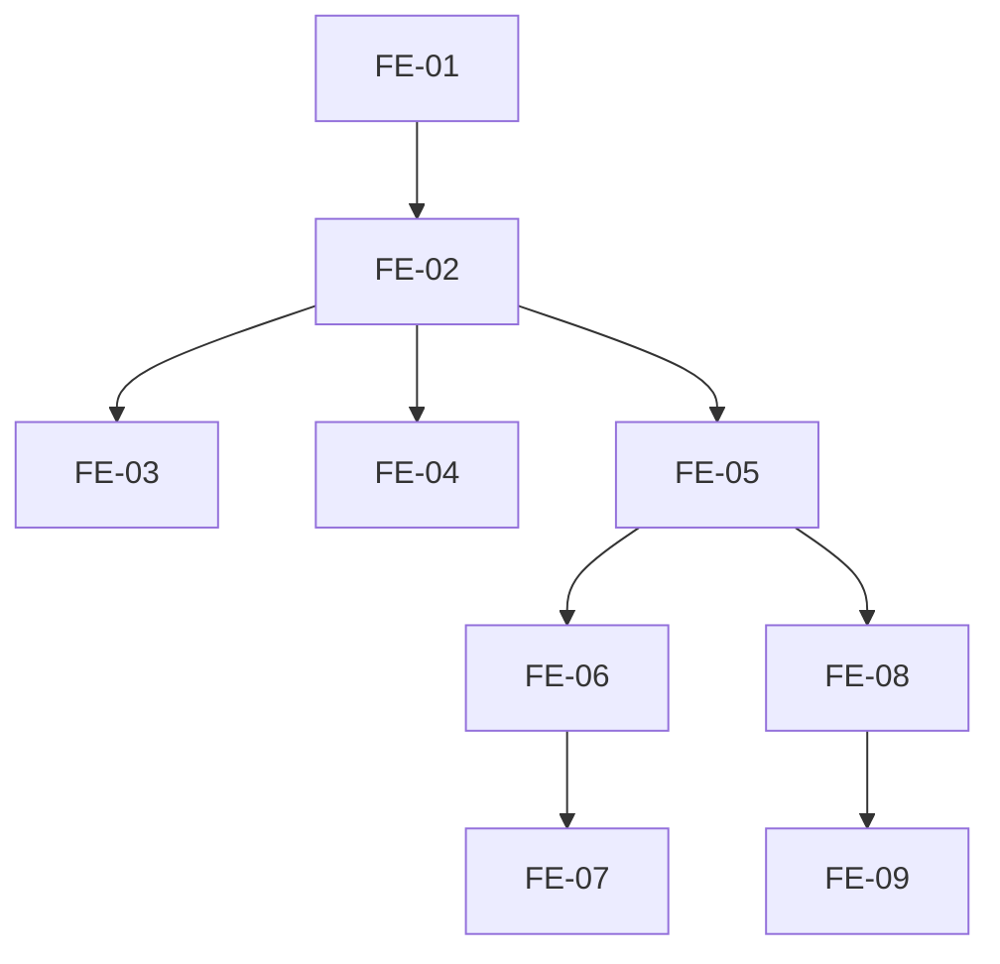

# Execution Backlog: ADR-004 (Frontend: UsuariosPage + Visual por Papel)

## 1. Traceability Context

- **Source SPEC**: `./.spec/frontend/gestao-usuarios-tenant-adr-004/SPEC.md`
- **Source PLAN**: `./.spec/frontend/gestao-usuarios-tenant-adr-004/PLAN.md`
- **Goal**: Tela de Usuarios (tabs) + sidebar por capacidade + route guards + redirect por papel + copy.

## 2. Sprint Summary

| Phase | Task ID | Type | Priority | Risk | Complexity | Status |
|-------|---------|------|----------|------|------------|--------|
| Phase 1 | FE-01 | Frontend | P0 | Medium | M | Todo |
| Phase 1 | FE-02 | Frontend | P0 | Medium | L | Todo |
| Phase 1 | FE-03 | Frontend | P0 | Medium | M | Todo |
| Phase 1 | FE-04 | Frontend | P1 | Low | M | Todo |
| Phase 2 | FE-05 | Frontend | P0 | Medium | M | Todo |
| Phase 2 | FE-06 | Frontend | P0 | High | M | Todo |
| Phase 2 | FE-07 | Frontend | P1 | Medium | M | Todo |
| Phase 2 | FE-08 | Frontend | P0 | Medium | M | Todo |
| Phase 2 | FE-09 | Frontend | P2 | Low | S | Todo |
| Phase 3 | IT-01..IT-06 | Test | P0 | Medium | M | Todo |

## 3. Dependency Graph

## 4. Task Backlog

### Task FE-01: Criar hook useTenantUsers

- **Constraint Ref**: SPEC 3
- **Depends on (PLAN)**: ADR-002
- **Dependency Type**: Hard
- **Layer**: Frontend
- **Task Type**: Frontend
- **Priority**: P0
- **Risk Level**: Medium
- **Parallelizable**: No
- **Artifact**: `src/hooks/useTenantUsers.ts`
- **Framework Detail**: TanStack Query + Supabase

#### Acceptance Criteria (BDD)
- **Scenario 1 (Success)**: admin carrega profiles do tenant.
- **Scenario 2 (Failure)**: erro de rede -> StatePanel retry.
- **Scenario 3 (Edge)**: loading -> skeleton.

#### Implementation Steps
- [ ] Criar hook com useQuery (profiles select sob RLS).
- [ ] Expor data, isLoading, isError, refetch.

#### Definition of Done
- [ ] Hook funcional e testado.

---

### Task FE-02: Renomear/evoluir MembrosPage -> UsuariosPage com tabs

- **Constraint Ref**: SPEC 2
- **Depends on (PLAN)**: FE-01
- **Dependency Type**: Hard
- **Layer**: Frontend
- **Task Type**: Frontend
- **Priority**: P0
- **Risk Level**: Medium
- **Parallelizable**: No
- **Artifact**: `src/app/config/usuarios/UsuariosPage.tsx`
- **Framework Detail**: React + shadcn/ui Tabs

#### Acceptance Criteria (BDD)
- **Scenario 1 (Success)**: admin ve tabs Ativos e Convites.
- **Scenario 2 (Failure)**: nao-admin nao acessa (guard).
- **Scenario 3 (Edge)**: empty state em ambas tabs.

#### Implementation Steps
- [ ] Criar UsuariosPage com Tabs (Ativos/Convites).
- [ ] Admin only (RequireRole).
- [ ] Registrar rota /app/config/usuarios.

#### Definition of Done
- [ ] Pagina funcional e testada.

---

### Task FE-03: Implementar AtivosTab

- **Constraint Ref**: SPEC 3
- **Depends on (PLAN)**: FE-02
- **Dependency Type**: Hard
- **Layer**: Frontend
- **Task Type**: Frontend
- **Priority**: P0
- **Risk Level**: Medium
- **Parallelizable**: No
- **Artifact**: `src/app/config/usuarios/AtivosTab.tsx`

#### Acceptance Criteria (BDD)
- **Scenario 1 (Success)**: admin ve tabela/cards de profiles.
- **Scenario 2 (Failure)**: erro -> StatePanel.
- **Scenario 3 (Edge)**: empty state.

#### Implementation Steps
- [ ] Tabela (desktop) / cards (mobile) com nome, email, papel, status, desde.
- [ ] Acoes: editar nome, trocar papel, desativar/reativar (via Edge Functions).
- [ ] Loading (skeleton), error, empty.

#### Definition of Done
- [ ] AtivosTab funcional e testado.

---

### Task FE-04: Integrar ConvitesTab

- **Constraint Ref**: SPEC 3
- **Depends on (PLAN)**: FE-02
- **Dependency Type**: Hard
- **Layer**: Frontend
- **Task Type**: Frontend
- **Priority**: P1
- **Risk Level**: Low
- **Parallelizable**: Yes
- **Artifact**: `src/app/config/usuarios/ConvitesTab.tsx`

#### Acceptance Criteria (BDD)
- **Scenario 1 (Success)**: convites por email + papel.
- **Scenario 2 (Failure)**: erro -> retry.
- **Scenario 3 (Edge)**: empty state.

#### Implementation Steps
- [ ] Migrar logica de MembrosPage para ConvitesTab.
- [ ] Reenviar/revogar convites.

#### Definition of Done
- [ ] ConvitesTab funcional e testado.

---

### Task FE-05: Filtrar AppSidebar por capacidades

- **Constraint Ref**: SPEC 4
- **Depends on (PLAN)**: FE-02
- **Dependency Type**: Hard
- **Layer**: Frontend
- **Task Type**: Frontend
- **Priority**: P0
- **Risk Level**: Medium
- **Parallelizable**: No
- **Artifact**: `src/components/AppSidebar.tsx`

#### Acceptance Criteria (BDD)
- **Scenario 1 (Success)**: admin ve todos os itens.
- **Scenario 2 (Failure)**: professional nao ve Cobrancas/Config admin.
- **Scenario 3 (Edge)**: receptionist nao ve financeiro.

#### Implementation Steps
- [ ] Filtrar items por usePermissions (canViewCommission, isAdmin, etc.).
- [ ] Professional: Visao geral, Agenda, Clientes (leitura), Horarios.
- [ ] Receptionist: Visao geral, Agenda, Clientes.

#### Definition of Done
- [ ] Sidebar por role funcional e testado.

---

### Task FE-06: Adicionar RequireRole guards em rotas

- **Constraint Ref**: SPEC 5
- **Depends on (PLAN)**: FE-05
- **Dependency Type**: Hard
- **Layer**: Frontend
- **Task Type**: Frontend
- **Priority**: P0
- **Risk Level**: High
- **Parallelizable**: No
- **Artifact**: `src/router.tsx`

#### Acceptance Criteria (BDD)
- **Scenario 1 (Success)**: admin acessa todas as rotas.
- **Scenario 2 (Failure)**: professional tenta /app/cobrancas -> redirect /app + toast.
- **Scenario 3 (Edge)**: receptionist tenta /app/config/pagamentos -> redirect.

#### Implementation Steps
- [ ] Adicionar RequireRole(['admin']) em rotas financeiras/config.
- [ ] Excecao: profissionais/horarios para professional (ownership).
- [ ] Redirect + toast.

#### Definition of Done
- [ ] Guards funcionais e testados.

---

### Task FE-07: Ownership check em horarios

- **Constraint Ref**: SPEC 5
- **Depends on (PLAN)**: FE-06
- **Dependency Type**: Hard
- **Layer**: Frontend
- **Task Type**: Frontend
- **Priority**: P1
- **Risk Level**: Medium
- **Parallelizable**: No
- **Artifact**: `src/app/config/profissionais/horarios/HorariosPage.tsx`

#### Acceptance Criteria (BDD)
- **Scenario 1 (Success)**: professional edita horarios proprios.
- **Scenario 2 (Failure)**: professional tenta horarios de outro -> bloqueado.
- **Scenario 3 (Edge)**: admin edita qualquer.

#### Implementation Steps
- [ ] Verificar ownership (professional_id === ownProfessional.id).
- [ ] Bloquear se nao owner (admin bypass).

#### Definition of Done
- [ ] Ownership funcional.

---

### Task FE-08: Redirect pos-login por papel

- **Constraint Ref**: SPEC 6
- **Depends on (PLAN)**: FE-05
- **Dependency Type**: Hard
- **Layer**: Frontend
- **Task Type**: Frontend
- **Priority**: P0
- **Risk Level**: Medium
- **Parallelizable**: No
- **Artifact**: `src/auth/resolvePostLoginDestination.ts`

#### Acceptance Criteria (BDD)
- **Scenario 1 (Success)**: professional -> /app/agenda.
- **Scenario 2 (Success)**: receptionist -> /app/agenda.
- **Scenario 3 (Success)**: admin -> /app.

#### Implementation Steps
- [ ] Mapear role -> destino.
- [ ] Atualizar resolvePostLoginDestination.

#### Definition of Done
- [ ] Redirect por papel funcional e testado.

---

### Task FE-09: Copy por papel no Dashboard

- **Constraint Ref**: SPEC 7
- **Depends on (PLAN)**: FE-08
- **Dependency Type**: Hard
- **Layer**: Frontend
- **Task Type**: Frontend
- **Priority**: P2
- **Risk Level**: Low
- **Parallelizable**: Yes
- **Artifact**: `src/app/dashboard/DashboardPage.tsx`

#### Acceptance Criteria (BDD)
- **Scenario 1 (Success)**: professional ve "Sua agenda".
- **Scenario 2 (Success)**: admin ve "Visao geral".

#### Implementation Steps
- [ ] Ajustar copy baseado em role.

#### Definition of Done
- [ ] Copy por papel funcional.

---

### Task IT-01..IT-06: Testes

- **Constraint Ref**: SPEC 11
- **Depends on (PLAN)**: FE-01..FE-09
- **Dependency Type**: Hard
- **Layer**: Integration (Frontend)
- **Task Type**: Test
- **Priority**: P0
- **Risk Level**: Medium
- **Parallelizable**: No

#### Acceptance Criteria (BDD)
- useTenantUsers, UsuariosPage, AppSidebar, route guards, redirect, a11y.

#### Implementation Steps
- [ ] Criar testes unitarios (vitest) para cada componente/hook.
- [ ] Validar a11y (foco, labels, contraste).

#### Definition of Done
- [ ] Todos os testes passando.
- [ ] npm test + npm run build verdes.

## 5. Coverage Validation

- [ ] All PLAN tasks converted and mapped.
- [ ] All constraints mapped to BDD scenarios.
- [ ] All tasks include failure mode.
- [ ] No circular dependencies.
- [ ] No orphan tasks.

## 6. Plan Feedback

- **Identified Issues**:
  - MembrosPage sera evoluido para UsuariosPage (rename). Verificar testes existentes (MembrosPage.test.tsx) para atualizar.
  - ConvitesTab migra logica de MembrosPage.
