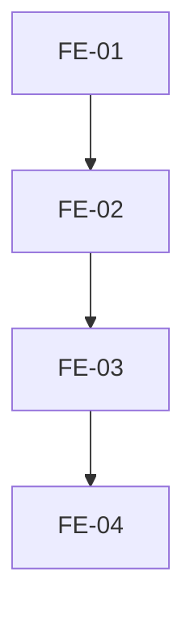

# Execution Backlog: ADR-005 (Vinculo Profissional <-> Login)

## 1. Traceability Context

- **Source SPEC**: `./.spec/frontend/gestao-usuarios-tenant-adr-005/SPEC.md`
- **Source PLAN**: `./.spec/frontend/gestao-usuarios-tenant-adr-005/PLAN.md`
- **Goal**: UX de vinculo profissional<->login (convite pre-cadastrado + revogacao).

## 2. Sprint Summary

| Phase | Task ID | Type | Priority | Risk | Complexity | Status |
|-------|---------|------|----------|------|------------|--------|
| Phase 1 | FE-01 | Frontend | P0 | Medium | M | Todo |
| Phase 1 | FE-02 | Frontend | P0 | Medium | M | Todo |
| Phase 2 | FE-03 | Frontend | P1 | Low | S | Todo |
| Phase 2 | FE-04 | Frontend | P1 | Medium | M | Todo |
| Phase 3 | IT-01..IT-04 | Test | P0 | Medium | M | Todo |

## 3. Dependency Graph

## 4. Task Backlog

### Task FE-01: Adicionar botao "Convidar para acesso" em ProfissionaisPage

- **Constraint Ref**: SPEC 2
- **Depends on (PLAN)**: ADR-002
- **Dependency Type**: Hard
- **Layer**: Frontend
- **Task Type**: Frontend
- **Priority**: P0
- **Risk Level**: Medium
- **Parallelizable**: No
- **Artifact**: `src/app/config/profissionais/ProfissionaisPage.tsx`
- **Framework Detail**: React + shadcn/ui

#### Acceptance Criteria (BDD)
- **Scenario 1 (Success)**: admin ve botao "Convidar para acesso" em profissional sem login.
- **Scenario 2 (Failure)**: botao nao aparece para non-admin ou profissional com login.
- **Scenario 3 (Edge)**: profissional inativo nao exibe botao.

#### Implementation Steps
- [ ] Adicionar botao condicional (isAdmin && !profile_id).
- [ ] Abrir ConviteProfissionalDialog ao clicar.

#### Definition of Done
- [ ] Botao funcional.

---

### Task FE-02: Criar ConviteProfissionalDialog

- **Constraint Ref**: SPEC 2
- **Depends on (PLAN)**: FE-01
- **Dependency Type**: Hard
- **Layer**: Frontend
- **Task Type**: Frontend
- **Priority**: P0
- **Risk Level**: Medium
- **Parallelizable**: No
- **Artifact**: `src/app/config/profissionais/ConviteProfissionalDialog.tsx`

#### Acceptance Criteria (BDD)
- **Scenario 1 (Success)**: admin envia convite com professional_id.
- **Scenario 2 (Failure)**: email invalido -> erro.
- **Scenario 3 (Edge)**: professional ja vinculado -> 409.

#### Implementation Steps
- [ ] Dialog com email input + papel fixo (professional) + professional_id.
- [ ] Chamar useInviteMember com professional_id.
- [ ] Toast sucesso/erro.

#### Definition of Done
- [ ] Dialog funcional e testado.

---

### Task FE-03: Exibir "Acesso vinculado a: email" em ProfessionalFormDialog

- **Constraint Ref**: SPEC 2
- **Depends on (PLAN)**: FE-02
- **Dependency Type**: Hard
- **Layer**: Frontend
- **Task Type**: Frontend
- **Priority**: P1
- **Risk Level**: Low
- **Parallelizable**: No
- **Artifact**: `src/app/config/profissionais/ProfessionalFormDialog.tsx`

#### Acceptance Criteria (BDD)
- **Scenario 1 (Success)**: profissional com profile_id exibe "Acesso vinculado".
- **Scenario 2 (Failure)**: profissional sem profile_id exibe "Sem login vinculado".
- **Scenario 3 (Edge)**: admin ve botao "Revogar acesso" quando vinculado.

#### Implementation Steps
- [ ] Atualizar bloco "Acesso" para mostrar email vinculado (se disponivel).
- [ ] Adicionar botao "Revogar acesso" (admin, profile_id not null).

#### Definition of Done
- [ ] Exibicao funcional.

---

### Task FE-04: Adicionar botao "Revogar acesso" com Dialog de confirmacao

- **Constraint Ref**: SPEC 2
- **Depends on (PLAN)**: FE-03
- **Dependency Type**: Hard
- **Layer**: Frontend
- **Task Type**: Frontend
- **Priority**: P1
- **Risk Level**: Medium
- **Parallelizable**: No
- **Artifact**: `src/app/config/profissionais/ProfessionalFormDialog.tsx`

#### Acceptance Criteria (BDD)
- **Scenario 1 (Success)**: admin revoga acesso -> professional.profile_id=null, toast sucesso.
- **Scenario 2 (Failure)**: erro -> toast erro.
- **Scenario 3 (Edge)**: confirmacao obrigatoria (Dialog).

#### Implementation Steps
- [ ] Botao "Revogar acesso" (admin, profile_id not null).
- [ ] Dialog de confirmacao.
- [ ] Chamar unlink-professional-profile.
- [ ] Atualizar UI (profile_id=null).

#### Definition of Done
- [ ] Revogacao funcional e testada.

---

### Task IT-01..IT-04: Testes

- **Constraint Ref**: SPEC 7
- **Depends on (PLAN)**: FE-01..FE-04
- **Dependency Type**: Hard
- **Layer**: Integration (Frontend)
- **Task Type**: Test
- **Priority**: P0
- **Risk Level**: Medium
- **Parallelizable**: No

#### Acceptance Criteria (BDD)
- Botao convidar, dialog convite, exibicao vinculo, revogar acesso, a11y.

#### Implementation Steps
- [ ] Criar testes vitest para cada componente.
- [ ] Validar a11y.

#### Definition of Done
- [ ] Todos os testes passando.
- [ ] npm test + npm run build verdes.

## 5. Coverage Validation

- [ ] All PLAN tasks converted and mapped.
- [ ] All constraints mapped to BDD scenarios.
- [ ] All tasks include failure mode.
- [ ] No circular dependencies.
- [ ] No orphan tasks.

## 6. Plan Feedback

- **Identified Issues**:
  - ProfessionalFormDialog ja exibe "Acesso" somente-leitura; evoluir para mostrar email vinculado.
  - useInvitations ja existe (useInviteMember); reusar.
