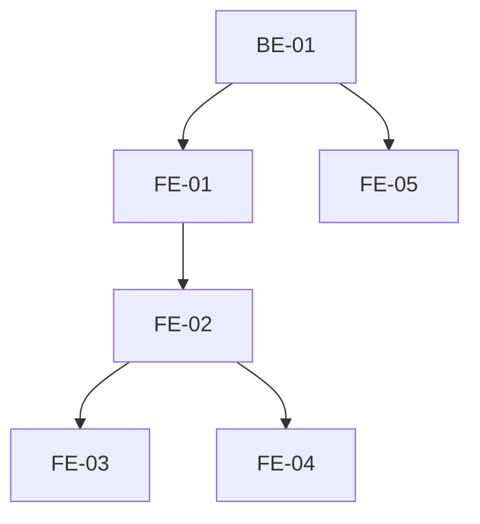

# Execution Backlog: ADR-006 (Auditoria + Onboarding por Papel)

## 1. Traceability Context

- **Source SPEC**: `./.spec/frontend/gestao-usuarios-tenant-adr-006/SPEC.md`
- **Source PLAN**: `./.spec/frontend/gestao-usuarios-tenant-adr-006/PLAN.md`
- **Goal**: Auditoria do tenant (filtro + CSV) + copy por papel + redirect verificado.

## 2. Sprint Summary

| Phase | Task ID | Type | Priority | Risk | Complexity | Status |
|-------|---------|------|----------|------|------------|--------|
| Phase 1 | BE-01 | API | P1 | Low | S | Todo |
| Phase 1 | FE-01 | Frontend | P0 | Medium | M | Todo |
| Phase 2 | FE-02 | Frontend | P0 | Medium | M | Todo |
| Phase 2 | FE-03 | Frontend | P2 | Low | S | Todo |
| Phase 2 | FE-04 | Frontend | P0 | Medium | S | Todo |
| Phase 3 | FE-05 | Frontend | P1 | Low | M | Todo |
| Phase 4 | IT-01..IT-04 | Test | P0 | Medium | M | Todo |

## 3. Dependency Graph

## 4. Task Backlog

### Task BE-01: Incluir role no okResponse de accept-invitation

- **Constraint Ref**: SPEC 4
- **Depends on (PLAN)**: ADR-002
- **Dependency Type**: Hard
- **Layer**: Interface
- **Task Type**: API
- **Priority**: P1
- **Risk Level**: Low
- **Parallelizable**: No
- **Artifact**: `supabase/functions/accept-invitation/handler.ts`
- **Framework Detail**: Deno

#### Acceptance Criteria (BDD)
- **Scenario 1 (Success)**: aceite retorna { ok: true, role }.
- **Scenario 2 (Success)**: caminho accepted idempotente tambem retorna role.
- **Scenario 3 (Edge)**: cliente antigo ignora campo extra (aditivo).

#### Implementation Steps
- [ ] Adicionar role ao okResponse (pending + accepted).
- [ ] Atualizar testes deno.

#### Definition of Done
- [ ] role retornado; testes passando.

---

### Task FE-01: Criar hook useUserAuditLog

- **Constraint Ref**: SPEC 3
- **Depends on (PLAN)**: BE-01
- **Dependency Type**: Hard
- **Layer**: Frontend
- **Task Type**: Frontend
- **Priority**: P0
- **Risk Level**: Medium
- **Parallelizable**: No
- **Artifact**: `src/hooks/useUserAuditLog.ts`

#### Acceptance Criteria (BDD)
- **Scenario 1 (Success)**: admin carrega acoes de usuario do tenant.
- **Scenario 2 (Failure)**: erro -> StatePanel retry.
- **Scenario 3 (Edge)**: loading -> skeleton; vazio -> empty state.

#### Implementation Steps
- [ ] useQuery audit_log com .in('action', USER_ACTIONS) sob RLS.
- [ ] Filtro client-side por ator/periodo (padrao useAuditLog).
- [ ] zod em tudo.

#### Definition of Done
- [ ] Hook funcional e testado.

---

### Task FE-02: Criar AuditoriaTenantPage

- **Constraint Ref**: SPEC 3
- **Depends on (PLAN)**: FE-01
- **Dependency Type**: Hard
- **Layer**: Frontend
- **Task Type**: Frontend
- **Priority**: P0
- **Risk Level**: Medium
- **Parallelizable**: No
- **Artifact**: `src/app/config/auditoria/AuditoriaTenantPage.tsx`

#### Acceptance Criteria (BDD)
- **Scenario 1 (Success)**: admin ve tabela/cards (quando, ator, acao, alvo).
- **Scenario 2 (Failure)**: nao-admin nao acessa (guard).
- **Scenario 3 (Edge)**: empty state; labels pt-BR por acao.

#### Implementation Steps
- [ ] Tabela (desktop) / cards (mobile) + filtro de acao + busca por ator.
- [ ] Labels pt-BR (auditLabels.ts).
- [ ] Loading/error/empty + a11y.

#### Definition of Done
- [ ] Pagina funcional e testada.

---

### Task FE-03: Export CSV do filtrado

- **Constraint Ref**: SPEC 3
- **Depends on (PLAN)**: FE-02
- **Dependency Type**: Hard
- **Layer**: Frontend
- **Task Type**: Frontend
- **Priority**: P2
- **Risk Level**: Low
- **Parallelizable**: Yes
- **Artifact**: `src/app/config/auditoria/*` (ou lib csv)

#### Acceptance Criteria (BDD)
- **Scenario 1 (Success)**: CSV baixa o filtrado (UTF-8 BOM).
- **Scenario 2 (Failure)**: vazio -> botao desabilitado.
- **Scenario 3 (Edge)**: aviso "contem dados pessoais" na UI.

#### Implementation Steps
- [ ] Gerar CSV do array filtrado; Blob download.
- [ ] Aviso de PII.

#### Definition of Done
- [ ] CSV funcional e testado.

---

### Task FE-04: Registrar rota /app/config/auditoria + atalho ConfigHub

- **Constraint Ref**: SPEC 3
- **Depends on (PLAN)**: FE-02
- **Dependency Type**: Hard
- **Layer**: Frontend
- **Task Type**: Frontend
- **Priority**: P0
- **Risk Level**: Medium
- **Parallelizable**: No
- **Artifact**: `src/router.tsx`, `src/app/config/ConfigHubPage.tsx`

#### Acceptance Criteria (BDD)
- **Scenario 1 (Success)**: admin acessa /app/config/auditoria.
- **Scenario 2 (Failure)**: professional/receptionist -> redirect + toast.
- **Scenario 3 (Edge)**: atalho visivel so para admin.

#### Implementation Steps
- [ ] Rota com RequireRole(['admin']).
- [ ] Atalho no ConfigHub (admin).

#### Definition of Done
- [ ] Rota + atalho funcionais.

---

### Task FE-05: Copy de proximos passos por papel em AcceptInvitationPage

- **Constraint Ref**: SPEC 3
- **Depends on (PLAN)**: BE-01
- **Dependency Type**: Hard
- **Layer**: Frontend
- **Task Type**: Frontend
- **Priority**: P1
- **Risk Level**: Low
- **Parallelizable**: Yes
- **Artifact**: `src/app/accept-invitation/AcceptInvitationPage.tsx`

#### Acceptance Criteria (BDD)
- **Scenario 1 (Success)**: professional/receptionist ve "entre e veja sua agenda".
- **Scenario 2 (Success)**: admin ve "entre e gerencie sua empresa".
- **Scenario 3 (Edge)**: role ausente -> copy generica.

#### Implementation Steps
- [ ] Ler role do accept response; copy por papel; fallback generico.
- [ ] Manter redirect /login com notice.

#### Definition of Done
- [ ] Copy por papel funcional e testada.

---

### Task IT-01..IT-04: Testes

- **Constraint Ref**: SPEC 8
- **Depends on (PLAN)**: FE-01..FE-05
- **Dependency Type**: Hard
- **Layer**: Integration (Frontend)
- **Task Type**: Test
- **Priority**: P0
- **Risk Level**: Medium
- **Parallelizable**: No

#### Acceptance Criteria (BDD)
- useUserAuditLog, AuditoriaTenantPage (filtro, CSV, guard), AcceptInvitationPage copy, redirect por papel.

#### Implementation Steps
- [ ] Criar testes vitest para hook/pagina.
- [ ] Validar a11y.

#### Definition of Done
- [ ] Todos os testes passando.
- [ ] npm test + npm run build verdes.

## 5. Coverage Validation

- [ ] All PLAN tasks converted and mapped.
- [ ] All constraints mapped to BDD scenarios.
- [ ] All tasks include failure mode.
- [ ] No circular dependencies.
- [ ] No orphan tasks.

## 6. Plan Feedback

- **Identified Issues**:
  - Templates de e-mail por papel: diferido (requer infra propria; tech-debt convite-email-smtp).
  - Redirect por papel ja implementado (ADR-004); IT-04 apenas verifica.
  - AuditoriaPage do super_admin nao e alterada.
